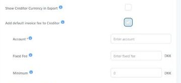

# Invoice fee


The Invoice Fee is not enabled for all companies. Contact Tourpaq Support if you want to use this feature.


### Overview

The **Invoice Fee** is a fixed amount that Tourpaq deducts from every invoice Autobilling sends to a creditor.

The fee is configured per creditor and added automatically to the invoice as its own negative line, just before **Invoice total**.

See [Autobilling](./) for the full invoice flow and [How to create a creditor](how-to-create-a-creditor.md) for creditor setup.

***

### Business Context

The travel agency handles invoicing for its suppliers through Autobilling. The Invoice Fee lets the agency charge creditors for this service.

The fee:

* is a fixed amount, not a percentage
* is set per creditor and applies to all hotels, extras and handling linked to that creditor
* is dated, so the amount can change over time
* is posted to its own account in the accounting export, so it can be tracked separately in Business Central

***

### Prerequisites

* Autobilling is active (see [Autobilling](./))
* The Invoice Fee feature is enabled for your company by Tourpaq Support
* The creditor exists and has a currency selected
* You know the account number the fee should be posted to

***

### Invoices that include the fee

| Invoice type                | Invoice Fee added |
| --------------------------- | ----------------- |
| Hotel Invoice               | Yes               |
| Hotel Early Booking Invoice | Yes               |
| Extra Invoice               | Yes               |
| Extra Early Booking Invoice | Yes               |
| Handling Invoice            | Yes               |
| Hotel Deposit Invoice       | **No**            |

Only one Invoice Fee is added per invoice, regardless of how many hotels or bookings the invoice covers.

***

### How to set up the Invoice Fee on a creditor

#### 1 Access

Navigate to: `Users → Creditors`, open the creditor and select the **Invoice Fee** tab.

The tab is placed right after **General**. It is available once the creditor has been saved.

***

#### 2 Enter the account

Enter the **Account** number used for the fee in the accounting export. The account is entered once per creditor, in the first row of the table.

***

#### 3 Add a fee row

1. Click the **+** button below the table (tooltip: _Adds a new Invoice Fee configuration row_).
2. Fill in **Date From**, **Fixed Fee** and, if needed, **Minimum**. The amounts are in the creditor currency, which is shown next to each amount field.
3. Click **Save** at the bottom of the page. The message _Invoice fee saved successfully_ confirms the save.


If a default Invoice Fee is configured in System Setup and the creditor has no fee yet, the tab opens with the default values filled in. They are only stored when you click **Save**.


***

### Field Definitions

| Field     | Required | Description                                                                                                                 |
| --------- | -------- | --------------------------------------------------------------------------------------------------------------------------- |
| Account   | Yes      | Account number for the Invoice Fee in the accounting export. One account per creditor.                                      |
| Date From | Yes      | Invoices with an invoice date on or after this date get the Invoice Fee.                                                    |
| Fixed Fee | No       | The fee as a positive amount, in the creditor currency. Added to the invoice as a negative line. Empty = no fee.            |
| Minimum   | No       | The invoice total must be equal to or higher than this amount before the fee is added. Empty = 0. In the creditor currency. |

The info icons next to each column header show the same explanations as tooltips.

#### Managing fee rows

* All fields can be edited. Click **Save** to keep the changes.
* To delete a row, click the bin icon at the end of the row. A saved row is deleted immediately, without a confirmation, and the message _Invoice fee line deleted successfully_ is shown. A row that was not saved yet is just removed from the table.
* By default, the tab shows the fee row that applies today and any future rows. Tick **Show Older** (top right) to see all rows.
* All changes to the Invoice Fee tab are recorded in the creditor's **Activity Log**. See [How to create a creditor](how-to-create-a-creditor.md#activity-log).

***

### How it works

When Autobilling generates an invoice, Tourpaq:

1. Finds the fee row with the latest **Date From** that is on or before the invoice date. If no row matches, no fee is added.
2. Checks **Fixed Fee**. If it is empty, no fee is added.
3. Compares the invoice total with **Minimum**. The total is taken after other deductions (for example payment terms) and before the Invoice Fee itself.
4. If the total is equal to or higher than **Minimum**, adds **Fixed Fee** as a negative **Invoice fee** line and deducts it from **Invoice total**.

Changing a fee row does not change invoices already sent. New values apply to invoices generated or regenerated after the change.

Invoices created with **Schedule in the past** follow the same rules.

***

### Invoice output

#### Invoice PDF

The fee is shown as **Invoice fee** with its currency, as the last line before **Invoice total**:

| Line                     | Amount (EUR) |
| ------------------------ | ------------ |
| Total EUR                | 1623.50      |
| Total unbooked rooms EUR | 0.00         |
| Deposit EUR              | -488.25      |
| Deductions paid EUR      | 0.00         |
| Payment terms EUR        | -300.00      |
| **Invoice fee EUR**      | **-30.00**   |
| Invoice total EUR        | 805.25       |

The line is only shown when a fee was applied. Hotel Deposit invoices never show it.

#### Download Invoice XML

The XML file in `Finance → Invoice` includes the Invoice fee line, before **Invoice total**.

#### Download Accounting

The accounting file gets a new **Invoice fee** line between the debit line and the creditor line, using the **Account** from the creditor's Invoice Fee tab.

Example: invoice 36870, fixed fee 10 EUR.

| Invoice number | Account | Amount | Type        | Description                                     |
| -------------- | ------- | ------ | ----------- | ----------------------------------------------- |
| 36870          | 2100    | 343    | Finanskonto | Invoice total before the fee (unchanged)        |
| 36870          | 8900    | -10    | Finanskonto | **New:** Invoice Fee on the creditor's Account  |
| 36870          | K06140  | -333   | Kreditor    | Amount paid to the creditor, reduced by the fee |

See [Invoice](../invoice.md) for the download options.

***

### Default Invoice Fee for new creditors

A default fee can be copied to every new creditor, so the fee is not forgotten when creditors are created.

Navigate to: `Setup → System Setup → General Information → Settings`. The option is shown below **Show Creditor Currency in Export**, only when Automatic Billing is enabled for the company.

1. Tick **Add default invoice fee to Creditor**.
2. Fill in **Account**, **Fixed Fee** and **Minimum**. The amounts are in the company currency, which is shown next to the fields. The same rules apply as on the creditor.
3. Click **Save**.

<figure><figcaption>
System Setup: the default Invoice Fee fields appear when the option is ticked.
</figcaption></figure>

When a new creditor is created, Tourpaq adds a fee row on its Invoice Fee tab:

* **Account** is copied as is.
* **Fixed Fee** and **Minimum** are converted from the company currency to the creditor currency, using the rates in `Setup → System Setup → Currency conversion`, and rounded to 2 decimals.
* **Date From** is the creation date.


The default is only copied to new creditors. It is not applied to existing creditors and is not used as a fallback. Add the fee to existing creditors manually.



If the creditor currency differs from the company currency and no currency conversion is set up between them, the creditor cannot be created. Add the conversion rate first.


Because the fee is converted to the creditor currency, **Currency** is mandatory when creating a creditor.

***

### Example Scenario

**Configuration (creditor in EUR):**

| Date From  | Fixed Fee | Minimum |
| ---------- | --------- | ------- |
| 01-11-2026 | 15        | 150     |
| 01-01-2026 | 10        | 100     |

**Result:**

| Invoice date | Total before fee | Fee row used | Invoice fee      | Invoice total |
| ------------ | ---------------- | ------------ | ---------------- | ------------- |
| 15-10-2026   | 343.00           | 01-01-2026   | -10.00           | 333.00        |
| 15-10-2026   | 80.00            | 01-01-2026   | none (below 100) | 80.00         |
| 10-11-2026   | 1001.00          | 01-11-2026   | -15.00           | 986.00        |
| 10-11-2026   | 150.00           | 01-11-2026   | -15.00           | 135.00        |
| 15-12-2025   | 500.00           | none         | none             | 500.00        |

***

### Edge Cases

* If **Fixed Fee** is empty: no fee is added
* If the invoice total is below **Minimum**: no fee is added
* If the invoice date is before the first **Date From**: no fee is added
* If the invoice is a **Hotel Deposit Invoice**: no fee is added
* If the default fee in System Setup changes: existing creditors are not updated
* **Account** is required as long as the creditor has fee rows; it can only be cleared after all rows are deleted

***

### Related Pages

* [Autobilling](./)
* [How to create a creditor](how-to-create-a-creditor.md)
* [Creditor invoices](creditor-invoices.md)
* [Finance → Invoice](../invoice.md)
