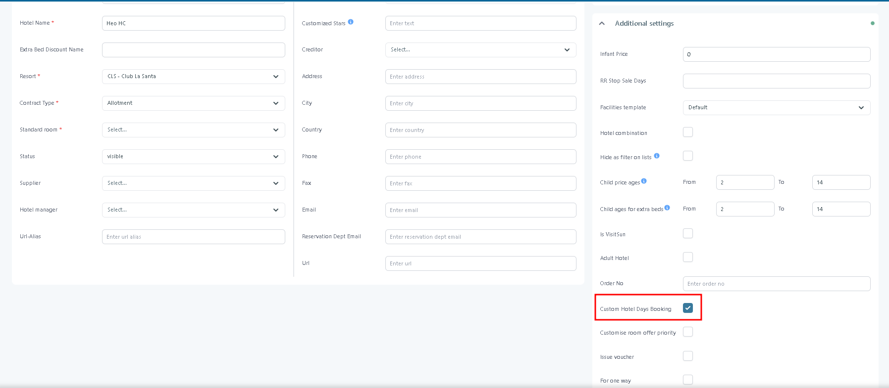
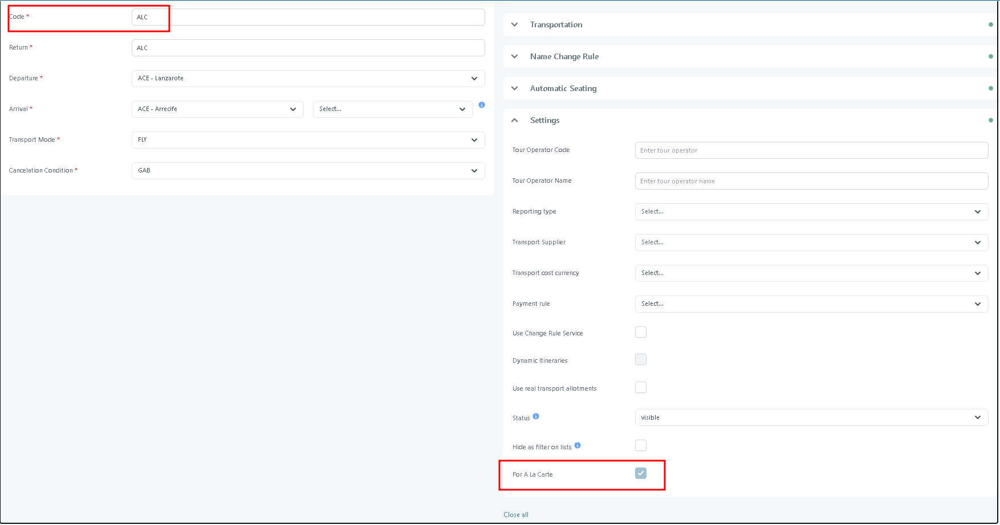
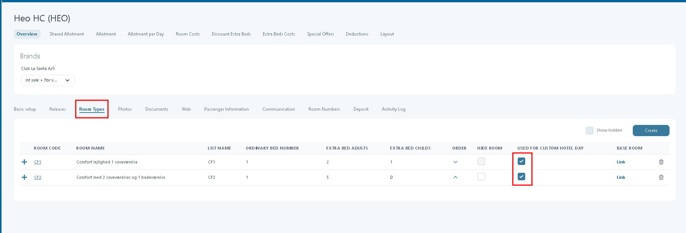
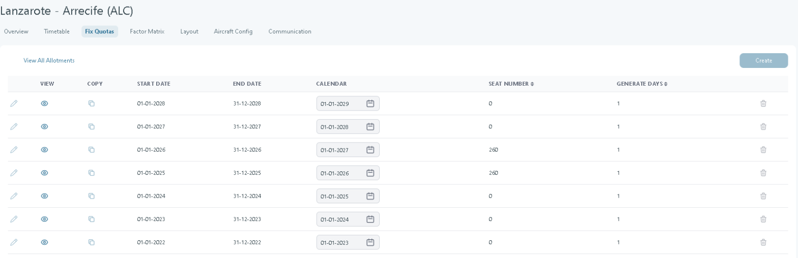
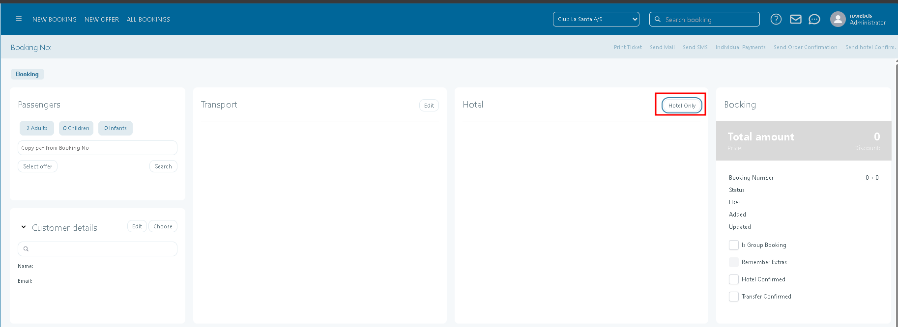
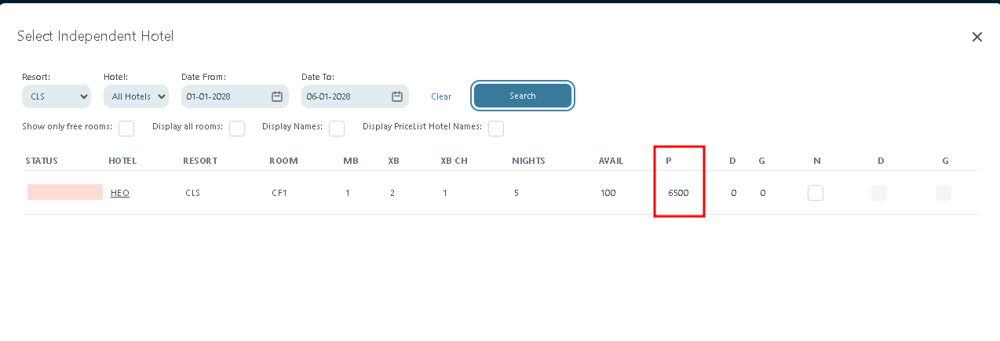
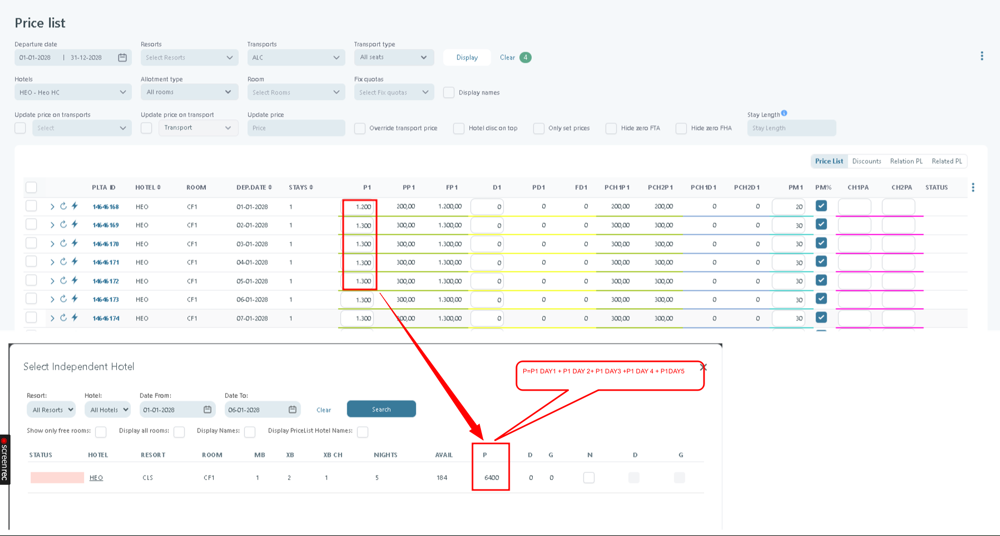

# Hotel Only Bookings

### Overview

**Hotel Only Bookings** create accommodation-only stays without a flight or bus.

This workflow uses Tourpaq's **A la Carte** setup. An **ALC transport** supports the price-list configuration. It is not selected during the booking.

The hotel must support **Custom Hotel Day booking**. Eligible room types, allotment, and a Custom Hotel Days price list determine availability and price.

### Precondition

*   It needs to have a hotel defined in the system. The hotel should have the Custom hotel day Booking checkbox marked.

    <figure><figcaption></figcaption></figure>
*   An ALC transport defined in the system. Need to have For A La Carte checkbox

    <figure><figcaption></figcaption></figure>

### Setup (recommended)



**1. Create an ALC transport**

Create a transport with the For a la carte checkbox marked

When you save the transport, Tourpaq creates its interval, timetable, and fix quota. You don't set them up yourself.

See [Transport creation](../../transport/transport/transport-creation/) if you need the full transport setup flow.



**Create/Use a Hotel with the checkbox Custom Hotel Day booking marked**

Configure it like a normal hotel ( define room type, allotment, allotment per day, room cost, etc)

The room types used need to be marked to be Used for custom hotel days

<figure><figcaption></figcaption></figure>



**3. Create a pricelist between the ALC transport and the hotel**

Create a pricelist hotel day for the **hotel** you want to sell as hotel-only

See [Pricelist Hotel Day](../../price-list-custom-hotel-days-service.md) if you need the pricelist workflow.

Give the transport a short, recognisable code (ALC, OWN) — it appears as the Transports filter in the price list.



### Fix quota and new seasons

The fix quota of an ALC transport is view only. This is by design: Tourpaq creates and extends it for you. To sell hotel only in a new season, add the new dates in the Price List Hotel Days instead.

* On the **Fix Quotas** tab of the transport, click **View** to open a fix quota.
* **Create**, edit, copy, **Calendar** (extend), generate, and delete are disabled.
* To open a new season, create a new line in **Price List Hotel Day**. See [Open a new season](../../price-list-custom-hotel-days-service.md#open-a-new-season).
* Tourpaq adds the fix quota for the new year automatically.

<figure><figcaption>
Fix Quotas tab of an ALC transport. You can only view the fix quotas.
</figcaption></figure>


A second fix quota on the same ALC transport would double the fix quota and give wrong profit margins in the price list. That's why Tourpaq doesn't allow you to create or extend it.


### Book a hotel-only stay

Start a booking as usual in [New Booking](new-booking/).

Then:

1. In the Transport panel, you don't choose nothing
2.  In the Hotel panel, click **Hotel Only**.

    <figure><figcaption></figcaption></figure>
3.  In the **Select Independent Hotel** popup, search by resort, hotel, and dates, then select the room. The total price for the stay is shown in the **P** column.

    <figure><figcaption></figcaption></figure>
4. Complete passenger details, extras, and payments as normal.

The booking now shows the hotel-only stay with its total price.

#### Pricing

The total price shown in the **Select Independent Hotel** popup (the **P** column) is the sum of the prices **P1** from the price list for every stay day. (P=P1 DAY1 + P1 DAY 2+ P1 DAY3 +P1 DAY 4 + P1DAY5).

<figure><figcaption></figcaption></figure>

This total does not include supplements or discounts from the pricelist. Supplements and discounts are not applied on a per-night basis, so they cannot currently be summed into a single per-stay total for Hotel Only.

### Related pages

* [a-la-carte](a-la-carte/ "mention") — understand the flexible-booking framework behind hotel-only stays.
* [hotel-creation](../../hotel/hotel-creation/ "mention") and [room-types.md](../../hotel/hotel-creation/room-types.md "mention") — configure the hotel and rooms needed for Custom Hotel Day booking.
* [price-list-custom-hotel-days-service.md](../../price-list-custom-hotel-days-service.md "mention") — set daily hotel-only prices. [new-booking](new-booking/ "mention") — complete the wider booking workflow.
