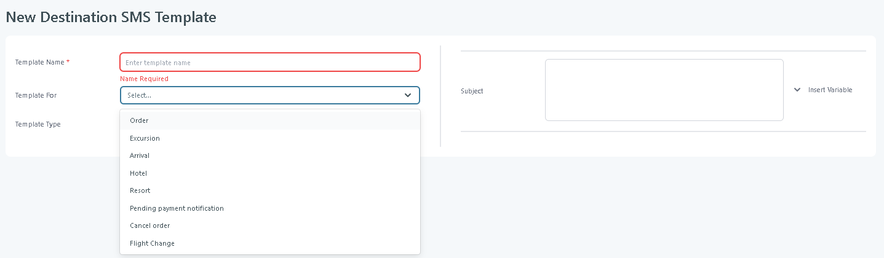

# Destination SMS Mappings

### Overview

Use **Destination SMS Mappings** to set up the messages sent from the Guide App.

Templates for **Order**, **Cancel order**, and **Pending payment notification** can be SMS or email. The Guide App messages (**Hotel**, **Excursion**, **Arrival**, **Resort**) are SMS.

Good templates help customers get clear and timely updates. For example, order confirmations and arrival messages.

### Access

Open **Email Setup → Destination SMS Mappings**.


**Hotel**, **Excursion**, **Arrival**, and **Resort** messages go out when a guide sends them from the Guide App. If the guide writes custom text, it replaces the template text.

**Order**, **Cancel order**, and **Pending payment notification** messages go out automatically when an extra order is booked, when Tourpaq cancels an order that the customer didn't finish, or when the payment is left pending.


### Purpose

Use this page to:

* Define templates for automatic SMS and email notifications.
* Make sure messages for orders, cancellations, and payments are sent correctly.
* Keep customer communication accurate and consistent.

<figure><figcaption>
Overview of template mappings.
</figcaption></figure>

### Types of SMS and email templates

<figure><figcaption>
Template types you can configure.
</figcaption></figure>

### Field explanations

#### Template Name (required)

* An internal name for the template.
* Used in the back office only.
* Keep it short and descriptive.

Example: `Arrival information – Resort SMS`

#### Template For

Defines **when** the template can be used.

Available options:

* **Order**: Messages for an extra order, sent after the payment is confirmed, or when the payment is pending (see **Pending payment notification**). The Guide App also uses this template for the SMS a guide sends to a single booking.
* **Excursion**: Excursion-related messages. Sent from Guide App > SMS > Excursion.
* **Arrival**: Arrival-day info, welcome messages, and practical details. Sent from Guide App > SMS > Arrival (filters the bookings by departure date, stay date, or homebound date).
* **Hotel**: Hotel messages, like check-in info or reminders. Sent from Guide App > SMS > Hotel.
* **Resort**: Destination or resort-wide messages. Sent from Guide App > SMS > Resort.
* **Pending payment notification**: Messages for extra orders whose payment is pending. If the payment provider approves the payment for an extra order but doesn't confirm it yet, Tourpaq sets the payment to pending, and the customer receives the **Order** message and this message.
* **Cancel order**: Sent when Tourpaq automatically cancels an extra order that the customer didn't finish.
* **Flight Change**: Tourpaq doesn't use this template. Set up the flight change SMS in Email Center; see [Flight Change - Email Template](flight-change/flight-change-email-template.md).

The templates for **Hotel**, **Excursion**, **Arrival**, and **Resort** appear as **Destination** in the Guide App.

<figure><figcaption>
Destination templates in the Guide App.
</figcaption></figure>

#### Other fields

* **Template Type**: **Email** or **SMS**. Each template is one or the other.
* **From Name** and **From Email**: the sender of an email template.
* **For Destinations**: for **Order** and **Cancel order** email templates, the resorts the template is used for.
* **Subject**: the email subject. In an SMS template, this field holds the SMS text. Use **Insert Variable** to add a variable.
* Email text: for an email template, write the message in the text editor.
