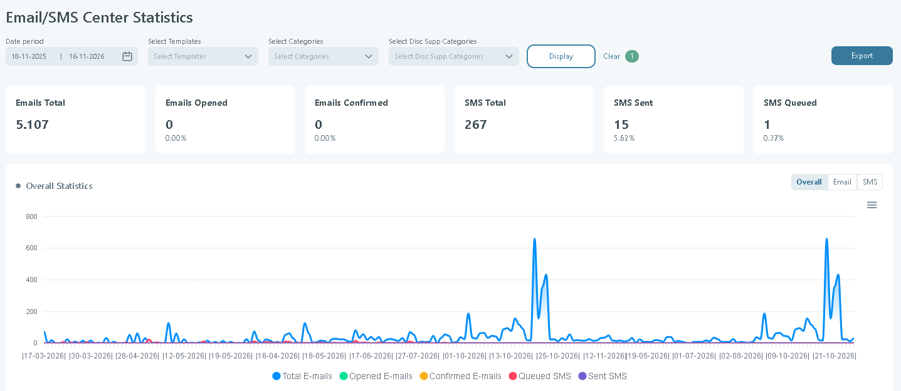
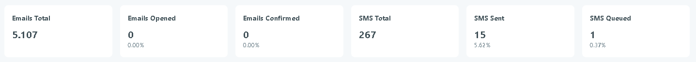

# E-mail/SMS Center Statistics

### Overview

Use **Email/SMS Center Statistics** to review sent messages.

It covers the emails and SMS messages sent from the templates in **Dynamic Email/SMS Center**.

It helps you see what was sent, what failed, and what is queued.

### Access

Open **Email Setup → Email/SMS Center Statistics**.

### What you can use it for

Use this page to:

* Follow how **Dynamic Email/SMS** is performing.
* See message status, like sent, failed, confirmed, and queued.
* Compare results across templates and categories.

<figure><figcaption>
Overview of message activity for the selected period.
</figcaption></figure>

### Statistics

#### Revenue totals

You can also see revenue totals.

To see them, select one or more categories in **Select Categories** or **Select Disc Supp Categories**, and then click **Display**. The **Turnover** tab shows the total price per category for the bookings that received a message in the period. The **Sold Products** tab shows how many products were sold per category.

#### Percentages

The page also shows percentages for the selected period.

These percentages cover **Emails Opened** and **Emails Confirmed**, and **SMS Sent** and **SMS Queued**.

<figure><figcaption>
Percentages for opened and confirmed emails, and sent and queued SMS messages.
</figcaption></figure>

### Date range

In **Date period**, you can pick a preset period, such as:

* Last week
* Last month
* Last year
* A custom date range

**Date period** is required. The statistics load when you click **Display**.


All results are based on the templates set up in **Dynamic Email/SMS Center**.


### Message list

In the template tables, click **View** next to a template to open the list of its emails or SMS messages.

From the list, you can:

* View message details.
* For emails, open the booking from **Booking Number**.

To save the statistics for the selected filters as a PDF file, or to send them by email, click **Export**.

### Related pages

* [Dynamic E-mail/SMS Center](email-setup/dynamic-e-mail-sms-center/)
* [E-mail center](email-setup/e-mail-center.md)
