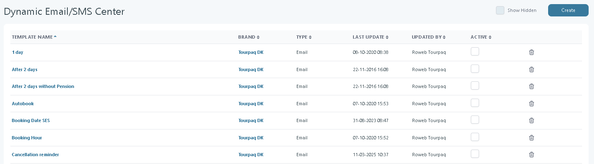

# Dynamic E-mail/SMS Center

### Overview

Use the **Dynamic Email/SMS Center** to send emails or SMS messages to bookings. You choose who receives the message using filters. This helps you send the right message at the right time.

### Access

Open **Email Setup → Dynamic Email/SMS Center**.

Before you start, check the following:

* You have the Administrator, Brand Manager, or Support role, you have the user right for this page, and your company has the **Dynamic Email/SMS Center** feature.
* The list shows only the templates of the brand selected in the page header.
* The brand has its SMTP settings (server, user name, password, and port). Without them, Tourpaq sends no email for the brand. Tourpaq skips an SMS for a booking that has no phone number.

### Purpose

Use this feature to:

* Send important reminders, like departure reminders.
* Send a message on the day of departure.
* Follow up after the trip.
* Share optional add-ons or upgrades.

### Template list columns

<figure><figcaption>
Template list with status and last update.
</figcaption></figure>

* **Template Name**: a short name you recognize later.
* **Brand**: which brand or agency the template belongs to.
* **Type**: email or SMS.
* **Last Update**: when the template was last changed.
* **Updated By**: who last changed it.
* **Active**: whether the template can be used.
* Delete icon: removes the template after you confirm.


You use filters to pick the bookings you want to contact. For example, you can filter by departure date.


### Email vs SMS

* **Email**
  * Has a subject and a message body.
  * Works well for longer messages.
* **SMS**
  * Has one **Body** field for the full message.
  * There is no subject.
  * Works best for short reminders.

### What you can do on this page

You can:

* Create email or SMS templates.
* Send a template automatically to the bookings that match its rules and filters.
* Apply filters to define the target audience.
* Send a test message with **Test** before you activate the template. Save the template first, because the test sends the saved version. Enter a booking number of the selected brand.
* See when a template was last updated.


**Important**

* Once an email or SMS template is sent to a booking, it **cannot be resent**.
* Avoid editing a template after sending it. One booking can only receive it once.
* Double-check the text and filters before sending.


### Typical steps



#### Create a template

Click **Create**. In **Email Type**, select **Dynamic Email / SMS**. Then select **Email** or **SMS** in **Template Type**. Give the template a clear name.



#### Write the message

For an email, write the subject and the message body. For an SMS, write the message in **Body**.



#### Choose who should receive it

Under **When to send**, add at least one rule. Then set the filters on the other tabs for the bookings you want to reach.



#### Activate the template

Review the message and the filters. Select **Active**, and then click **Save**. Tourpaq sends the message to each matching booking.



### Example

* Create an SMS template for a departure reminder.
* Under **When to send**, add the rule **Departure date**, **Before**, `1`.
* Select **Active**, and then click **Save**. Tourpaq sends it to all matching bookings.
