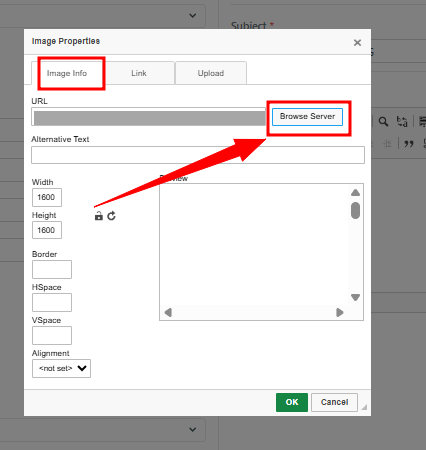
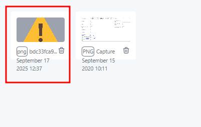
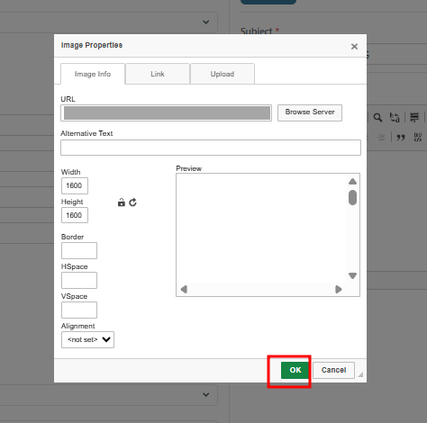

# Dynamic Email - Upload Image

### Overview

You can add images directly inside a **Dynamic Email**. This helps make your message easier to read.

You can either:

* upload an image from your computer, or
* use an image that is already online.

### Purpose

Use the image window to add a picture to a dynamic email, either from a file on your computer or from an image address.

### Steps



#### Open the image window

In the email editor, click the **Image** button.

<figure><figcaption>
Image window in the email editor.
</figcaption></figure>




#### Upload an image

1. Open the **Upload** tab.
2. Click **Choose File** and pick your image file.
3. Click **Send it to the Server**.
4. Wait until you see **Success**.

The image can be up to 500 KB.

<figure><figcaption>
Upload an image to the server.
</figcaption></figure>

<figure><figcaption>
Send the chosen file to the server.
</figcaption></figure>




#### Insert the uploaded image

1. Open the **Image Info** tab.
2. Click **Browse Server**.
3. Select the image from the list.
4. Click **OK**.

The image is placed in the email body.

<figure><figcaption>
Upload tab with the Choose File button.
</figcaption></figure>

<figure><figcaption>
Open the Browse Server window.
</figcaption></figure>

<figure><figcaption>
Select an uploaded image.
</figcaption></figure>

<figure><figcaption>
Confirm the image insertion.
</figcaption></figure>

<figure><figcaption>
Image inserted in an email.
</figcaption></figure>




#### Use an image from the internet

If the image is already online:

1. Open the **Image Info** tab.
2. Paste the image address into the **URL** field.
3. Click **OK**.

Use a direct link to the image file, not a web page link.




If you upload an image once, you can reuse it later with **Browse Server**.



Don't delete a file in **Browse Server** if an email still uses it: the email then shows a broken image. A file you upload with the name of an existing file replaces that file.

