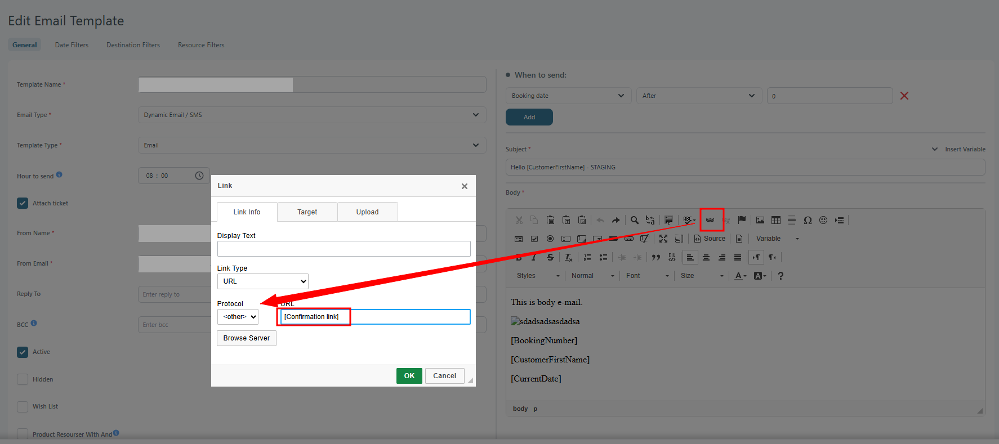
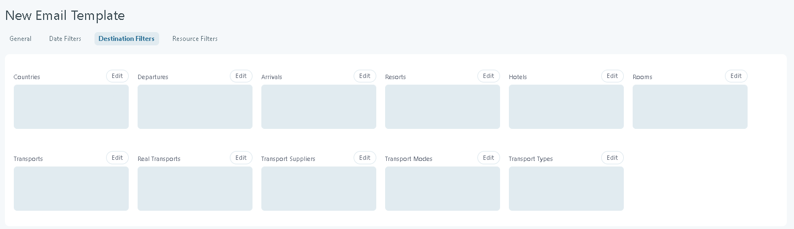
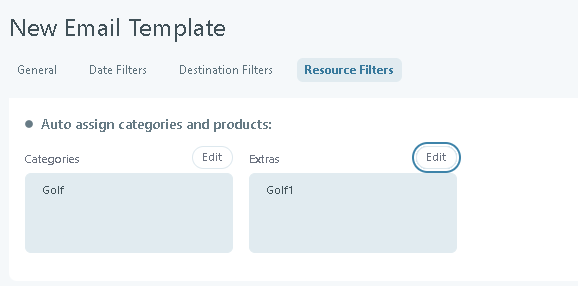
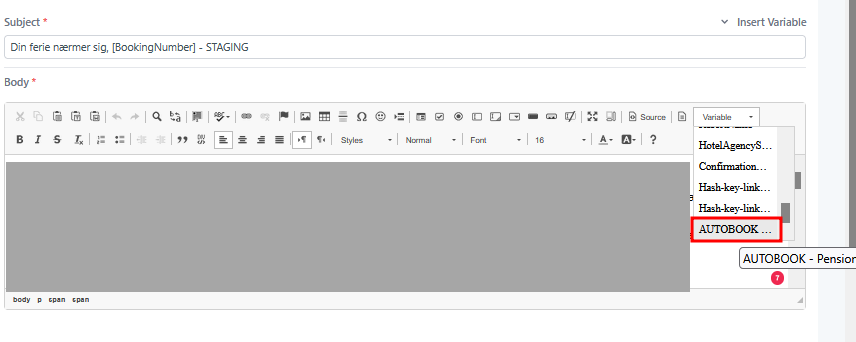

# Setup for Dynamic E-mail/SMS Center

### Overview

Use this page to set up **dynamic email or SMS templates**. You can send them automatically to bookings that match your rules and filters.

### Purpose

This feature is designed to:

* Send automatic messages for common situations (confirmations, reminders, promotions).
* Reduce manual work by sending messages based on rules and filters.

### Template setup

<figure><figcaption>
New Dynamic E-mail/SMS template setup.
</figcaption></figure>

### Access

Open **Email Setup → Dynamic Email/SMS Center**, and then click **Create**.

### Template types

In **Email Type**, you choose one of these template types:

* **Dynamic Email / SMS**
* **Confirmation Transfer**
* **Confirmation Hotel**

If you are setting up confirmation templates, also read [Hotel and transfer confirmation emails to suppliers](../../hotel-and-transfer-confirmation-e-mail-to-suppliers.md).

### Configure the template

Before you edit anything, select the correct brand in the brand list in the page header. The list shows the name of the selected brand.

The settings below apply to **Dynamic Email / SMS** templates. A **Confirmation Hotel** or **Confirmation Transfer** template has only the name, sender (**From Name**, **From Email**, **Reply To**, and **BCC**), **Active**, **Hidden**, subject, and body fields. You can create one of each per brand.

#### Basic template settings

* **Template Name**: a clear name you can recognize later.
* **Email Type**: the template type, from the list earlier on this page.
* **Template Type**: **Email** or **SMS**.
* **Active**: allows the template to be used for sending.
* **Hidden**: hides the template from the list on the **Dynamic Email/SMS Center** page. Select **Show Hidden** there to see it.
* **Hour to send**: the earliest time of day Tourpaq sends the message. If you leave it blank, Tourpaq sends it as soon as a booking matches.
* **Product Resourser With And:** when checked, the system finds all bookings with all resources purchased / not purchased

#### Email-only settings

* **Attach ticket**: attaches the booking ticket to the email.
* **From Name**: sender name shown to the customer.
* **From Email**: sender email address. Use a real address.
* **Reply To**: where replies should go. Use a real address.
* **BCC**: email addresses that should receive a copy. Use real addresses.

#### Optional product filters

* **Customers who have bought extras**: include bookings that bought the selected **Categories** or **Extras**.
* **Customers who have not bought extras**: exclude bookings that bought the selected **Categories** or **Extras**.
* **Customers who have bought disc/suppl**: include bookings that bought the selected **Categories** or **Disc Supp**.
* **Customers who have not bought disc/suppl**: exclude bookings that bought the selected **Categories** or **Disc Supp**.
* **Customers who have not bought** (email templates only): exclude bookings that bought **Cancellation Insurance** or the selected **Travel Insurances**.
* **Wish List**: a checkbox to filter on wish list bookings.
* **Min satisfaction** and **Max satisfaction**: limit the bookings to a satisfaction score from 0 to 10.

### Sending options

<figure><figcaption>
Sending options and rule builder.
</figcaption></figure>

Use these fields to decide **when** the message should be sent.

The first dropdown contains the primary sending options for the template:

* Booking date
* Departure date
* Return home date
* Moved bookings
* Canceled bookings
* Last minute

The second dropdown contains the timeframe options:

* Before
* After

In the third field, enter the number of days. The email/SMS is sent as soon as all requirements are met.

The timeframe dropdown shows only for **Booking date**, **Departure date**, and **Return home date**. **Last minute** has only the number of days.


**Important**

You can add more than one sending rule. Be careful when you combine rules.

You can combine only **Booking date**, **Departure date**, and **Return home date** rules.

* If you use **different rule types**, the booking must match **all** of them.
* If you use the **same rule type** more than once, the booking matches if **any** of them apply.

The examples below show how this works.


#### Different rule types

Send an email or SMS **60 days before departure** and **2 days after booking date**.

<figure><figcaption>
Example of combined rule types.
</figcaption></figure>

#### Same rule type

1.  **First Booking**:\
    One booking is made more than 25 days before departure, and the email template is configured as follows:

    * 20 days before departure
    * 18 days before departure
    * 16 days before departure
    * 14 days before departure

    In this case, the booking receives **only one email** scheduled for 20 days before departure. It doesn't receive additional emails at 18, 16, or 14 days before departure.
2. **Second Booking**:\
   This booking is made 17 days before departure. With the same configuration, it receives **only one email** scheduled for 16 days before departure. The system sends no additional email at 14 days before departure.

The system sends **only one message per template**, even if you add several “when to send” conditions.

### Product and discount/supplement filters

<figure><figcaption>
Product and discount or supplement filters.
</figcaption></figure>

Use these fields to filter bookings based on what they bought. “Disc/suppl” means **discounts and supplements**.

#### Product Resourser

**Default setup**

If you select multiple items in **Customers who have bought**, a booking qualifies if it bought **at least one** of them.

If you select multiple items in **Customers who have not bought**, a booking is excluded if it bought **at least one** of them.

**Product Resourser With And** changes the “at least one” behavior to “all of them”.

If you select multiple items in **Customers who have bought**, a booking qualifies only if it bought **all** of them.

If you select multiple items in **Customers who have not bought**, a booking is excluded only if it bought **all** of them.

For example, the system sends the email as follows:

Note: `1` means the email is sent. `0` means it is not sent.

### Message content

<figure><figcaption>
Dynamic template message editor.
</figcaption></figure>

The message editor works like the regular **Email Center**.

The email body can include the name of the Transport Supplier.

Support is available for Real Transport. The Transport Supplier name inserted into the email is taken from the outbound transport.

#### Add a link to the Customer Center

Write the link text (for example, “Open your booking”). Select it. Then click the **Link** button in the editor toolbar.

<figure><figcaption>
Add link button in the message editor.
</figcaption></figure>

In the **URL** field, insert `[Hash-key-link]`. In **Protocol**, select **\<other>**.

When you use the **Link** button with an existing system-generated link (for example, a confirmation link), set **Protocol** to **\<other>**.\
This is required because the system automatically adds the correct protocol. If you add another protocol, the generated link becomes invalid and may result in an access error when the link is opened.

<figure><figcaption>
Protocol setting for a system-generated link.
</figcaption></figure>

### Date filters

<figure><figcaption>
Booking date filters.
</figcaption></figure>

Use these fields to filter bookings by booking, departure, arrival, and return dates. If the template has a **Moved bookings** or **Canceled bookings** sending rule, you must also enter the dates between which the booking was moved or canceled.

### Destination and transport filters

<figure><figcaption>
Destination and transport filters.
</figcaption></figure>

You can configure Dynamic Emails to vary their content based on departure/arrival details and transport characteristics. This makes it possible to deliver highly targeted emails, such as departure specific instructions or airport related information.

You can filter Dynamic Emails so that a specific email template is sent only when defined booking, destination, or transport conditions are met. You combine filters to precisely control when an email is triggered.

#### Destination filters

Destination filters define **where** the booking applies. You can filter Dynamic Emails by:

* **Countries**
* **Departures** (departure airports or locations)
* **Arrivals**
* **Resorts**
* **Hotels**
* **Rooms**

This allows, for example, sending different emails based on the departure airport or destination hotel.

#### Transport filters

Transport-related filters define **how** the customer is traveling:

* **Transports**
* **Real Transports**
*   **Transport Suppliers -** The Transport Supplier filter supports Real Transport values.

    Filtering is evaluated only against the outbound transport. The transport supplier configured on the homebound transport is not taken into account.
* **Transport Modes**
* **Transport Types**

These filters make it possible to distinguish between different suppliers, charter vs GDS flights, or system vs external transports.

#### How filtering works

* Filters are **inclusive**. If a filter is set, the booking must match it for the email to be sent.
* You can combine multiple filters to create highly specific rules.
* If a filter category is left empty, it does not restrict the email.

#### Typical use case

You can configure different Dynamic Email variants such as:

* One email for passengers departing from Airport A with Supplier X
* Another email for Airport A with Supplier Y
* A third email for Airport B with Supplier X

This is especially useful for departure-specific information, such as parking instructions or airline-specific details.

These filtering options ensure that customers receive only the most relevant communication for their exact booking context.

### Resource filters (product links)

Use **Resource Filters** to send clickable product links to guests. Guests can add the product to their booking from the link.

<figure><figcaption>
Resource filters for product links.
</figcaption></figure>

When you use **Resource Filters**, the **Variable** list of the email editor gets one variable per selected category: `[AUTOBOOK - <category name>]`.

<figure><figcaption>
Variable for inserting product links.
</figcaption></figure>

You can attach this variable to a button, text, or image. When the guest clicks it, they are taken to the Customer Center. They see a message that the product is added. They must save the booking to confirm it. The variable works only in the email body. Tourpaq does not replace it in the subject or in an SMS.

If you send several links, only the clicked link is applied.

**There can be only one link per category.**

**If you select multiple products in a category:**

* For a **multi-select** category, all selected products are added.
* For a **single-select** category, the cheapest selected product is added.


**Caution**

* An email or SMS template that has been sent to a booking cannot be resent.
* Be careful when creating a template. If you make a mistake, avoid editing the same template. A booking can receive a template only once.

