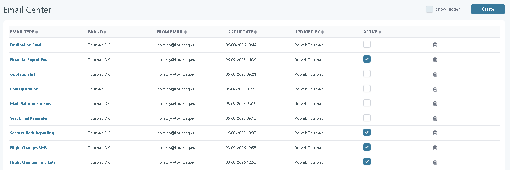

# E-mail center

### Overview

The **Email Center** is the place where administrators, brand managers, and support users set up and maintain **automated email templates** used by the system. To open the Email Center, a user needs the **Email Center** user right.

From here you can create, edit, and test templates. This keeps customer emails consistent and up to date.

### Purpose

Use the Email Center to:

* Create and maintain templates for automated emails.
* Insert booking details using built-in placeholders.
* Test emails before you send them to customers.
* Control sender details and whether a template is active.

### Access

Open **Email Setup** → **Email Center** in the back office.

### Table structure

<figure><figcaption>
Email Center list of email templates.
</figcaption></figure>

Each row shows one email template, with the following columns:

**Email Type** - Defines the functional purpose of the email. Each type corresponds to a specific automated process or event trigger in the system.

**Brand** - Indicates the brand context under which the email configuration is applied. This ensures that email behavior can vary across different brand setups.

**From Email** - Specifies the sender email address used when emails are dispatched. This field controls the visible sender identity in outgoing emails.

**Last Update** - Shows the timestamp of the most recent modification to the configuration. This helps track recent configuration changes.

**Updated By** - Displays the user or system account that performed the last update.

**Active** - Indicates whether the email configuration is enabled.

* Checked: Active and used in workflows
* Unchecked: Disabled and ignored by the system

You can select or clear the checkbox directly in the list.

The list leaves out hidden templates. To include them, select **Show Hidden**.


While a template is inactive, Tourpaq doesn't send that email and doesn't mark it as sent. When you activate the template, Tourpaq sends it to every booking that meets its conditions at that moment.

* Some types look back only a short time. For example, **Thank you for booking** and **Booking updated** cover bookings made or changed in the last 7 days, and **Reservation canceled** covers cancellations of the last 14 days.
* Other types have no time limit, such as **Deposit received**, **Second payment received**, and **Payment reminder**. Activating them can send the email to all bookings with a future departure that meet the conditions, also bookings made long ago.

**Example**\
If you activate **Thank you for booking** on 10 June, bookings made from 3 June get the email.


#### Row actions

Each row includes these action controls:

* Click the email type in a row to open and edit the template.
* **Delete (trash icon)**\
  Removes the template after you confirm with **Delete**.

Delete carefully: without a template, Tourpaq doesn't send that type of email for the brand.

### Template fields

For each email template, you can configure the following fields:

* **Email Type** – The email the template is for. Each brand has one template per email type.
* **From Email** – The “from” email address. Replies go to this address, unless you fill in **Reply To**.
* **From Name** – The “from” name shown in the inbox.
* **Activate** – Selected: Tourpaq sends the email. Cleared: Tourpaq doesn't send it.
* **Hidden** – Hides the template from the list unless **Show Hidden** is selected.
* **Reply To** – The address that replies go to, if it differs from **From Email**.
* **BCC** – Addresses that get a blind copy. Separate several addresses with a semicolon (;).
* **Delay Minutes** – How long Tourpaq waits after the last change to a booking before it sends the email. Not every email type uses it.
* **When to Send** – For payment reminders and welcome home emails only: the number of days before or after the due date or return day.
* **Subject** – The subject line of the email.
* **Body** – The message content. You can add placeholders like customer name or booking number.


Placeholders are short codes the system replaces automatically.

For example, a booking number placeholder becomes the real booking number.

To add one, use **Insert Variable** next to **Subject**, or the **Variable** list in the body editor.


### Types of automatic emails

The system can send many types of automated emails. Common examples, as named in **Email Type**, include:

* Thank you for booking
* Reservation canceled
* Payment preminder
* Payment reminder
* Booking canceled in 48 hours
* Deposit received
* Insurance information missing / Insurance information still missing
* Second payment received
* Full payment received
* Welcome home / Welcome Home Reminder
* Reporting Schedule Communication
* Thank you for your LMS booking
* Booking updated
* Hotel release
* Flight Changes Email
* Seat Email Reminder
* Financial Export Email
* Questionnaire After Deposit Paid
* Wait list booking
* Vouchers Generated
* Attributes are missing
* Creditor Invoice
* Special offer Rejected
* Hotel Reporting / Extras Reporting / Supplier Extras Reporting
* Documents Uploaded
* Email sent from view all bookings / Email sent from Customer Export
* Request more rooms
* Early booking rooming list
* Quotation list
* Stop sales introduction
* Extras Category Reporting
* **Pending payment notification** – Sent when the payment provider (DIBS) needs more time.
* **Captured money but no allotment** – Sent when payment succeeds, but availability is gone. A refund often follows.

### Step-by-step: configure an email template



#### Open the Email Center

Open **Email Setup** → **Email Center**.



#### Choose a template

Either:

* Select an existing template from the list to edit it, **or**
* Click **Create**, and then select the **Email Type**. If the brand already has a template of that type, it opens.



#### Fill in sender details

Set:

* **From Email** – Use a valid address that belongs to your domain.
* **From Name** – Use a clear name that customers will recognize as your company or brand.



#### Define subject and content

* Enter a clear, descriptive **Subject**.
* In the **Body**, write the content of the message.
* Add placeholders where you want details filled in automatically.



#### Set activation and save

* Leave **Activate** cleared while you are still testing.
* Click **Save**.



#### Test the template

* Open the template. **Test** uses the saved version of the template, so save your changes before you click **Test**.
* In **Email**, enter your own email address (or a dedicated test mailbox) as the recipient.
* In **Test booking**, enter the number of a booking of the brand. The test fills in the placeholders from this booking.
* Click **Test**, and then check your inbox.
* Verify that:
  * The sender, subject, and content look correct.
  * All placeholders are replaced with the expected values.
* A test email can miss some attachments, and some placeholders may not work in a test.
* When you are satisfied, set the template to **Active**.
* The system then uses it automatically.



### Best practices


To keep email communication reliable and professional, follow these recommendations:

* **Use recognizable sender details** – Choose a sender name and email that clearly represent your company or brand.
* **Keep subjects clear and specific** – Make it obvious what the email is about (for example: _"Booking confirmation – \[Booking Number]"_).
* **Test placeholders** – Send a test email and check the details.
* **Avoid unnecessary changes to live templates** – A brand has one template per email type, so a saved change applies to the next emails right away. Test the template right after you save it.
* **Test after major system changes** – If booking flows or payment providers change, re-test the key email templates (confirmation, payment, cancellation, etc.).

