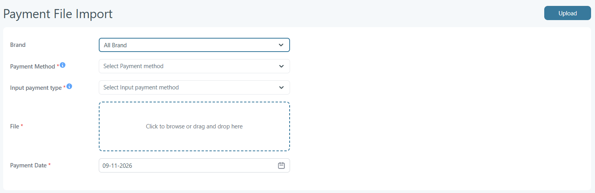
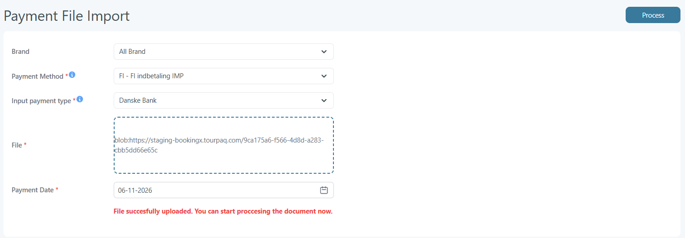
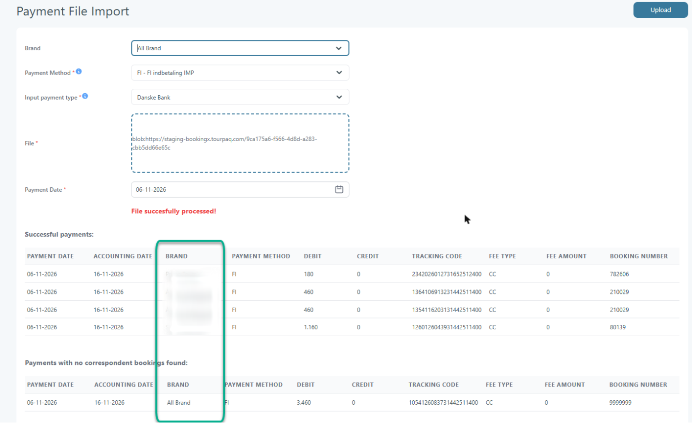

# Payment File Import

### Overview

**Payment File Import** lets you import a **bank payment file** so Tourpaq Office can **register booking payments automatically**.

This is a function that allows importing in the system the payments that have been made to the bank by the customers.


The company selects the banks it uses in **System Setup**, and each brand has its own **Bank** and **Creditor number** in the brand's **General** settings.


The bank will provide a file with payments together with the specification for importing them in the system.

This helps with **bank reconciliation** and reduces manual payment entry.

After the import, the payments are visible in [Payment Registration](../payment-registration.md).

***

### Purpose

Use Payment File Import when you receive payments through the bank and want to avoid registering each payment manually.

Although the file format depends on your bank, each payment line normally needs:

* A **booking identifier** (for example booking number/reference)
* A **payment date**
* An **amount**

***

### Before you start

* Make sure you have the **payment file** from your bank.
* Make sure the file contains the **booking reference/identifier** Tourpaq expects.
* Each payment from the system has a certain “method of payment” associated. For the payments that come from the bank, a special method of payment will be needed.
  * The method must be **active** and have **Use for FI payments** checked. It sets the debit/credit accounts used for the payments.
  * If you do not see a suitable method, ask an Admin/Financial user to configure it in [Method of Payment](../method-of-payment.md).
* To import one file for all brands (**All Brand**), each brand must have its **Creditor number** set (brand **General** settings). Brands without a creditor number are not included.
* To upload and process the file you need the **Payment File Import** permission and the **Administrator** or **Brand Manager** role.


Your bank (or your finance setup) should provide the **specification** that explains which file format to export and which booking identifier Tourpaq expects.


***

### Dependency on System Configuration

The supported file format is directly linked to the system configuration.


Before importing any payment file, ensure that the correct input type is configured.


#### Related Setting

**System Setup → General Settings → Input Payments Type**

<figure><figcaption></figcaption></figure>

* This setting defines which file formats are supported
* The banks selected here (Sydbank, Skjern Bank, Danske Bank, Arbejdernes Landsbank) are the options of **Input payment type** on the import screen
* Different banks/providers may require different formats
* The system parses the file based on this configuration


Selecting an incorrect **Input Payments Type** may result in:

* Failed imports
* Incorrect parsing of payment lines
* Missing or misinterpreted transactions


### Workflow Summary

To ensure a successful payment import, follow this sequence:

1. Configure **Input Payments Type** in:
   * System Setup → General Settings
2. Verify that the file matches the expected provider format\
   (e.g. FI 128-character format)
3. Import the file via:
   * **Finance → Payment File Import**, selecting the **Brand**, **Payment Method** and **Input payment type**
4. The system processes the file based on the selected configuration

### Notes


If you are unsure which format to use, contact your bank or payment provider before attempting the import.



The format described in this section should be used as a reference guide, not as a substitute for the official provider specification.


### Import a payment file

<figure><figcaption>
Select the brand, payment method and input payment type, then upload the bank payment file.
</figcaption></figure>



#### Get the payment file from your bank

Download/export the payment file in the format your company uses.

If you are unsure which format to use, check the bank’s export options or ask your finance administrator.



#### Open Payment File Import

Go to **Finance → Payment File Import**.



#### Select the brand and payment settings

* **Brand** – one brand, or **All Brand** (default) to import one file with the payments of all brands.
* **Payment Method** – the FI method of payment used for the payments, shown as code - name.
* **Input payment type** – the bank format of the file. For a single brand, it must match the **Bank** set on that brand.

If only one payment method or input payment type is available, it is selected automatically. **Payment Method** and **Input payment type** are required to process the file.



#### Upload the file

1. Select the file.
2. Upload/import it.

<figure><figcaption>
After a successful upload, the Upload button changes to Process.
</figcaption></figure>

Uploading only stores the file. Tourpaq reads and checks its content when you click **Process**.



#### Process the file

<figure><figcaption>
Processed file with All Brand: the Brand column shows the brand of each payment.
</figcaption></figure>



#### Review validation results

If Tourpaq shows an error (for example a creditor number that does not belong to the selected brand(s), or invalid file content), correct the file and upload again.

When the file is accepted, the payments are created in Tourpaq.

* With **All Brand**, a payment is registered on a booking only when the booking number and the creditor number of the booking's brand both match the file.
* Payments that cannot be matched are listed under **Payments with no correspondent bookings found**. They are saved without a booking and appear in **Finance → Balance Administration → Unregistered Payments**.
* Both tables have a **Brand** column (after **Accounting Date**); unmatched payments imported with All Brand show **All Brand**.
* Payments that were already imported are skipped. If all payments in the file were already imported, Tourpaq shows an error.


If the import fails, no payments from the file are saved.




#### Verify the imported payments

Open [Payment Registration](../payment-registration.md) and search by payment date range and the payment method you selected (for example **BANKIN**) to confirm the payments are listed.



***

### Notes

* Imported payments are validated during import. Any unmatched or erroneous lines are flagged for review.
* Payment date: **Skjern Bank** files use the accounting date from the file; the other banks use the **Payment Date** selected on the screen.
