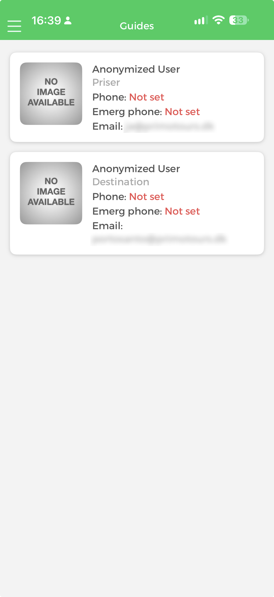
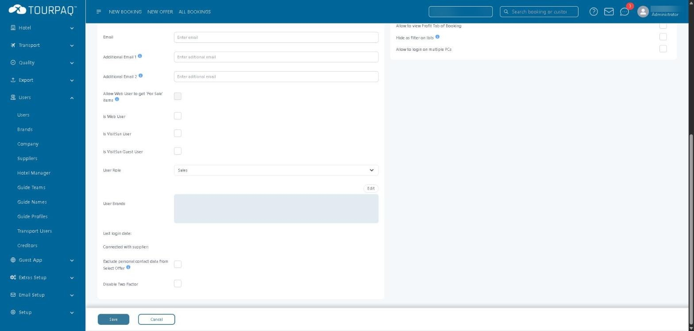
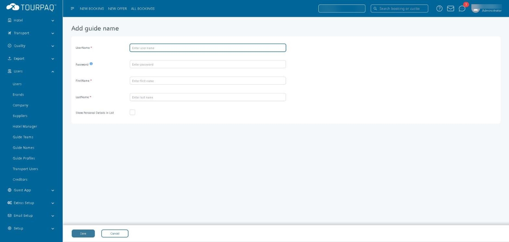
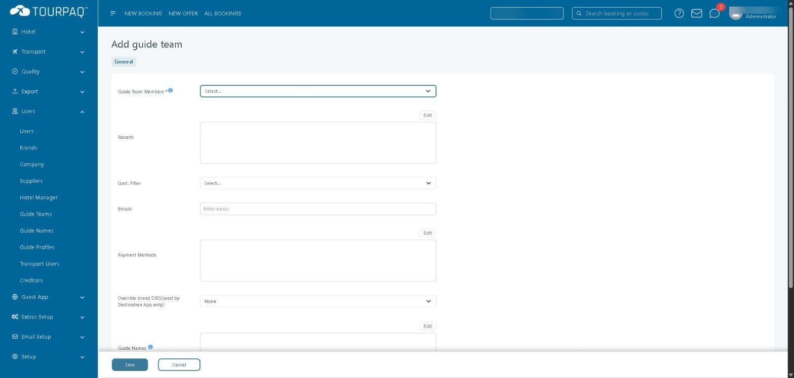
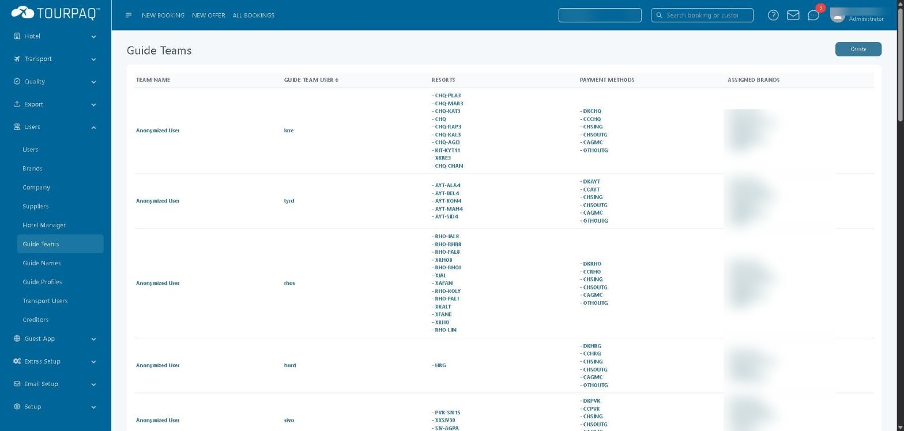
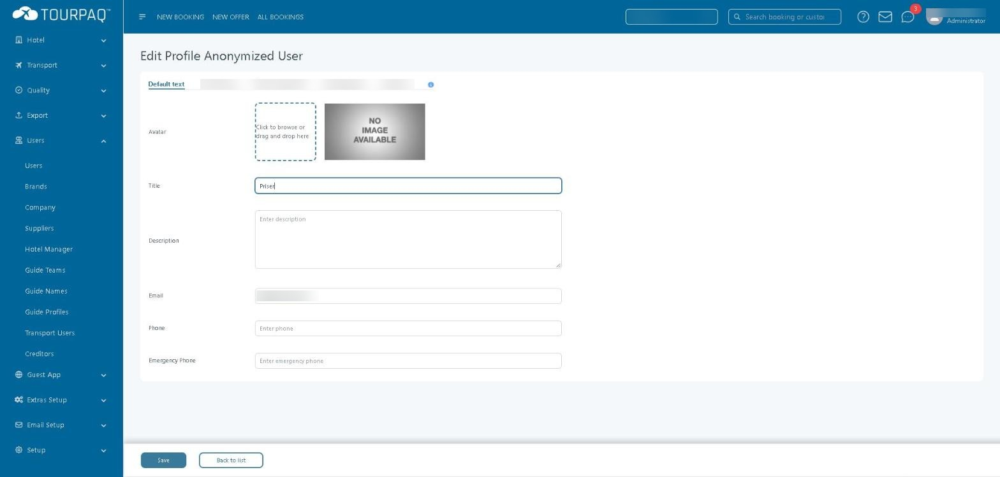
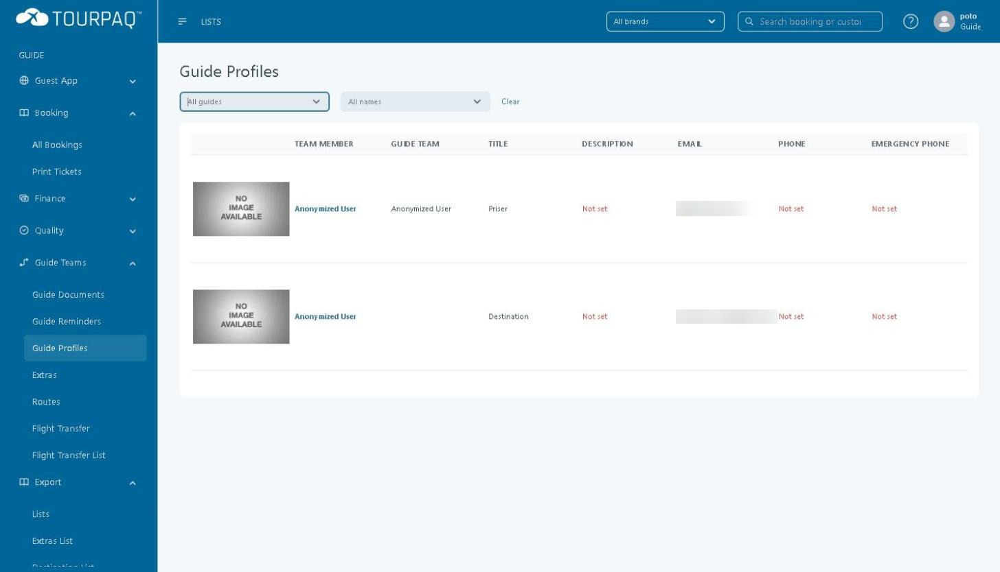

# Guides

#### Overview

**Guides** is one of the ten sections on the Guide App Home screen. It shows one card for each guide: photo, name, title, **Phone**, **Emerg phone** and **Email**. A value that has not been entered shows as **Not set** in red.

<div data-with-frame="true"><figure><figcaption></figcaption></figure></div>

The cards show the same fields as **Users → Guide Profiles** in Tourpaq Office: **Title**, **Email**, **Phone** and **Emergency Phone**. The Guide App does not show brands, resorts or guide teams on this screen.

Four Tourpaq Office records are involved in setting up a guide:

| Record              | Menu path                  | What it is                                                                                                         |
| ------------------- | -------------------------- | ------------------------------------------------------------------------------------------------------------------ |
| **Guide Team user** | **Users → Users**          | A user with the role **Guide Team**. It carries the **User Brands** and is selected as the member of a guide team. |
| **Guide name**      | **Users → Guide Names**    | A guide's own login (user name and password) and name.                                                             |
| **Guide team**      | **Users → Guide Teams**    | Groups a Guide Team user with resorts, payment methods, guide names and user team members.                         |
| **Guide profile**   | **Users → Guide Profiles** | The contact details shown to other users, with optional brand-specific texts.                                      |

#### Purpose

Use this page to:

* Understand what a guide sees on the Guides screen of the Guide App.
* Set up a guide in Tourpaq Office: login, team, resorts and brands.
* Maintain the contact details shown on the Guides screen, per brand if needed.

#### Preconditions

* You have access to the **Users** menu in Tourpaq Office. Users with the role **Guide Team** do not see the **Users** menu.
* The brands the guide will work for exist — see [Brands](../../brands/).
* The resorts the team will cover exist — see [Resorts](../../setup/resorts.md).
* The payment methods the team may use exist — see [Method of payment](../../finance/method-of-payment.md).

#### How-to

**Step 1. Create the Guide Team user and set its brands**

1. Go to **Users → Users** and click **Create**.
2. Enter **Username**, **Password**, **First Name**, **Last Name** and **Seller ID in booking**. These fields are marked as required.
3. Set **User Role** to `Guide Team`.
4. Click **Edit** next to **User Brands** and select the brands this user works for.
5. Click **Save**.

<figure><figcaption></figcaption></figure>

The user is now available in **Guide Team Members** on the guide team form.

**Step 2. Create the guide name**

1. Go to **Users → Guide Names** and click **Create**.
2. Enter **UserName**, **FirstName** and **LastName**. Enter a **Password**.
3. Select **Show Personal Details In List** if the guide's personal details must be shown in lists.
4. Click **Save**.

<figure><figcaption></figcaption></figure>

**Step 3. Create the guide team and assign resorts and guides**

1. Go to **Users → Guide Teams** and click **Create**.
2. In **Guide Team Members**, select the Guide Team user from step 1.
3. Click **Edit** above **Resorts** and select the resorts the team works in.
4. Click **Edit** above **Payment Methods** and select the payment methods the team may use.
5. Click **Edit** above **Guide Names** and select the guide names from step 2.
6. Click **Edit** above **User Team Members** to add team members who are regular Tourpaq users.
7. Click **Save**.

<figure><figcaption></figcaption></figure>

The team appears in the **Guide Teams** list with its resorts, payment methods and **Assigned Brands**.

<figure><figcaption></figcaption></figure>

**Step 4. Maintain the guide profile**

1. Go to **Users → Guide Profiles**.
2. Optionally filter with **All guides** or **All names**.
3. Click the guide's name.
4. On the **Default text** tab, enter **Title**, **Description**, **Email**, **Phone** and **Emergency Phone**. Add an **Avatar** if needed.
5. To use different texts for a brand, open the tab with the brand's name and enter the texts there.
6. Click **Save**.

<figure><figcaption></figcaption></figure>

The values appear in the **Guide Profiles** list.

<figure><figcaption></figcaption></figure>

**How the setup affects what you see**

Only the following effects have been observed.

| Setting                                              | Where it is set            | Observed effect                                                                                                                                                        |
| ---------------------------------------------------- | -------------------------- | ---------------------------------------------------------------------------------------------------------------------------------------------------------------------- |
| **User Brands**                                      | **Users → Users**          | A Guide Team user who signs in to Tourpaq Office sees only these brands in the brand list at the top of the page. The same brands appear as tabs on the guide profile. |
| **Title**, **Email**, **Phone**, **Emergency Phone** | **Users → Guide Profiles** | The same fields appear on the Guides screen of the Guide App.                                                                                                          |
| **Resorts**, **Payment Methods**                     | **Users → Guide Teams**    | Shown in the **Guide Teams** list. The effect on the Guide App is not verified.                                                                                        |


A Guide Team user can sign in to Tourpaq Office. It sees a reduced menu: **Guest App**, **Booking**, **Finance**, **Quality**, **Guide Teams** and **Export**. Under **Guide Teams**, it can open **Guide Profiles**.


#### Field Reference

**New User (guide-related fields)**

| Field                         | Description                                                 | Required | Notes                                                                                   |
| ----------------------------- | ----------------------------------------------------------- | -------- | --------------------------------------------------------------------------------------- |
| **Username**                  | The user's login name.                                      | Yes      |                                                                                         |
| **Password**                  | The user's password.                                        | Yes      | The tooltip recommends upper and lower case characters, numbers and special characters. |
| **First Name**, **Last Name** | The user's name.                                            | Yes      |                                                                                         |
| **Seller ID in booking**      | The seller identifier on bookings.                          | Yes      |                                                                                         |
| **User Role**                 | The role of the user. Select `Guide Team` for a guide team. | No       | The list also contains `Guide Master`.                                                  |
| **User Brands**               | The brands the user can access.                             | No       | Click **Edit** to select brands. See Edit User for the other fields.                    |

**Add guide name**

| Field                             | Description                                  | Required | Notes                                                                                   |
| --------------------------------- | -------------------------------------------- | -------- | --------------------------------------------------------------------------------------- |
| **UserName**                      | The guide's login name.                      | Yes      |                                                                                         |
| **Password**                      | The guide's password.                        | No       | The tooltip recommends upper and lower case characters, numbers and special characters. |
| **FirstName**                     | The guide's first name.                      | Yes      |                                                                                         |
| **LastName**                      | The guide's last name.                       | Yes      |                                                                                         |
| **Show Personal Details In List** | Shows the guide's personal details in lists. | No       |                                                                                         |

The **Guide Names** list has the columns **User Name**, **Password**, **First Name**, **Last Name**, **Guide Team**, **Company** and **Last Login**.

**Add guide team**

| Field                                                 | Description                              | Required | Notes                                                           |
| ----------------------------------------------------- | ---------------------------------------- | -------- | --------------------------------------------------------------- |
| **Guide Team Members**                                | The Guide Team user of the team.         | Yes      | Tooltip: `Create a user with the role 'Guide Team' to list it.` |
| **Resorts**                                           | The resorts of the team.                 | No       | Click **Edit** to select resorts.                               |
| **Qust. Filter**                                      | A selection list.                        | No       | TO VERIFY — what does it filter?                                |
| **Emails**                                            | Email addresses of the team.             | No       |                                                                 |
| **Payment Methods**                                   | The payment methods of the team.         | No       | Click **Edit** to select payment methods.                       |
| **Override brand DIBS(used by Destination App only)** | Overrides the DIBS setting of the brand. | No       | Default `None`.                                                 |
| **Guide Names**                                       | The guide names that belong to the team. | No       | Tooltip: `Add team members from the 'Guide Names' menu`         |
| **User Team Members**                                 | Regular Tourpaq users in the team.       | No       | Tooltip: `Add team members who are regular Tourpaq users`       |

When you edit a team, the tabs **Emails** and **Hotel Lists** are added next to **General**. **Emails** has a date range and a **Display** button. **Hotel Lists** has one checkbox for each list.

**Edit Profile**

| Field               | Description                         | Required | Notes                                                              |
| ------------------- | ----------------------------------- | -------- | ------------------------------------------------------------------ |
| **Avatar**          | The guide's photo.                  | No       | Without a photo, the Guide App shows a No image available picture. |
| **Title**           | The guide's title.                  | No       |                                                                    |
| **Description**     | A text about the guide.             | No       |                                                                    |
| **Email**           | The guide's email address.          | No       |                                                                    |
| **Phone**           | The guide's phone number.           | No       |                                                                    |
| **Emergency Phone** | The guide's emergency phone number. | No       |                                                                    |

The tabs above the fields are **Default text** and one tab for each brand. The tooltip reads:

```
This control is used for switching between the different brands custom texts for this entity
```

#### Related pages

* [Guide App](./)
* [Guide teams](../../guides/)
* [Guide names](../../guides/guide-names.md)
* [Guide profiles](../../guides/guide-profiles.md)
* [Users Management](../../users/users/users-management.md)
* [Brands](../../brands/)
