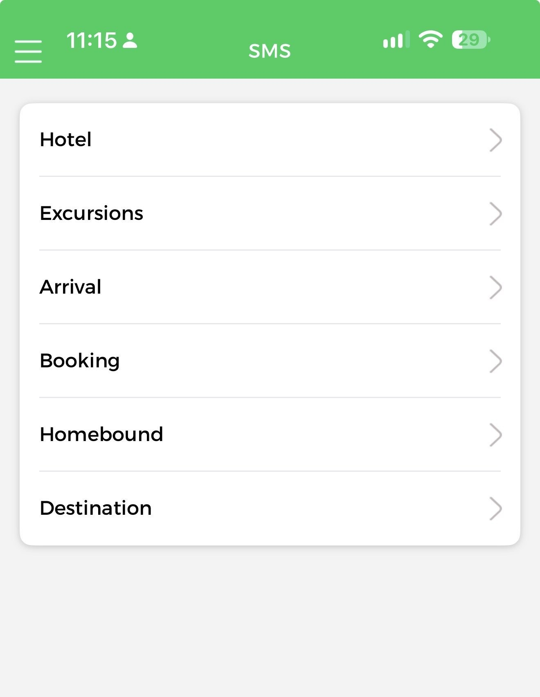
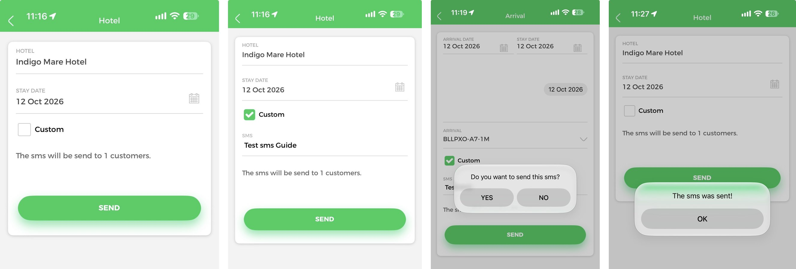
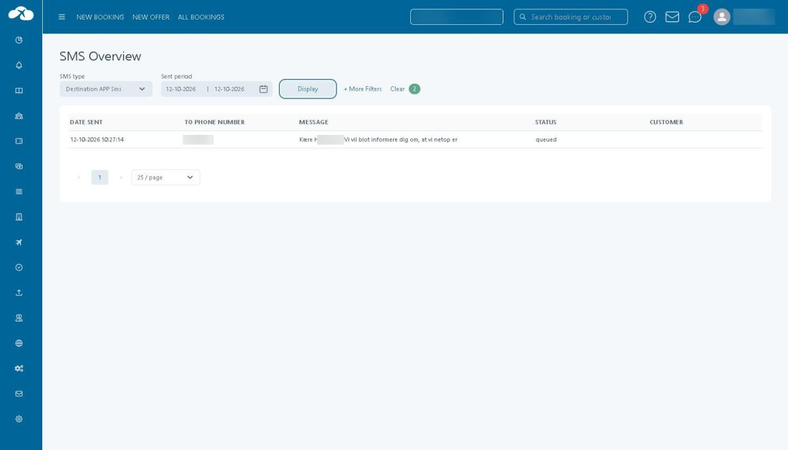
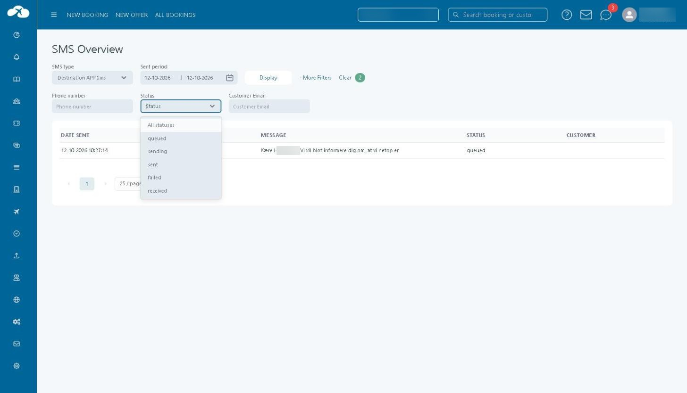
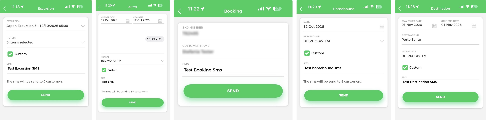
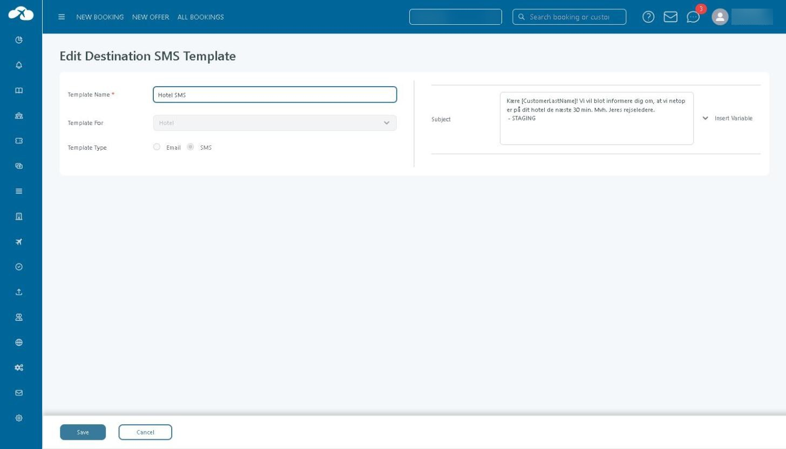

# SMS

#### Overview

The **SMS** section of the Guide App lets a guide send a text message to customers from the phone. The menu offers six message types: **Hotel**, **Excursions**, **Arrival**, **Booking**, **Homebound** and **Destination**.

<figure><figcaption>
The SMS menu in the Guide App.
</figcaption></figure>

In Tourpaq Office, messages sent this way are listed under **Tickets → SMS Overview** with the SMS type **Destination APP Sms**.&#x20;

#### Purpose

Use the SMS section to notify customers of practical information during their stay, for example that the guide is arriving at the hotel, or to send a free-text message. Use **SMS Overview** to check afterwards that a message was recorded and what its status is.

#### Preconditions

* The guide is signed in to the Guide App.
* An SMS template exists for the message type, when a template is used. Templates are maintained under Destination SMS Mappings.
* The customer has a valid phone number and the SMS integration is enabled, as described in SMS Overview.

#### How-to

**Send an SMS**



**Open the SMS menu.** In the Guide App, open **SMS** and choose the message type: Hotel, Excursions, Arrival, Booking, Homebound or Destination.



**Select the recipients.** Fill in the fields for the chosen type (see Field Reference). For Hotel, Excursions, Arrival and Homebound the app then shows how many customers will receive the message.

<figure><figcaption>
Sending an SMS, left to right: Hotel form with a hotel selected; Custom ticked; the confirmation Arrival asks for; the message shown after a send.
</figcaption></figure>



**Choose the message text.** Select **Custom** and type the text in the **SMS** field that appears. See Message text below for what is sent when Custom is not used.



**Press SEND.** Some types ask for confirmation first: Arrival shows **Do you want to send this sms?** with **YES** and **NO**. When the message is sent, the app shows **The sms was sent!** with **OK**.




Pressing **SEND** sends a text message to customers. Check the recipients and the text before pressing it.


**Check sent messages in Tourpaq Office**

1. Open **Tickets → SMS Overview**.
2. Set **SMS type** to **Destination APP Sms**.
3. Check **Sent period**. It defaults to today; widen it to find older messages.
4. Click **Display**.
5. To narrow the list, click **More Filters** and use **Phone number**, **Status** or **Customer Email**.
6. To read the full text of a message, hover over its **Message** cell.

<figure><figcaption>
SMS Overview with SMS type Destination APP Sms. Phone number and customer name are masked.
</figcaption></figure>

Rows in this list are not clickable; there is no separate detail view. The full message is available only through the hover text.

When no message matches the filters, the list shows **There are no entries to show.**

<figure><figcaption>
More Filters and the Status dropdown.
</figcaption></figure>


For this SMS type the list shows the columns **Date Sent**, **To Phone Number**, **Message**, **Status** and **Customer**. The Departure period and Booking number filters, and the Booking and Dept. Date columns described for other SMS types on SMS Overview, are not shown.


#### Field Reference

**Guide App forms**

| Message type | Fields                                                                              |
| ------------ | ----------------------------------------------------------------------------------- |
| Hotel        | **HOTEL**, **STAY DATE**, **Custom**                                                |
| Excursions   | **EXCURSION**, **HOTELS**, **Custom**                                               |
| Arrival      | **ARRIVAL DATE**, **STAY DATE**, **ARRIVAL**, **Custom**                            |
| Booking      | **BKG NUMBER**, **CUSTOMER NAME**, **SMS**                                          |
| Homebound    | **DATE**, **HOMEBOUND**, **Custom**                                                 |
| Destination  | **STAY START DATE**, **STAY END DATE**, **DESTINATIONS**, **TRANPORTS**, **Custom** |

<figure><figcaption>
Guide App forms, left to right: Excursions, Arrival, Booking, Homebound, Destination. Booking number and customer name are masked.
</figcaption></figure>

The counter text in the app reads **The sms will be send to N customers.**

**Message text**

* **Template.** The text comes from a template maintained under Destination SMS Mappings. In the one case checked, the Hotel SMS template ("Kære \[CustomerLastName]! …") produced a message with the same text and the customer's last name substituted for \[CustomerLastName].
* **Custom.** The guide types the text in the **SMS** field.

<figure><figcaption>
The Hotel SMS template under Destination SMS Mappings.
</figcaption></figure>

**SMS Overview columns and statuses**

| Field               | Description                                                                         |
| ------------------- | ----------------------------------------------------------------------------------- |
| **SMS type**        | Filter. **Destination APP Sms** lists messages sent from the Guide App.             |
| **Sent period**     | Filter on the date the message was sent. Defaults to today.                         |
| **Phone number**    | More Filters. Filters on the recipient number.                                      |
| **Status**          | More Filters. One of **queued**, **sending**, **sent**, **failed** or **received**. |
| **Customer Email**  | More Filters. Filters on the customer's e-mail address.                             |
| **Date Sent**       | Date and time the message was recorded.                                             |
| **To Phone Number** | The recipient number.                                                               |
| **Message**         | Start of the message text; hover for the full text.                                 |
| **Status** (column) | Current status of the message.                                                      |
| **Customer**        | The customer linked to the message.                                                 |

#### Related pages

* Guide App
* SMS Overview
* SMS (booking)
* Destination SMS Mappings
