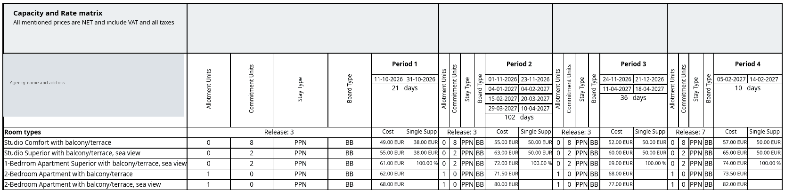
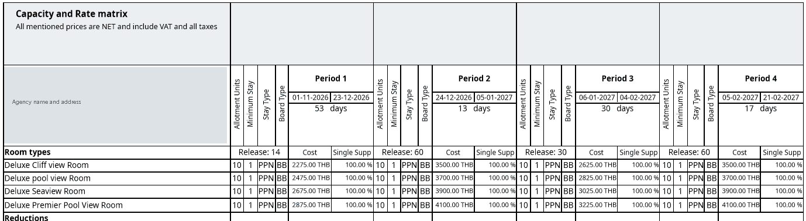
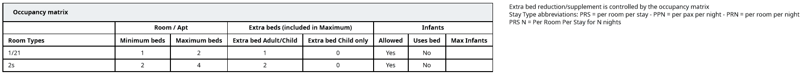
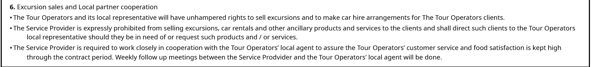

# Hotel Contract PDF

**Hotel › Hotel Contracts › Actions › Share**

## Purpose

The Hotel Contract PDF is the printable version of a hotel contract. Use it to send the contract to the hotel supplier and to sign it: the PDF has a signature line for the tour operator and one for the hotel.

## How to use

### Export a hotel contract as PDF

1. Go to **Hotel › Hotel Contracts**.
2. Click the name of the contract.
3. Click the **Actions** tab.
4. On the **Share** tab, click **Export Hotel Contract (PDF)**.

Tourpaq generates the PDF and your browser downloads it.


The PDF shows the saved contract. Save your changes before you export.


If the export stops with a message that a room is missing from a configuration, add the room to the configuration that the message names and export again.

## Reference

### Before you start

* Your user needs the role Administrator, BrandManager, Sales, Financial, Supplier, or Support.
* The layout described here applies to contracts that you create and edit on the **Hotel Contracts** page. Contracts created earlier that still open in the earlier edit page print the previous layout.

### What the PDF contains

The main page shows these parts, in this order:

| Part                                        | What it shows                                                                                                                                                                                  |
| ------------------------------------------- | ---------------------------------------------------------------------------------------------------------------------------------------------------------------------------------------------- |
| Header                                      | The logo of the tour operator, the hotel with its star rating, resort, address, phone, website, and email, the contract name with its operation days, and the contract type with the currency. |
| Capacity and Rate matrix                    | Periods, capacity, and rates in one table.                                                                                                                                                     |
| Occupancy matrix                            | The beds and infants allowed per room type, with a legend.                                                                                                                                     |
| Gala Dinner Supplements                     | Board type, age, room, period, and price of each gala dinner supplement. Only when the contract has them.                                                                                      |
| Remarks                                     | The text of the **Remarks** tab. Only when the contract has remarks.                                                                                                                           |
| Early booking discount (EBD) and Stay & Pay | One table per discount or offer. Only when the contract has them.                                                                                                                              |
| Payment plan                                | One table per year, with the invoice dates, the amounts, and the total. Only when the contract has a payment plan.                                                                             |
| Signatures                                  | A signature line for the tour operator and one for the hotel.                                                                                                                                  |

The facilities and the rules of the contract print on separate pages after the main page.

#### Header

The hotel rating shows as stars out of five. A rating with a plus, such as 4+, adds a half star. If the hotel has no address, phone, website, or email, the PDF prints **Not provided**. The operation days are the total days of all periods.

<figure><figcaption>
The header of the Hotel Contract PDF. The logo is covered in this image.
</figcaption></figure>

#### Capacity and Rate matrix

The matrix is one table, so the lines of all periods stay aligned:

* Periods sit side by side, four to a block. A contract with more periods continues in the next block of the same table.
* Each period shows its name (**Period 1** if it has no name), its date intervals, and its total days.
* **Release:** shows the release days of the period.
* **Cost** shows for every room type. **Single Supp** shows only when at least one room type has a single supplement.
* Reductions and supplements follow the room types, with the room they apply to or **Per pax/day**.
* A room type without a price in a period leaves an empty cell for that period.
* Amounts show the currency and two decimals, for example 49.00 EUR. Percentages show two decimals, for example 100.00%.

Columns without data are hidden:

* **Allotment Units**, **Commitment Units**, **Secured Units**, and **Minimum Stay** show only when at least one room type has a value above zero.
* **Stay Length** shows only when at least one room type uses the stay type PRS.
* **Stay Type** and **Board Type** always show.

<figure><figcaption>
The Capacity and Rate matrix of a contract with committed units. The name and address of the tour operator are covered.
</figcaption></figure>

<figure><figcaption>
The same matrix for a contract without committed units: the Commitment Units column is hidden.
</figcaption></figure>

#### Occupancy matrix

The occupancy matrix is a separate table under the Capacity and Rate matrix. It has one row per room type and these groups of columns:

* **Room / Apt**: **Minimum beds** and **Maximum beds**.
* **Extra beds (included in Maximum)**: **Extra bed Adult/Child** and **Extra bed Child only**.
* **Infants**: **Allowed**, **Uses bed**, and **Max Infants**.

**Uses bed** stays empty when infants are not allowed. An empty **Max Infants** means no limit. The values come from the room settings, see [Rooms – Hotel Contract Configuration](rooms-hotel-contract-configuration.md).

A legend next to the table explains the board abbreviations and the stay types PRS, PPN, and PRN.

<figure><figcaption>
The Occupancy matrix with the infant configuration and its legend.
</figcaption></figure>

#### Remarks and internal notes

The text of the **Remarks** tab prints as a bullet list. Internal notes never print. If the contract has internal notes, the PDF shows **\[X] Internal Notes** under the remarks. See [Remarks - Hotel Contract Configuration](remarks-hotel-contract-configuration.md).

#### Rules

Rules print on their own pages. Each rule shows its number. Each line of the rule text prints on its own line, and a line that wraps is indented under the number. The payment details of the supplier (creditor name, SWIFT code, and IBAN) print at the top of the first rules page. See [Rules - Hotel Contract Configuration](rules-hotel-contract-configuration.md).

<figure><figcaption>
A rule in the PDF: one line per line of text, wrapped lines indented.
</figcaption></figure>

## Related pages

* [Actions - Hotel Contract Configurations](actions-hotel-contract-configurations.md): The **Share** tab with the export button.
* [Rooms – Hotel Contract Configuration](rooms-hotel-contract-configuration.md): Occupancy and infant settings per room type.
* [Early Booking Discount – Hotel Contract Configuration](early-booking-discount-hotel-contract-configuration.md) and [Stay & Pay - Hotel Contract Configuration](stay-and-pay-hotel-contract-configuration.md): The discounts and offers that print as tables.
* [Payment Plan - Hotel Contract Configuration](payment-plan-hotel-contract-configuration.md): The payment plan tables.
* [Remarks - Hotel Contract Configuration](remarks-hotel-contract-configuration.md) and [Rules - Hotel Contract Configuration](rules-hotel-contract-configuration.md): The text that prints on the PDF.
* [Facilities - Hotel Contract Configuration](facilities-hotel-contract-configuration.md): The facilities page of the PDF.
