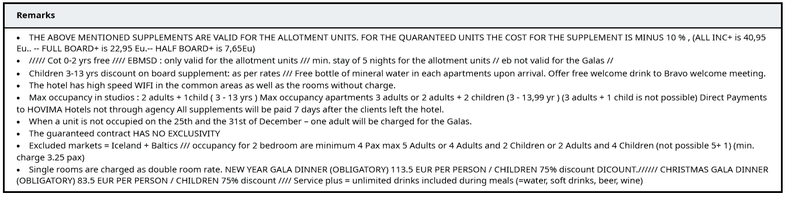

# Remarks - Hotel Contract Configuration

### Overview

Use **Remarks** to add optional text to the exported **Contract PDF**.

Remarks are typically used for:

* Supplier-facing notes.
* Practical stay information (check-in rules, meal notes, etc.).
* Contract-specific clarifications that should print on the PDF.


Keep Remarks short. Long blocks make the PDF harder to scan.


***

### Screenshot (where you edit Remarks)

<figure><figcaption></figcaption></figure>

***

### Screenshot (how it looks in the Contract PDF)

<figure><figcaption>
The Remarks box in the Contract PDF.
</figcaption></figure>

***

### How it works



**Add your text**

Go to **Hotel Contract → Remarks**.

Enter your text in **Remarks**.



**Save the contract**

Save the hotel contract to persist the Remarks text.



**Export the Contract PDF**

Generate the Contract PDF.

The Remarks text prints in the **Remarks** section.



### Notes (for internal use)

Use **Notes** for internal comments that should stay inside Tourpaq Office.

Notes are **not printed** in the Contract PDF.

If Notes exist, the Contract PDF shows a small indicator under **Remarks**:

* `[X] Internal Notes`

This tells the reader to open the contract in Tourpaq to view the Notes.

<figure><figcaption>
The internal notes indicator in the Contract PDF.
</figcaption></figure>

***

### Related workflows

* [Hotel Contract PDF](hotel-contract-pdf.md): The layout of the exported PDF and what each part shows.
* [Hotel contract - General](hotel-contract-contract-name.md): Where you create and maintain the full contract.
* [Periods – Hotel Contract Configuration](periods-hotel-contract-configuration.md): Also contains internal-only Notes (but period-specific).
