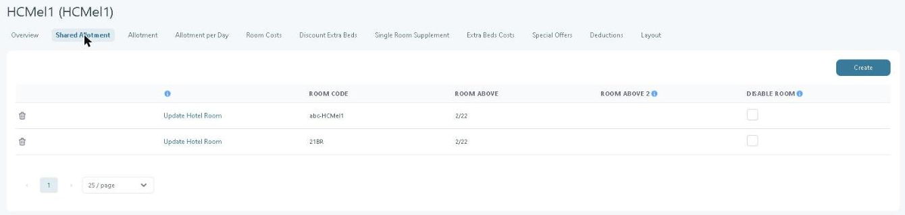
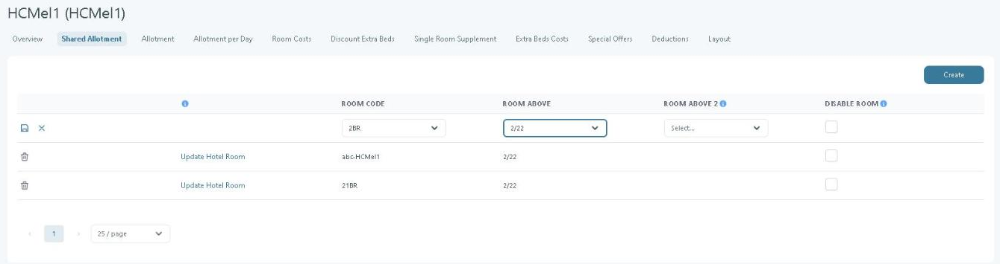
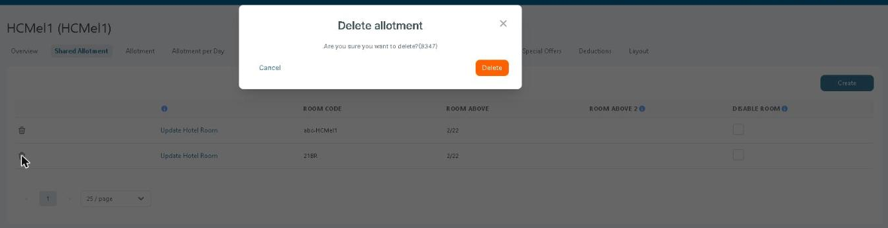
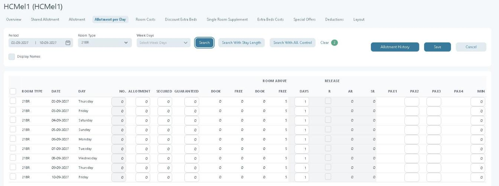

# Shared Allotment

**Hotel › Hotels › open a hotel › Shared Allotment**

## Purpose

Use **Shared Allotment** when a hotel sells the same rooms under more than one room type and the rooms must come out of one [allotment](../../integration/glossary.md). You link a room type to a _room above_. When someone books the room type, Tourpaq also checks the allotment of the room above and takes a room from it.

## How to use

Before you create a shared allotment, check [Before you start](shared-allotment.md#before-you-start).

### Create a shared allotment



Go to **Hotel › Hotels**, and open the hotel.



Click the **Shared Allotment** tab. The table lists the shared allotments of the hotel.

<figure><figcaption>
The Shared Allotment tab lists the room types that share the allotment of another room type.
</figcaption></figure>



Click **Create**. An empty row appears at the top of the table.



In **Room Code**, select the room type that shares the allotment.



In **Room Above**, select the room type whose allotment it shares.



Optional: In **Room Above 2**, select a second room type to share from.



Optional: Select **Disable Room** to keep the room out of [Hotel Layout](hotel-layout.md).

<figure><figcaption>
A new row, filled in and not yet saved. The save icon and the cancel icon are at the start of the row.
</figcaption></figure>



Click the save icon at the start of the row. Tourpaq shows **Shared Allotment inserted successfully!** and the row stays in the table.

To discard the row, click the cancel icon instead.



Tourpaq rejects a row in these cases and shows the reason:

* **Room Code** or **Room Above** is empty.
* **Room Code**, **Room Above**, and **Room Above 2** are not three different room types.
* The room type in **Room Code** already has a row. A room type can have only one row.
* The room type in **Room Code** is already used as a room above, or the room type in **Room Above** already has a room above. A room type can't be both.

### Disable a room for Hotel Layout

On a saved row, **Room Code**, **Room Above**, and **Room Above 2** can't be edited. You can only change **Disable Room**.

1. On the **Shared Allotment** tab, select or clear **Disable Room** in the row.
2. Click **Update Hotel Room** in the same row. Tourpaq shows **Shared Allotment was updated successfully!**

Selecting the checkbox without clicking **Update Hotel Room** changes nothing.

### Delete a shared allotment


After you delete a row, bookings of the room type no longer check or use the allotment of the room above. You can't delete a row once allotment exists for its room type.




On the **Shared Allotment** tab, click the trash icon at the start of the row.



In the **Delete allotment** dialog, click **Delete**. To keep the row, click **Cancel**.

<figure><figcaption>
The Delete allotment dialog asks for confirmation before it removes the row.
</figcaption></figure>



The room type stays on the [Room Types](room-types.md) tab. It stops sharing the allotment.

If allotment exists for the room type, Tourpaq shows **You cannot delete this room, as there have been allotments generated for it**, and keeps the row.

### Where it shows up

* **Allotment per Day:** for a room type with a room above, the table adds a **Room Above** group with **BOOK** and **FREE**. They show the rooms booked and the rooms free in the room above on each date. A second group, **Room Above 2**, appears when a room has one. See [Allotments per day](allotments-per-day/).
* **Booking:** when a booking takes the room type, Tourpaq also takes a room from the room above, and from **Room Above 2** if set. If a room above has no free room in the selected period, the booking can't be made, and Tourpaq shows **The shared room \[code] is not available in the selected period!**
* **Hotel Layout:** a room with **Disable Room** selected isn't offered for selection in [Hotel Layout](hotel-layout.md). **Room Above 2** isn't used in Hotel Layout.

## Examples

A hotel sells two room types, **2/22** and **21BR**. You want bookings of **21BR** to use the allotment of **2/22**.

1. On the **Shared Allotment** tab, click **Create**.
2. Select **21BR** in **Room Code** and **2/22** in **Room Above**. Click the save icon.
3. Open the **Allotment per Day** tab, search room type **21BR** for 2–10 September 2027, and check **Room Above**. Each date shows **BOOK** 0 and **FREE** 5, the figures of **2/22**.
4. A booking of **21BR** for those dates takes one room from **2/22**, and **FREE** drops to 4. When **FREE** is 0, the booking can't be made.

<figure><figcaption>
Under <strong>Room Above</strong>, Allotment per Day shows the bookings and free rooms of 2/22 for each date of 21BR.
</figcaption></figure>

## Reference

### Before you start

* **Role:** you need the Administrator, BrandManager, or Support role to create, change, or delete a shared allotment. The tab is hidden for hotel managers, suppliers, and users with the Sales role.
* **Hotel:** the hotel can't have the **Free Sell** contract type or be a hotel combination. The tab isn't shown for them.
* **Room types:** add both room types to the hotel first. See [Room Types](room-types.md). **Room Code**, **Room Above**, and **Room Above 2** list the room types of this hotel.
* **Allotment:** generate the allotment of the room above for the dates you sell. See [Hotel allotments](hotel-allotments/).
* **Hotel Layout:** **Disable Room** only matters if the hotel uses [Hotel Layout](hotel-layout.md).

### Configuration

| Field                 | Description                                                                                                         | Values                                                                     | Required |
| --------------------- | ------------------------------------------------------------------------------------------------------------------- | -------------------------------------------------------------------------- | -------- |
| **Room Code**         | The room type that shares the allotment. Bookings of this room type also use the room above.                        | A room type of the hotel. Each room type can have one row.                 | Yes      |
| **Room Above**        | The room type whose allotment is shared.                                                                            | A room type of the hotel, different from **Room Code**.                    | Yes      |
| **Room Above 2**      | A second room type whose allotment is shared. Not used in Hotel Layout.                                             | A room type of the hotel, different from **Room Code** and **Room Above**. | No       |
| **Disable Room**      | Keeps the room out of Hotel Layout. Selecting it on a saved row takes effect after you click **Update Hotel Room**. | Selected or cleared. Cleared by default.                                   | No       |
| **Update Hotel Room** | Saves **Disable Room** for a saved row. It changes nothing else.                                                    | Link in each saved row.                                                    | –        |

Notes:

* To change **Room Code**, **Room Above**, or **Room Above 2**, delete the row and create a new one.

## Related pages

* [Hotel creation](./)
* [Room Types](room-types.md)
* [Hotel allotments](hotel-allotments/)
* [Allotments per day](allotments-per-day/)
* [Hotel Layout](hotel-layout.md)
* [Glossary](../../integration/glossary.md)
