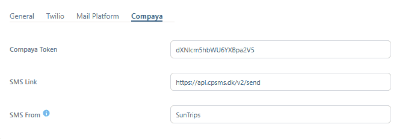
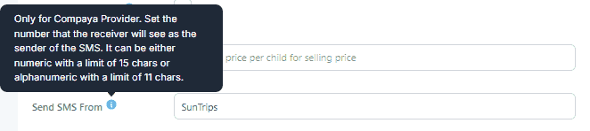

# Compaya

**Setup** › **System Setup** › **SMS Config** › **Compaya**

## Purpose

Compaya is a Danish SMS gateway, and one of the three SMS providers Tourpaq can send SMS through. With Compaya, Tourpaq sends your company's SMS through your own Compaya account. Each brand can have its own sender, and the passengers who agreed to get the booking's SMS get a copy.

Tourpaq only sends. Delivery reports and replies stay in Compaya.

Which SMS Tourpaq sends, when, and with which status is the same for every provider: see [How Tourpaq sends SMS](../../../sms-overview.md#how-tourpaq-sends-sms). For the request Tourpaq sends to Compaya, see [Compaya – technical reference](compaya-technical-reference.md).

## How to use

Before you connect Compaya, check [Before you start](./#before-you-start).

### Connect Compaya

<figure><figcaption>
The Compaya tab on SMS Config.
</figcaption></figure>

1. Go to **Setup** › **System Setup** › **SMS Config** › **Compaya**.
2. In **Compaya Token**, enter the token for your Compaya account. See [Configuration](./#configuration).
3. In **SMS Link**, enter `https://api.cpsms.dk/v2/send`.
4. In **SMS From**, enter the sender your customers see.
5. Click **Save**.
6. Open the **General** tab.
7. In **SMS Provider**, select **Compaya**, and click **Save**.

### Give a brand its own sender

1. Go to **Users** › **Brands**, and select the brand.
2. On the **General** tab, open **Other Settings**.
3. Enter the sender in **Send SMS From**.
4. Click **Save**.

The brand's SMS go out with this sender instead of **SMS From**.

<figure><figcaption>
Send SMS From under Other Settings on the brand's General tab.
</figcaption></figure>

### Test the connection

1. In **All Bookings**, select a booking, and open the SMS dialog.
2. Write a short text, and click **Test**. Tourpaq sends the SMS to your brand's phone number, not to the booking's customer.
3. After a few minutes, open **Tickets** › **SMS Overview**, and check that the SMS has the status **sent**.

### Where it shows up

* **SMS Overview** and the booking's [SMS](../../../booking/new-booking/sms.md) tab: every SMS with its status.
* Your Compaya account: each SMS and what it cost.

## Examples

### A booking SMS with a passenger copy

**Context.** The brand Sun Trips has `SunTrips` in **Send SMS From**. On booking 123456, the customer's **Phone** is `004512345678`, and one passenger with the phone `+4523456789` has **SMS** ticked: they agreed to get the same SMS as the customer. In **All Bookings**, you send the booking the text "Your transfer leaves at 08:30 from the hotel lobby."

**What Tourpaq does.** It creates one SMS for the booking. On the next run of the SMS Service, it sends Compaya one request: to `+4512345678` and `+4523456789`, from `SunTrips`, with the text.

**Result.** Both phones get the SMS from SunTrips. **SMS Overview** shows the SMS as **sent**, with the customer's number.

## Reference

### Before you start

* **Who sets it up:** a user with the role Administrator, Brand Manager, or Support, and the user right **System Setup**, enters the settings. Enter the token yourself; don't send it by email.
* **Tourpaq Support** turns on **SMS integration** for your company and schedules the **SMS Service** (every five minutes by default).
* **A Compaya account** with credit, and with the countries you send to allowed.
* **Credentials needed:** your Compaya username and API key.

### Configuration

| Field                                                       | Description                                                                                                                              | Values                                                      | Required |
| ----------------------------------------------------------- | ---------------------------------------------------------------------------------------------------------------------------------------- | ----------------------------------------------------------- | -------- |
| **Compaya Token**                                           | Your Compaya username and API key, written as `username:apikey` and Base64-encoded. Tourpaq sends it as it is, for Basic authentication. | Text                                                        | Yes      |
| **SMS Link**                                                | The address of Compaya's SMS API.                                                                                                        | `https://api.cpsms.dk/v2/send`                              | Yes      |
| **SMS From**                                                | The sender of the SMS, for brands without their own **Send SMS From**.                                                                   | Up to 11 letters and digits, or a number of up to 15 digits | Yes      |
| **Send SMS From** (brand, **General** › **Other Settings**) | The sender of the brand's SMS. Replaces **SMS From**.                                                                                    | As **SMS From**                                             | No       |
| **SMS Provider** (**SMS Config** › **General**)             | The provider your company sends SMS through.                                                                                             | **Compaya**                                                 | Yes      |
| **Remove Body Limitation** (**SMS Config** › **General**)   | Sends SMS longer than 160 characters.                                                                                                    | Selected or not                                             | No       |

If **Compaya Token**, **SMS Link**, or **SMS From** is empty, Tourpaq sends no SMS and keeps them in the queue.

**What Tourpaq sends.** For each SMS, Tourpaq sends Compaya:

* the phone number, formatted as described in [Phone numbers](../../../sms-overview.md#phone-numbers). With Compaya, a leading `0` is removed.
* for an SMS that belongs to a booking, the phone numbers of the booking's passengers who have **SMS** ticked, as they're stored on the booking.
* the sender: the brand's **Send SMS From**, or else **SMS From**.
* the text, with non-breaking spaces replaced by normal spaces, and cut after 160 characters unless **Remove Body Limitation** is selected.

**When Compaya refuses an SMS.** The SMS gets the status **failed**, and Tourpaq keeps Compaya's error message with it. Tourpaq Support can read it for you. Two errors you can fix yourself:

| Compaya's message                                 | What to do                                                                            |
| ------------------------------------------------- | ------------------------------------------------------------------------------------- |
| Country is not in the allowed countries           | Allow the country in your Compaya account, and send the SMS again.                    |
| Phone number length and country code do not match | Correct the phone number or its country code on the customer, and send the SMS again. |

## Related pages

* [Compaya – technical reference](compaya-technical-reference.md)
* [SMS Overview](../../../sms-overview.md), with [How Tourpaq sends SMS](../../../sms-overview.md#how-tourpaq-sends-sms)
* [General Settings](../../../brands/general-settings/) of a brand, with **Send SMS From**
* The other SMS providers: [Twilio](../system-setup-sms-configuration-twilio.md) and [Mail Platform](../system-setup-mail-platform.md) (deprecated)
