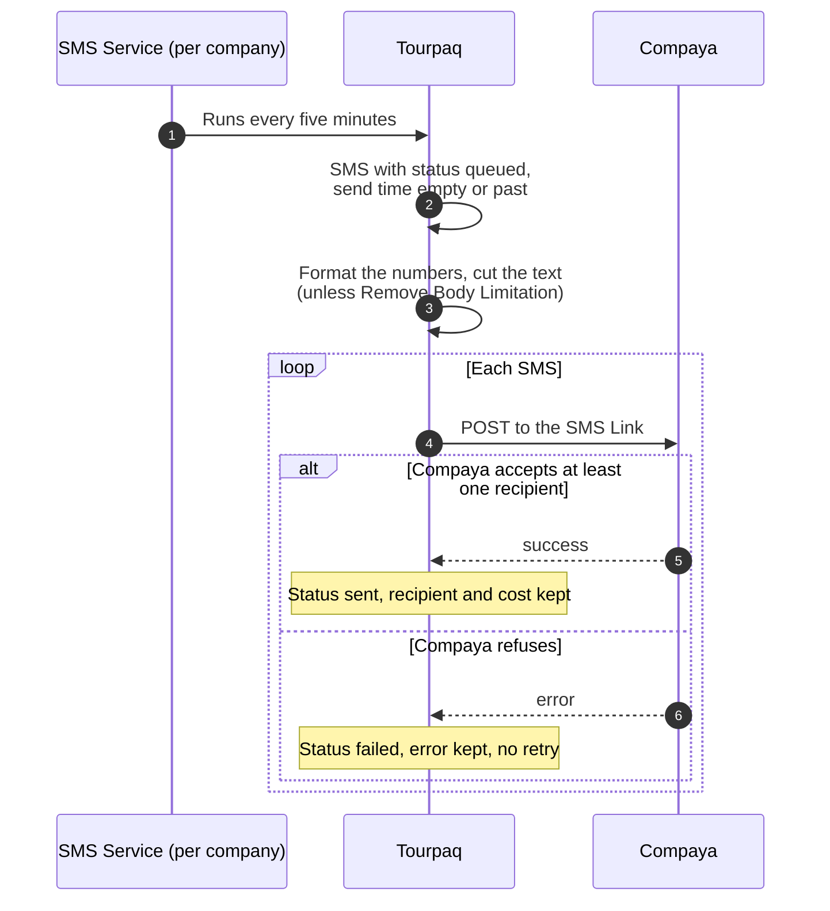

# Compaya – technical reference

This page is for Tourpaq support, developers, and the IT staff who set up or troubleshoot the [Compaya](./) SMS provider. For setup in Tourpaq Office, see the main page. For the SMS queue, the schedule, and the statuses that every provider shares, see [How Tourpaq sends SMS](../../../sms-overview.md#how-tourpaq-sends-sms).

## Data flow



Tourpaq only sends. Compaya never calls Tourpaq, and delivery reports and replies don't come back.

## Connection

| Setting           | Where                                                             | Used for                                                              |
| ----------------- | ----------------------------------------------------------------- | --------------------------------------------------------------------- |
| **Compaya Token** | **Setup** › **System Setup** › **SMS Config** › **Compaya**       | The `Authorization` header                                            |
| **SMS Link**      | Same tab                                                          | The address Tourpaq posts each SMS to: `https://api.cpsms.dk/v2/send` |
| **SMS From**      | Same tab                                                          | The sender, when the brand has none                                   |
| **Send SMS From** | **Users** › **Brands** › brand › **General** › **Other Settings** | The sender of that brand's SMS                                        |
| **SMS Provider**  | **SMS Config** › **General**                                      | Must be **Compaya**                                                   |

The settings belong to the company: all brands use the same Compaya account. If **Compaya Token**, **SMS Link**, or **SMS From** is empty, Tourpaq writes a warning to the SMS Service's log, sends nothing, and keeps the SMS queued.

## Authentication

Tourpaq sends the header `Authorization: Basic <Compaya Token>`. It doesn't encode the token, so the field holds the Base64 encoding of your Compaya username and API key joined by a colon: `username:apikey`.

## Request

One request per SMS:

```http
POST https://api.cpsms.dk/v2/send
Authorization: Basic <Compaya Token>
Content-Type: application/json; charset=UTF-8
Accept: application/json, text/javascript
```

```json
{
  "to": ["+4512345678", "+4523456789"],
  "message": "Your transfer leaves at 08:30 from the hotel lobby.",
  "from": "SunTrips"
}
```

| Field     | Value                                                                                                                                                                                                                      |
| --------- | -------------------------------------------------------------------------------------------------------------------------------------------------------------------------------------------------------------------------- |
| `to`      | The SMS's phone number, formatted by Tourpaq. For an SMS that belongs to a booking, the phone numbers of the booking's passengers who agreed to get the same SMS as the customer follow, as they're stored on the booking. |
| `message` | The SMS text, with non-breaking spaces replaced by normal spaces, cut after 160 characters unless **Remove Body Limitation** is selected.                                                                                  |
| `from`    | The brand's **Send SMS From**, or else **SMS From**.                                                                                                                                                                       |

Phone numbers: Tourpaq turns `00` at the start into `+`, removes a single leading `0`, and puts the customer's country code in front of a number without `+` when the number is the customer's **Phone**. It sends any other character, such as a space, as it is. The passengers' numbers get none of these changes. See [Phone numbers](../../../sms-overview.md#phone-numbers).

## Response

Tourpaq reads two lists from Compaya's answer:

```json
{
  "success": [{ "to": "4512345678", "cost": "1" }],
  "error": [{ "code": "409", "message": "Phone number length and country code do not match", "to": "4523456789" }]
}
```

| Answer                                     | Status in Tourpaq | Kept with the SMS                                                                 |
| ------------------------------------------ | ----------------- | --------------------------------------------------------------------------------- |
| `success` has at least one entry           | **sent**          | `To:<to>Cost:<cost>` of the first entry                                           |
| `success` is empty                         | **failed**        | `Code:<code>Message:<message>` of the first `error` entry                         |
| HTTP error, or Tourpaq can't reach Compaya | **failed**        | The error text, such as `The remote server returned an error: (400) Bad Request.` |
| Compaya doesn't answer in time             | **failed**        | An error text                                                                     |

When Compaya accepts at least one recipient, the SMS counts as sent, even if Compaya refused another recipient. Tourpaq tries a failed SMS only once. When Compaya refuses the SMS, Tourpaq logs nothing; when the request itself fails, Tourpaq writes an error to the SMS Service's log. Tourpaq sends the SMS one at a time: a failed SMS doesn't stop the others.

## Errors

Errors Compaya returned to Tourpaq:

| Compaya's message                                 | Cause                                                           | What to do                                    |
| ------------------------------------------------- | --------------------------------------------------------------- | --------------------------------------------- |
| Country is not in the allowed countries           | The Compaya account doesn't allow SMS to that country.          | Allow the country in Compaya.                 |
| Phone number length and country code do not match | The number is too long or too short for its country code.       | Correct the number on the customer.           |
| Phone number should be specified as a number      | The number has a character that isn't a digit, such as a space. | Correct the number on the customer.           |
| HTTP 400 Bad Request, without a message           | Compaya refused the whole request.                              | Tourpaq Support checks the SMS Service's log. |
