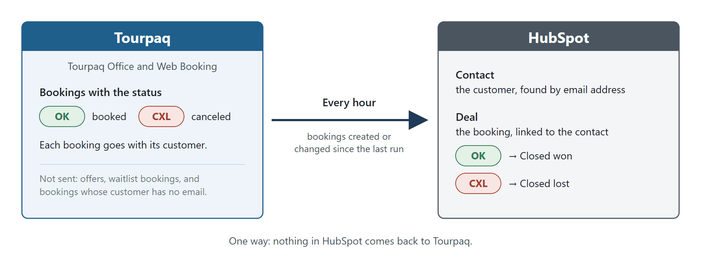

# HubSpot

### Overview

The HubSpot integration sends your bookings and customers from Tourpaq to your HubSpot account. Each customer becomes a HubSpot contact, and each booking becomes a deal on that contact, so your sales and marketing teams see your bookings in HubSpot. You set it up per brand.

<figure><figcaption>
Tourpaq sends booked and canceled bookings to HubSpot every hour, one way.
</figcaption></figure>

* Tourpaq sends; HubSpot never changes anything in Tourpaq.
* Tourpaq sends bookings with the status OK or canceled. It doesn't send offers, enquiries, or waitlist bookings.
* A booking that changes in Tourpaq updates its deal in HubSpot on the next run.

For the API calls and the full field mapping, see [HubSpot – technical reference](hubspot-technical-reference.md). It's written for your HubSpot administrator or IT staff.

### What you can do here

* Connect a brand to your HubSpot account with a **License Key**.
* Choose the HubSpot subscription that customers who agree to your newsletter are added to.

### Access

1. Go to **Users** › **Brands**.
2. Select the brand.
3. Open the **HubSpot** tab.

Administrators, Brand Managers, and Support users can open the brand settings.

### Field reference

<figure><figcaption>
The brand's HubSpot tab.
</figcaption></figure>

#### License Key

The HubSpot service key that Tourpaq uses for this brand. Your HubSpot administrator creates the service key in HubSpot and copies it. A brand that already uses the access token of a HubSpot private app keeps working with it. Enter the key yourself, so it isn't sent by email.

🔹 _Required_: Yes. Without it, Tourpaq sends nothing for the brand.

#### Subscriptions

The name of the HubSpot subscription type that customers are added to, exactly as it's spelled in HubSpot, for example `Newsletter`. To enter more than one name, separate them with `;` (semicolon). Tourpaq then uses the first of them that HubSpot lists for the customer.

When the customer has agreed to the newsletter (**Newsletter** on the customer), Tourpaq subscribes them in HubSpot. Tourpaq never unsubscribes anyone: if a customer withdraws consent in Tourpaq, unsubscribe them in HubSpot.

🔹 _Required_: No. When it's empty, Tourpaq subscribes no one, and still sends the bookings.


HubSpot API keys (the older key type) don't work. Use a service key.


### Setup



**Ask Tourpaq Support to turn on HubSpot**

Tourpaq Support turns on the HubSpot integration for your company and schedules the HubSpot service for each brand that uses it.



**Prepare HubSpot**

Your HubSpot administrator creates a service key for Tourpaq and the deal properties Tourpaq fills in. See [HubSpot – technical reference](hubspot-technical-reference.md).



**Add Brand Code**

<figure><figcaption>
Brand Code on the brand's General tab.
</figcaption></figure>

On the brand's **General** tab, set a **Brand Code**. It's required: Tourpaq puts it in front of the booking number in the deal name, for example `ABC-123456`.



**Add HubSpot credentials and subscriptions**

<figure><figcaption>
License Key and Subscriptions on the HubSpot tab.
</figcaption></figure>

On the brand's **HubSpot** tab, enter the **License Key** and, if you use newsletter subscriptions, the **Subscriptions**. Then save.



#### Add a brand

To connect another brand to HubSpot, tell Tourpaq Support:

* which brand to connect, so they schedule the HubSpot service for it;
* whether the brand needs another interval than every hour;
* whether your HubSpot account has contact properties for the brand, such as a property that marks the contact as the brand's or holds the brand's owner. Tourpaq fills these only after Tourpaq Support has added them for the brand.

Then set the brand's **Brand Code** and fill in its **HubSpot** tab, as in the setup steps. Several brands can use the same HubSpot account.

### Data sync behavior

#### What Tourpaq sends per booking

**The contact.** Tourpaq looks for a HubSpot contact with the customer's email address. If it finds one, it updates the contact with the booking's customer details, such as name, phone numbers, and address. If not, it creates the contact.

**The deal.** Each booking is one deal, linked to the contact:

* **Name**: the Brand Code and the booking number, for example `ABC-123456`.
* **Amount**: the booking's total price.
* **Stage**: **Closed won** for a booking with the status OK, **Closed lost** for a canceled booking. The deal goes into your default deal pipeline.
* **Travel details**: the destination, hotel, and board, the travel dates and length, the number of passengers, and the airports and flight numbers.
* **Payments**: the deposit and the balance, with the amount to pay, the amount paid, and the due date.
* **Comments**: the booking's customer, hotel, and destination comments.
* **Links**: a link to the booking in Tourpaq Office and a link to the booking in the Customer Center.

**The owner.** The deal gets the HubSpot user with the same email address as the Tourpaq user who made the booking as its owner. Tourpaq doesn't change the contact's owner.

Give every Tourpaq user who makes bookings an email address that belongs to a HubSpot user, or their deals don't get the right owner. That includes the Tourpaq user that the brand's Web Booking books with: its email address decides the owner of every web booking.

#### When Tourpaq creates or updates bookings in HubSpot

Each run sends every booking of the brand that was created or changed since the previous run, from Tourpaq Office and Web Booking alike, when:

* the booking's status is OK or canceled, and
* the customer has an email address and a postcode, and
* the booking has a transport, with its departure and arrival.

A booking already in HubSpot updates its deal. Any change to the booking counts, for example a new passenger, a payment, or a cancellation.

The customer goes to HubSpot only together with a booking: each time Tourpaq sends a booking, it first creates or updates the customer's contact. A change made only on the customer, such as a new phone number, reaches HubSpot the next time one of the customer's bookings changes. A customer without an OK or canceled booking never reaches HubSpot.

Tourpaq starts with the bookings changed on the day the integration starts. Older bookings go to HubSpot the next time they change.

#### Sync frequency

The HubSpot service runs every hour. Tourpaq Support can set another interval for a brand.

#### When a booking can't be sent

When HubSpot rejects a booking, Tourpaq tries again on the next runs, up to five times. After that, Tourpaq sends the booking again the next time it changes.

Each failed run logs a warning of the type **Unable to Send Booking to HubSport**, with the bookings and HubSpot's error message. To get it by email, add a [warning notification rule](../../../warning-notification-rules.md) for that warning type.

The most common cause is a customer email address that HubSpot doesn't accept, for example one ending in `.con` instead of `.com`. Correct the address, and then save the booking: Tourpaq sends it on the next run.

### Tips

* Keep the **License Key** private. If it's exposed, create a new service key in HubSpot and enter it on the **HubSpot** tab.
* Copy subscription names from HubSpot. A name that doesn't match exactly is ignored.
* Don't change a brand's **Brand Code** after the integration starts. Tourpaq finds a booking's deal by its name, so a booking that changes after a new Brand Code gets a second deal.
* Give your sales staff the same email address in Tourpaq and in HubSpot, so their bookings' deals get them as owner.

### FAQ

#### Where do I get the License Key?

Your HubSpot administrator creates a service key in HubSpot and copies it. Paste it into the brand's **HubSpot** tab. The access the key needs is on [HubSpot – technical reference](hubspot-technical-reference.md).

#### How do I enter multiple subscriptions?

Separate them with `;` (semicolon).

Example: `Newsletter;Newsletter SE`.

#### What happens if Subscriptions is empty?

Tourpaq subscribes no one. It still sends the contacts and the deals.

#### Why are some bookings not created in HubSpot?

Check these, in this order:

* The customer has no email address or no postcode.
* The booking's status isn't OK or canceled, for example a waitlist booking.
* The HubSpot service hasn't run since the booking changed.
* The brand has no **License Key**.
* The brand has no **Brand Code**. Tourpaq then sends no booking of the brand and logs no warning. Set the **Brand Code**, and ask Tourpaq Support to check the HubSpot service if bookings still don't arrive.
* HubSpot rejected the booking: look for the warning **Unable to Send Booking to HubSport**. It has HubSpot's error message.

#### Does Tourpaq create new contacts, or update existing ones?

It updates the contact with the customer's email address, and creates one when there is none. Two bookings for the same email address go to the same contact.

#### How often does the sync run?

Every hour. Ask Tourpaq Support to change the interval for a brand.
