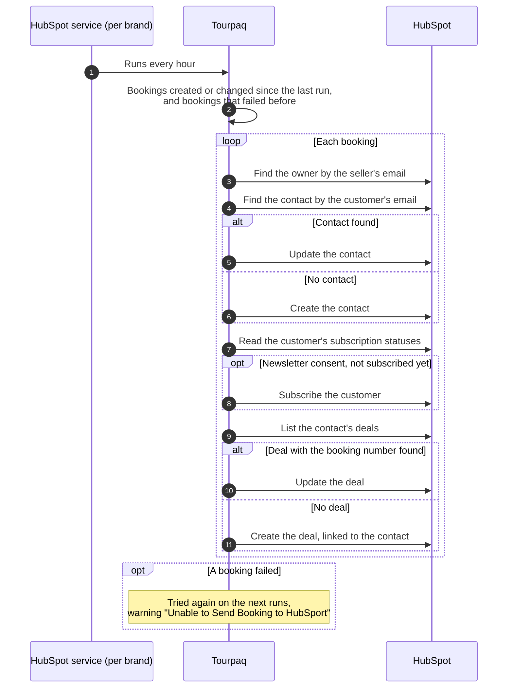

# HubSpot – technical reference

This page is for Tourpaq support, developers, and the HubSpot administrator or IT staff who set up or troubleshoot the [HubSpot](./) integration. It describes what Tourpaq sends to HubSpot and how. For setup in Tourpaq and day-to-day use, see the main page.

## Data flow



Tourpaq only sends. HubSpot never calls Tourpaq, and nothing changed in HubSpot comes back to Tourpaq.

## Connection

Each brand connects to one HubSpot account, with the brand's **HubSpot** tab in Tourpaq Office:

| Setting                                 | Used for                                                                                                                                                                       |
| --------------------------------------- | ------------------------------------------------------------------------------------------------------------------------------------------------------------------------------ |
| **License Key**                         | A HubSpot service key, or the access token of an existing HubSpot private app. Without it, Tourpaq sends nothing for the brand.                                                |
| **Subscriptions**                       | The names of the HubSpot subscription types for newsletter consent, separated by `;`. See [Newsletter subscriptions](hubspot-technical-reference.md#newsletter-subscriptions). |
| **Brand Code** (on the **General** tab) | The prefix of the booking number in HubSpot, and the business unit on contacts and deals. Required.                                                                            |

Tourpaq Support turns on the company access feature **HubSpot Integration** and schedules the **HubSpot Service** (code `HBS`) for each brand in **Application** › **Running Services**.

## Authentication

Every call goes to `https://api.hubapi.com` with the header `Authorization: Bearer <License Key>`. HubSpot API keys (the `hapikey` query parameter) aren't supported.

A HubSpot super admin, or a user with the **Developer tools access** permission, creates the service key. It needs these scopes:

| Scope                                                     | For                                                    |
| --------------------------------------------------------- | ------------------------------------------------------ |
| `crm.objects.contacts.read`, `crm.objects.contacts.write` | Finding, creating, and updating contacts               |
| `crm.objects.deals.read`, `crm.objects.deals.write`       | Listing, creating, and updating deals                  |
| `crm.objects.owners.read`                                 | Finding the owner by email                             |
| `communication_preferences.read_write`                    | Reading subscription statuses and subscribing contacts |

## Prepare HubSpot

Tourpaq writes to the deal properties in [Deal](hubspot-technical-reference.md#deal) and to the contact properties `zipcode` and `business_unit`. Create every one that isn't a HubSpot default property before the first run, with the internal name exactly as in the tables. HubSpot rejects a call with a property it doesn't know, and the booking fails.

Use single-line text properties, except for the date properties (date picker) and **Amount** (HubSpot's own).

## API calls

Per booking, in this order. `{vid}` is the contact's ID, `{dealId}` the deal's ID.

| Purpose                        | Method and path                                                                                                                 |
| ------------------------------ | ------------------------------------------------------------------------------------------------------------------------------- |
| Find the owner                 | `GET /crm/v3/owners?email={seller email}&limit=100`                                                                             |
| Find the contact               | `GET /contacts/v1/search/query?q={customer email}&property=email`                                                               |
| Update the contact             | `POST /contacts/v1/contact/vid/{vid}/profile`                                                                                   |
| Create the contact             | `POST /contacts/v1/contact`                                                                                                     |
| Read the subscription statuses | `GET /communication-preferences/v3/status/email/{customer email}`                                                               |
| Subscribe the contact          | `POST /communication-preferences/v3/subscribe`                                                                                  |
| List the contact's deals       | `GET /deals/v1/deal/associated/contact/{vid}/paged?includeAssociations=true&properties=bookingnumber&limit=100&offset={offset}` |
| Update the deal                | `PUT /deals/v1/deal/{dealId}`                                                                                                   |
| Create the deal                | `POST /deals/v1/deal`                                                                                                           |

The contact is the first search result for the customer's email address (in lower case). The deal is the contact's deal whose `bookingnumber` matches. Tourpaq pauses half a second after each contact, deal, and owner call to stay within HubSpot's rate limit.

## Which bookings Tourpaq sends

The **HubSpot Service** runs once per brand, every hour by default (at one minute past the hour), and never twice at the same time for one brand. Each run sends the brand's bookings that:

* have the status OK or canceled, and
* have a customer with an email address and a postcode, and
* have a transport, with its departure and arrival, and
* were changed since the start of the previous run minus one interval, or failed on an earlier run fewer than five times.

The first run starts from midnight of that day; there is no back-fill. The overlap of one interval means a booking can be sent twice; the second time only updates.

Tourpaq sends the bookings one at a time. A failed booking doesn't stop the others.

## Contact

| HubSpot property        | Value from Tourpaq                                           |
| ----------------------- | ------------------------------------------------------------ |
| `email`                 | The customer's email (only when Tourpaq creates the contact) |
| `firstname`, `lastname` | The customer's first and last name                           |
| `phone`                 | The customer's day phone                                     |
| `mobilephone`           | The customer's mobile phone                                  |
| `address`               | The customer's address                                       |
| `zip`, `zipcode`        | The customer's postcode                                      |
| `city`                  | The postcode's place name                                    |
| `country`               | The postcode's country name                                  |
| `business_unit`         | The Brand Code                                               |

An existing contact is overwritten with these values on every booking for that email address. A property Tourpaq has no value for isn't sent. Tourpaq doesn't set the contact owner (`hubspot_owner_id`); only the deal gets an owner.

Some brands also get a contact property that marks the contact as theirs and one that holds the brand's owner. Each brand's pair is fixed in the code, so a brand that needs them takes a change by Tourpaq: tell Tourpaq Support the brand and the two internal property names. Both properties must exist in HubSpot, or HubSpot rejects the contact.

## Deal

| HubSpot property                                                                         | Value from Tourpaq                                                                                                                                           |
| ---------------------------------------------------------------------------------------- | ------------------------------------------------------------------------------------------------------------------------------------------------------------ |
| `dealname`, `bookingnumber`                                                              | Brand Code and booking number, for example `ABC-123456`                                                                                                      |
| `amount`                                                                                 | The booking's total price, in the HubSpot account's currency (Tourpaq sends no currency)                                                                     |
| `dealstage`                                                                              | `closedwon` for the status OK, `closedlost` for canceled. No `pipeline` is sent, so HubSpot uses the default pipeline                                        |
| `hubspot_owner_id`                                                                       | The owner: the HubSpot user with the email address of the Tourpaq user on the booking. For web bookings that is the user the brand's Web Booking books with. |
| `closedate`                                                                              | The booking's date and time                                                                                                                                  |
| `orderdate`                                                                              | The booking date                                                                                                                                             |
| `arrivaldate`                                                                            | The outbound departure date                                                                                                                                  |
| `returndate`                                                                             | The homebound departure date                                                                                                                                 |
| `week`                                                                                   | The week number of the return date (weeks start on Monday; week 1 is the first week with four days in the new year)                                          |
| `vacationlength`                                                                         | The number of nights                                                                                                                                         |
| `destinationname`                                                                        | The resort                                                                                                                                                   |
| `residencename`                                                                          | The hotel                                                                                                                                                    |
| `pension`                                                                                | The board: product code, price, and days, for example `HP - 1200 - 7 days`                                                                                   |
| `numberofpax`                                                                            | Adults and children, all rooms                                                                                                                               |
| `numbers_of_children`                                                                    | Children, all rooms                                                                                                                                          |
| `participantfirstname`, `participantlastname`, `participantemail`                        | The customer                                                                                                                                                 |
| `flighttransport`, `bustransport`, `cartransport`, `traintransport`                      | `yes` for the booking's transport mode, `no` for the others                                                                                                  |
| `outboundairport1`, `homeboundairport1`                                                  | Departure and arrival airport as `Name (Code)`                                                                                                               |
| `outboundflightnumber1`, `homeboundflightnumber1`                                        | The flight numbers                                                                                                                                           |
| `depositpayments`, `deposit_paid`, `depositpaymentdate`                                  | Deposit to pay, paid, and due date                                                                                                                           |
| `balancepayments`, `balance_paid`, `balancepaymentdate`                                  | Balance to pay, paid, and due date                                                                                                                           |
| `notetotravelcertificate`                                                                | The customer comments                                                                                                                                        |
| `notetoagent`                                                                            | The hotel comments                                                                                                                                           |
| `note_to_guide`                                                                          | The destination comments                                                                                                                                     |
| `businessunit`                                                                           | The Brand Code                                                                                                                                               |
| `rejse_booket_i`                                                                         | The brand name                                                                                                                                               |
| `linktobackendbooking`                                                                   | The booking in Tourpaq Office: `<Office address>/BookingEngine/EditBooking/Booking.aspx?bid=<booking ID>`                                                    |
| `linktominbooking`                                                                       | The booking in the Customer Center: the brand's Web Booking link and the booking's key                                                                       |
| `antal_skitransport_booket`, `antal_skileje_booket`, `antal_skiskole_booket`, `transfer` | Always `0`                                                                                                                                                   |

Dates are Unix timestamps in milliseconds, at midnight UTC of the date; a missing date is sent as `0`. `closedate` also keeps the time of the booking. Tourpaq sends its own local date and time as if it were UTC, without converting it, so HubSpot can show `closedate` a few hours off. The new deal is linked to the contact.

## Newsletter subscriptions

For each booking, Tourpaq reads the customer's subscription statuses from HubSpot and takes the first one whose name is in **Subscriptions**. Then:

| Newsletter consent in Tourpaq | Status in HubSpot | Tourpaq                             |
| ----------------------------- | ----------------- | ----------------------------------- |
| Yes                           | `NOT_SUBSCRIBED`  | Subscribes the customer             |
| Yes                           | `SUBSCRIBED`      | Nothing                             |
| No                            | any               | Nothing: Tourpaq never unsubscribes |

The consent is the customer's **Newsletter** setting for the brand, or else the customer's own. The subscribe call sends:

```json
{
  "emailAddress": "customer@example.com",
  "subscriptionId": 123456789,
  "legalBasis": "LEGITIMATE_INTEREST_CLIENT",
  "legalBasisExplanation": "Customer of ABC"
}
```

`legalBasis` and `legalBasisExplanation` come from the status HubSpot returned. Without them, Tourpaq sends `NON_GDPR` and an empty explanation.

## Errors

When a call for a booking fails, Tourpaq:

* marks the booking to be sent again and counts the attempt. The next runs pick it up until it has failed five times. A later change to the booking sends it again.
* logs a warning of the type **Unable to Send Booking to HubSport** for the brand, with the booking IDs (not the booking numbers) and HubSpot's error messages. Use [warning notification rules](../../../warning-notification-rules.md) to get it by email.

When a booking is sent, Tourpaq clears the mark and resets the count.

Errors HubSpot returns:

| HubSpot error            | Cause                                                                           | What to do                                                                                  |
| ------------------------ | ------------------------------------------------------------------------------- | ------------------------------------------------------------------------------------------- |
| `INVALID_EMAIL`          | The customer's email address isn't valid, for example `.con` instead of `.com`. | Correct the address and save the booking.                                                   |
| `PROPERTY_DOESNT_EXIST`  | A contact or deal property Tourpaq sends doesn't exist in HubSpot.              | Create the property; see [Prepare HubSpot](hubspot-technical-reference.md#prepare-hubspot). |
| `Contact already exists` | The contact search didn't find a contact that HubSpot has.                      | Nothing: the next attempt usually finds it.                                                 |
| `internal error`, `504`  | HubSpot was unavailable.                                                        | Nothing: the next run tries again.                                                          |

A brand without a **License Key** is skipped without a warning. For a brand without a **Brand Code**, the whole run stops before the first booking: nothing is sent, no booking is marked, and no warning is logged. The error is only in the service log.
