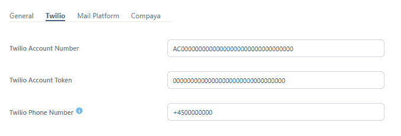

# Twilio

### Overview

Twilio is one of the three SMS providers Tourpaq can send SMS through. With Twilio, Tourpaq sends your company's SMS through your own Twilio account, from one Twilio phone number or sender ID, for all your brands. A separate account or sender per brand isn't possible.

Tourpaq only sends. Delivery reports and replies stay in Twilio.

Which SMS Tourpaq sends, when, and with which status is the same for every provider: see [How Tourpaq sends SMS](../../sms-overview.md#how-tourpaq-sends-sms).

Go to **Setup** › **System Setup** › **SMS Config** › **Twilio**.


The **Twilio Account Token** gives full access to your Twilio account. Give access to **System Setup** only to users who may see it. If the token is exposed, change it in Twilio and enter the new one here.


### Purpose

* Send the SMS that Tourpaq creates, such as booking SMS, offer reminders, and two-factor login codes, through your own Twilio account.
* Choose the number or name your customers see as the sender.

### Configuration fields

<figure><figcaption>
The Twilio tab on SMS Config.
</figcaption></figure>

| **Field**                 | **Description**                                                                                                                                                                       |
| ------------------------- | ------------------------------------------------------------------------------------------------------------------------------------------------------------------------------------- |
| **Twilio Account Number** | Your Twilio **Account SID**.                                                                                                                                                          |
| **Twilio Account Token**  | Your Twilio **Auth Token**.                                                                                                                                                           |
| **Twilio Phone Number**   | The sender of every SMS: a Twilio phone number in E.164 format, such as `+4512345678`, or an alphanumeric sender ID, such as your company name, in countries where Twilio allows one. |

All three fields are required. If one is empty, Tourpaq sends no SMS and keeps them in the queue.

### How to set it up

1. Ask Tourpaq Support to turn on **SMS integration** for your company and to schedule the **SMS Service**.
2. In Twilio, create or open your account, and get a phone number or sender ID that can send SMS to your customers' countries.
3. In the Twilio Console, copy the **Account SID** and the **Auth Token**.
4. In Tourpaq, go to **Setup** › **System Setup** › **SMS Config** › **Twilio**.
5. Enter the three fields, and click **Save**.
6. On the **General** tab, select **Twilio** in **SMS Provider**, and click **Save**.
7. Send a test SMS: in **All Bookings**, select a booking and open the SMS dialog, write a short text and click **Test**. Tourpaq sends it to your brand's phone number, not to the booking's customer, on the next run of the SMS Service.
8. In **Tickets** › **SMS Overview**, check that the SMS has the status **sent**, and that it arrived.

### What Tourpaq sends to Twilio

For each SMS, Tourpaq sends Twilio:

* **To**: the phone number, formatted as described in [Phone numbers](../../sms-overview.md#phone-numbers). With Twilio, a leading `0` stays.
* **From**: the **Twilio Phone Number**.
* **Body**: the SMS text, cut after 160 characters unless **Remove Body Limitation** is selected on the **General** tab.

When Twilio accepts the SMS, it gets the status **sent**, and Tourpaq keeps Twilio's message SID with it, so Tourpaq Support can find the SMS in Twilio.

For your IT staff: Tourpaq sends each SMS through Twilio's .NET library, authenticated with the Account SID and the Auth Token, with `To`, `From`, and `Body`. It sets no status callback, so Twilio reports nothing back to Tourpaq.

### Troubleshooting

* **SMS stay queued:** check that all three fields are filled in and that **Twilio** is selected in **SMS Provider**. If they are, ask Tourpaq Support whether the SMS Service runs for your company.
* **SMS fail:** Twilio refused them, for example because of a number Twilio doesn't accept. Tourpaq doesn't keep Twilio's error message: Tourpaq Support finds it in the SMS Service's log.
* **Wrong or expired token:** Twilio refuses every SMS. Each one gets the status **failed**, and Tourpaq doesn't send it again. Correct the token as soon as you see failed SMS; SMS created after that go out on the next run.
* **SMS is sent but not delivered:** Tourpaq shows **sent** when Twilio accepted the SMS. Check the delivery status in Twilio's message logs, and the phone number format.
* **Wrong sender number:** check the **Twilio Phone Number**. All your brands send from it.
* **Only some countries work:** Check Twilio account settings and country restrictions.

### Related pages

* [SMS Overview](../../sms-overview.md)
* [How Tourpaq sends SMS](../../sms-overview.md#how-tourpaq-sends-sms)
* The other SMS providers: [Compaya](compaya/) and [Mail Platform](system-setup-mail-platform.md) (deprecated)
