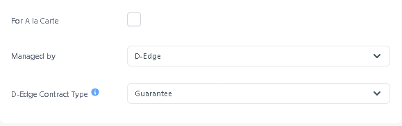
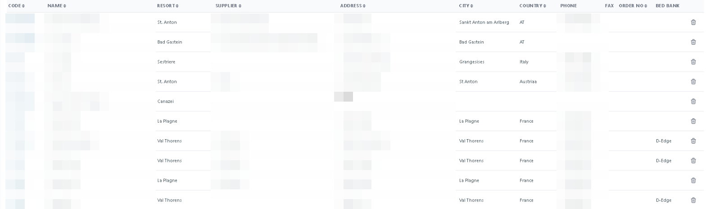
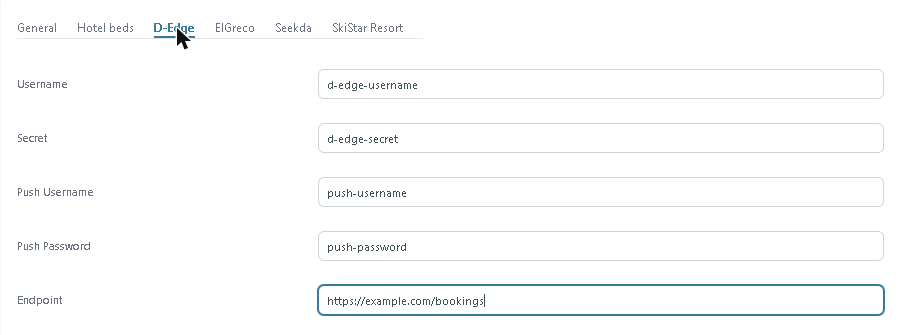
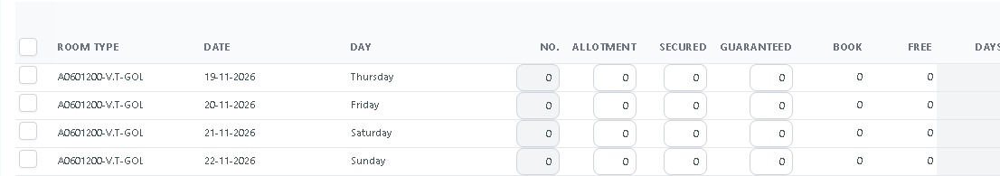

# D-Edge integration

**Setup › System Setup › Hotel Providers › D-Edge** and **Hotel › Hotels**

## Purpose

D-Edge (formerly Availpro) is a channel manager. A hotel that uses it keeps its room availability and prices in D-Edge, and Tourpaq receives them from D-Edge, so you don't maintain them by hand.

A hotel can sell its rooms on an allotment or a guarantee contract. The **D-Edge Contract Type** of the hotel tells Tourpaq which of the two D-Edge availability is.

## How to use

Before you start, make sure the [D-Edge connection of the company](d-edge-integration.md#before-you-start) is set up.

### Set up a hotel managed by D-Edge

1. Go to **Hotel › Hotels** and open the hotel.
2. On the **Overview** tab, in **Basic setup**, expand **Additional settings**.
3. In **Managed by**, select **D-Edge**. **D-Edge Contract Type** appears below it, set to **Allotment**.
4. For a guarantee hotel, select **Guarantee** in **D-Edge Contract Type**.
5. Click **Save**.

<figure><figcaption>
D-Edge Contract Type below Managed by.
</figcaption></figure>

D-Edge identifies the hotel by its Tourpaq hotel ID and each room by the room code of the room type. A room code that doesn't exist on the hotel is rejected.

### Change the contract type of a hotel

1. Go to **Hotel › Hotels** and open the hotel.
2. In **Additional settings**, select the other value in **D-Edge Contract Type**.
3. Click **Save**.

The change applies from the next availability update that D-Edge sends. Tourpaq doesn't recalculate the rooms it already has.


After you change a hotel to **Guarantee**, **GUARANTEED** shows the correct numbers only after D-Edge sends its next availability update.


### Where it shows up

* **Hotel › Hotels › Allotment per Day**: the rooms D-Edge sends, in the columns that the contract type decides (see [Which column D-Edge updates](d-edge-integration.md#which-column-d-edge-updates)).
* **Hotel › Hotels › Room Costs**: the prices D-Edge sends, converted to the currency of the hotel's creditor. If the hotel has no creditor currency, Tourpaq uses the company currency.
* **Price lists**: when D-Edge sends availability for dates that have no allotment yet, Tourpaq schedules a price list update for the room.
* **Hotel list**: the **Bed Bank** column shows **D-Edge** for hotels managed by D-Edge.
* **Bookings**: D-Edge can retrieve the bookings of its hotels from Tourpaq, and Tourpaq can push a booking to the endpoint of the **D-Edge** tab.

<figure><figcaption>
Hotels managed by D-Edge in the hotel list.
</figcaption></figure>

## Reference

### Before you start

* Only an administrator can set up the connection. See [System Setup – Hotel Providers](system-setup-hotel-providers.md).
* Agree the credentials with D-Edge and keep them private. Send them to Tourpaq Support in a secure way, never in a ticket comment or an email thread with other people.
* Each room type that D-Edge updates needs a room code that matches the room code in D-Edge. Prices use the rate code 1.

Set up the connection:

1. Go to **Setup → System Setup → Hotel Providers** and open the **D-Edge** tab.
2. Enter the values in the table that follows.
3. Click **Save**.

| Field                                   | Description                                                                               |
| --------------------------------------- | ----------------------------------------------------------------------------------------- |
| **Username** and **Secret**             | The login that D-Edge sends with every request. Tourpaq accepts only requests that match. |
| **Push Username** and **Push Password** | The login that Tourpaq uses when it sends a booking to D-Edge.                            |
| **Endpoint**                            | The address that Tourpaq sends bookings to.                                               |

<figure><figcaption>
The D-Edge tab (sample values).
</figcaption></figure>

### Configuration

**D-Edge Contract Type** is in **Hotel › Hotels › Overview › Basic setup › Additional settings**, directly below **Managed by**.

| Field                    | Description                                                                                     | Values                                                               | Required |
| ------------------------ | ----------------------------------------------------------------------------------------------- | -------------------------------------------------------------------- | -------- |
| **Managed by**           | The external system that manages the hotel's rooms.                                             | **D-Edge**, **Oracle Opera**, **Hotelbeds**, **SkiStar**, **Seekda** | No       |
| **D-Edge Contract Type** | Shown only when **Managed by** is **D-Edge**. Hover over the info icon for a short explanation. | **Allotment** (default), **Guarantee**                               | Yes      |

If you select another option in **Managed by**, Tourpaq clears **D-Edge Contract Type**.

#### Which column D-Edge updates

| D-Edge Contract Type | NO.                                                                      | GUARANTEED                         |
| -------------------- | ------------------------------------------------------------------------ | ---------------------------------- |
| **Allotment**        | Set to the rooms D-Edge sends, plus the rooms already booked in Tourpaq. | Emptied.                           |
| **Guarantee**        | Set to the rooms D-Edge sends, plus the rooms already booked in Tourpaq. | Set to the same number as **NO.**. |

The columns are on **Hotel › Hotels › Allotment per Day**.

<figure><figcaption>
The NO. and GUARANTEED columns that D-Edge updates.
</figcaption></figure>

#### Existing hotels

Every hotel that was managed by D-Edge (Availpro) before contract types existed has the contract type **Allotment**. A hotel without a value works as **Allotment**. To change a hotel to **Guarantee**, follow [Change the contract type of a hotel](d-edge-integration.md#change-the-contract-type-of-a-hotel).

#### Troubleshooting

* **No availability arrives for a hotel:** check that **Username** and **Secret** on the **D-Edge** tab are the ones D-Edge sends.
* **D-Edge reports a room as invalid or not configured:** add the room code that D-Edge sends to a room type of the hotel, or correct the room code in D-Edge.
* **D-Edge reports that the hotel is not linked:** the hotel ID that D-Edge uses is not a hotel of your company. Use the Tourpaq hotel ID.
* **Prices don't update:** D-Edge must send rate code 1, and Tourpaq needs a currency rate from the currency of D-Edge to the currency of the hotel's creditor.
* **The numbers on a hotel changed to Guarantee are wrong:** wait for the next availability update from D-Edge.

## Related pages

* [Hotel Providers](./)
* [System Setup – Hotel Providers](system-setup-hotel-providers.md)
* [Hotel creation](../../hotel/hotel-creation/)
