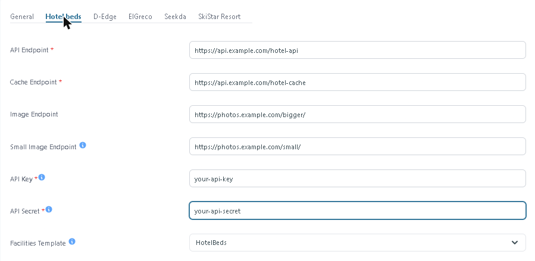

# Hotelbeds integration

**Setup › System Setup › Hotel Providers › Hotel beds** and **Hotel › Hotel Bed Bank**

## Purpose

Hotelbeds is a bed bank. With the connection set up, Tourpaq imports hotel content, contracts, availability, prices, and images from Hotelbeds, so you don't create these hotels by hand.

## How to use

Before you start, [set up the connection](hotelbeds-integration.md#before-you-start).

### Import a hotel from Hotelbeds

1. Go to **Hotel → Hotel Bed Bank**.
2. Search by country, destination, hotel name, or available contracts.
3. Review the contract information: room mappings, contract details, facilities, and available room types.
4. Select the contract, the room mappings, the facilities, the resort, and the hotel photos.
5. Save the hotel.

After the import, the hotel's information, images, prices, and availability are available in Tourpaq. Some data can take a few minutes to show.

### Example

An administrator wants to add a new hotel in Mallorca.

1. Open **Hotel Bed Bank**.
2. Search for Mallorca hotels.
3. Review the available contracts.
4. Select the room mappings.
5. Import the hotel details and images.
6. Save the hotel.

The hotel is then available for booking creation, dynamic packages, availability searches, and online sales.

### Where it shows up

Imported hotels are standard Tourpaq hotels, and you manage them in **Hotel → Hotels**. You can:

* Assign them to resorts.
* Connect them to suppliers.
* Configure them with room types.
* Include them in allotments.
* Use them in bookings.
* Publish them online.

Imported hotels work next to hotels you create by hand.

## Reference

### Before you start

* Only an administrator can set up the connection.
* Get the API credentials from Hotelbeds, and keep them private. Provider credentials are sensitive: limit access, and rotate them if you suspect exposure.

Set up the connection:

1. Go to **Setup → System Setup → Hotel Providers** and open the **Hotel beds** tab.
2. Enter the values in the table that follows.
3. Click **Save**.

After you save, Tourpaq can import hotel content and contract information.

### Configuration

| Field                    | Description                                               | Required |
| ------------------------ | --------------------------------------------------------- | -------- |
| **API Endpoint**         | URL endpoint for API communication.                       | Yes      |
| **Cache Endpoint**       | Endpoint for cached hotel data.                           | Yes      |
| **Image Endpoint**       | Endpoint for full-size hotel images.                      | No       |
| **Small Image Endpoint** | Endpoint for small hotel images, used on the import page. | No       |
| **API Key**              | Credential from Hotelbeds for authentication.             | Yes      |
| **API Secret**           | Credential from Hotelbeds for authentication.             | Yes      |
| **Facilities Template**  | Template that Tourpaq uses to map hotel facilities.       | No       |

<figure><figcaption>
The Hotel beds tab (sample values).
</figcaption></figure>

### Troubleshooting

* **No availability or prices import:** verify the credentials first, then the endpoints.
* **Images don't import:** verify **Image Endpoint** and **Small Image Endpoint**.

## Related pages

* [System Setup – Hotel Providers](system-setup-hotel-providers.md)
* [Hotel Providers](./)
