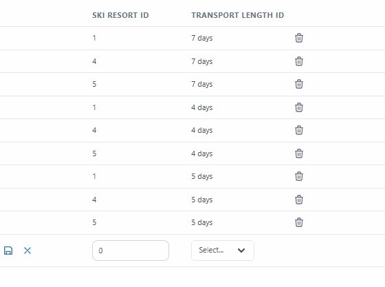
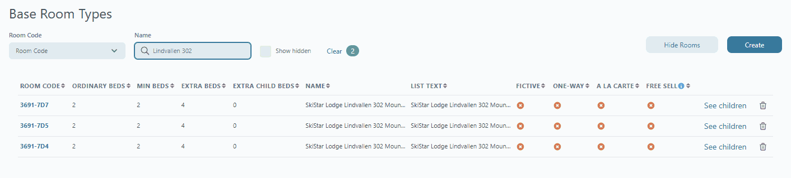
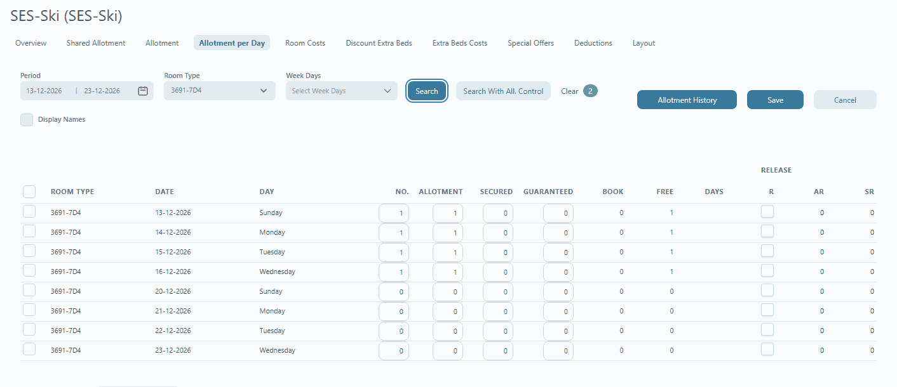

# SkiStar integration

SkiStar runs ski resorts in Sweden and Norway and rents out houses and apartments there through its Booking API. The SkiStar integration lets Tourpaq sell those accommodations in package trips: Tourpaq keeps their allotment and cost in line with SkiStar, and asks SkiStar before a booking takes one.

## Overview

In Tourpaq, SkiStar is a hotel provider, like D-Edge, Hotelbeds or Opera. A hotel with **Managed by: Skistar** gets its allotment and cost from SkiStar instead of from a hotel contract. Each SkiStar resort is one or more hotels in Tourpaq, and each SkiStar accommodation is a room type on such a hotel, one for each stay length you sell. From there, the rooms work like any other hotel's: you put them on price lists with your transports, and Tourpaq Office and Web Booking sell the packages.

<figure><figcaption><p>The parts of the integration.</p></figcaption></figure>

Data moves in both directions:

* **SkiStar → Tourpaq: allotment and cost.** Twice a day, **SkiStar Sync** asks SkiStar which accommodations are free for each Sunday arrival and stay length, and at what price. It writes the answer to the hotel's **Allotment per Day** (free `1` or `0`) and **Room Costs** (**Per Room Per Stay**). Price lists that use the rooms pick up the new values.
* **Tourpaq → SkiStar: availability check.** When a booking takes a SkiStar room, in Tourpaq Office or on Web Booking, Tourpaq asks SkiStar whether the accommodation is still free for the booking's dates. If it is not, the booking stops.


Tourpaq does **not** create bookings in SkiStar. Book the accommodation in SkiStar's own system after the booking is made in Tourpaq.


In SkiStar, every accommodation is one unit: one house or one apartment. SkiStar organises them as **Resort → Area → SubArea → Group → Accommodation**. Tourpaq uses only the resort and the accommodation.

**What must match**

| Tourpaq                                                            | SkiStar                         | Rule                                                                                          | Example                                                     |
| ------------------------------------------------------------------ | ------------------------------- | --------------------------------------------------------------------------------------------- | ----------------------------------------------------------- |
| Hotel **SkiStar Resort ID**                                        | Resort ID                       | Identical. Several hotels can have the same resort ID.                                        | `5` = Trysil                                                |
| Base room type **Room Code**                                       | Accommodation ID, plus the stay | `<Accommodation ID>-<weekday>D<nights>` — see [Room codes](skistar-integration.md#room-codes) | `23030-7D4` = accommodation 23030, Sunday arrival, 4 nights |
| **System Setup → Hotel Providers → SkiStar Resort**                | Stay lengths sold in the resort | One row per resort and stay length                                                            | Resort `5`, `4D`                                            |
| [Transport Stay Days](../../setup/transport-stay-days.md) **Days** | Stay length in nights           | Same number                                                                                   | `4D` = 4 days                                               |
| Price list transport                                               | The room's stay                 | Same length                                                                                   | `23030-7D4` only with 4-day transports                      |
| Hotel creditor currency                                            | Price currency                  | Same currency. Tourpaq does not convert.                                                      |                                                             |

The sync covers Sunday arrivals with stays of up to 7 nights, for the current and the next ski season. The details are under [How it works](skistar-integration.md#how-it-works).

## Before you start

* Tourpaq Support has connected the company to SkiStar. See [Connect the company to SkiStar](skistar-integration.md#connect-the-company-to-skistar).
* You know the SkiStar resort IDs and accommodation IDs you sell.
* Each stay length you sell exists in [Transport Stay Days](../../setup/transport-stay-days.md), e.g. `4D` with **Days** `4` and `7D` with **Days** `7`.
* Your transports for SkiStar trips have those stay lengths.
* The hotel's creditor uses the same currency as SkiStar's prices. Tourpaq stores SkiStar's prices without currency conversion.

## Set up the SkiStar integration

### Connect the company to SkiStar

Tourpaq Support sets up the SkiStar connection, one per company. There is no screen for it. Send Tourpaq Support:

| Required                | Where it comes from                                                                     | Used for                             |
| ----------------------- | --------------------------------------------------------------------------------------- | ------------------------------------ |
| **SkiStar API address** | SkiStar: the live address (`https://www.skistar.com`) or the test address they give you | The address of every call to SkiStar |
| **Identity**            | SkiStar: your agent name in their Booking API                                           | Sent as `Identity` on every call     |
| **API key**             | SkiStar: the key that belongs to that identity                                          | Sent as `apikey` on every call       |


The API key gives access to SkiStar on your behalf. Send it to Tourpaq Support in a secure way, never in a ticket comment or an email thread with other people.


Tourpaq Support also turns on the **SkiStar** access feature for the company (SuperAdmin, **Users → Companies → the company → Access features → Going Dynamic**). Without it, the sync skips the company.

### Add the stay lengths for each resort

The SkiStar Resort tab tells the sync which stay lengths to fetch for each SkiStar resort.

1. Go to **Setup → System Setup → Hotel Providers → SkiStar Resort**.
2. Select **Create**. A new row appears at the bottom of the list.
3. In the new row, enter the **Ski Resort ID**.
4. In **Transport Length ID**, select the stay length by its Transport Stay Days name, e.g. `4D` or `4 days`.
5. Select the save icon at the start of the row. The **X** next to it discards the row.
6. Repeat for each resort and stay length you sell.

<figure><figcaption><p>Resorts 1, 4 and 5 synced for 4, 5 and 7 days, and a new row after Create.</p></figcaption></figure>

Example:

| Ski Resort ID  | Transport Length ID |
| -------------- | ------------------- |
| `1` (Sälen)    | `7D`, `5D`          |
| `4` (Hemsedal) | `7D`, `5D`, `4D`    |
| `5` (Trysil)   | `7D`, `5D`, `4D`    |

Stay lengths longer than 7 days are not synced. See [System Setup – Hotel Providers](system-setup-hotel-providers.md#skistar-resort).

### Mark the hotel as managed by SkiStar

1. Open the hotel and go to the **General** tab.
2. In **Managed by**, select **Skistar**.
3. In **SkiStar Resort ID**, enter the SkiStar resort ID, e.g. `1`.
4. Save the hotel.

<figure><figcaption><p>Managed by Skistar, with the SkiStar Resort ID below it.</p></figcaption></figure>

### Create a room type per accommodation and stay length

SkiStar can sell an accommodation for one stay length and not for another over the same dates, e.g. 7 nights but not 4. Tourpaq therefore keeps one room type per accommodation and stay length, each with its own allotment and cost.

1. For each SkiStar accommodation and each stay length you sell, create a [base room type](../../base-room-types.md) with the Room Code `<Accommodation ID>-<weekday>D<nights>`. See [Room codes](skistar-integration.md#room-codes).
2. Add the base room types to the hotel.

<figure><figcaption><p>Three room types for SkiStar accommodation 3691: 7, 5 and 4 nights from Sunday.</p></figcaption></figure>

Create a room type only for the stay lengths you sell.

### Create the price lists

The sync fills allotment and cost. It does not create price lists.

1. Wait for the first sync. Then check **Allotment per Day** and **Room Costs** on the hotel.
2. Create the price lists for the SkiStar rooms and add the profit.
3. Put each room type only on price lists whose transport has the room's stay length: `23030-7D4` with 4-day transports, `23030-7D7` with 7-day transports.


Tourpaq does not check the stay length on price lists. A room type on a price list with another stay length sells with the wrong availability and cost.


After that, the sync keeps the price lists up to date: when it changes allotment or cost, the price lists that use the room get the new values, and the profit margin rules run again.

## Everyday tasks

### Add a SkiStar accommodation

1. Create the base room types for the accommodation, one per stay length (`<Accommodation ID>-7D<nights>`).
2. Add them to the hotel with the accommodation's SkiStar resort ID.
3. After the next sync, add the room types to the price lists with the matching stay length.

### Sell a new stay length

1. If the stay length is missing in [Transport Stay Days](../../setup/transport-stay-days.md), create it.
2. On **System Setup → Hotel Providers → SkiStar Resort**, add a row for each resort that sells it.
3. Create the room types with that stay in the code, e.g. `-7D4`.
4. After the next sync, create the price lists with transports of that length.

### Stop syncing a room

Hide the room on the hotel. The sync skips hidden rooms. The allotment and cost already in Tourpaq stay as they are.

### Check what the sync wrote

* **Hotel → Allotment per Day:** for SkiStar rooms, **Free** is `1` when SkiStar has the accommodation free, otherwise `0`. See [Allotments per day](../../hotel/hotel-creation/allotments-per-day/#skistar-allotment-per-day).

<figure><figcaption><p>3691-7D4: SkiStar has it free for 4 nights from Sunday 13 December, not from Sunday 20 December.</p></figcaption></figure>

* **Hotel → Room Costs → Room Cost Rules:** one **Per Room Per Stay** rule per room, arrival Sunday and transport length.

<figure><figcaption><p>Room costs written by the sync, per room and transport length.</p></figcaption></figure>

## How it works

### When the sync runs

The sync runs twice a day, at 02:00 and 14:00. It is the service **Hotel Configurator Service SkiStar** (`HCSS`) in **Application → Running Services** (SuperAdmin only).

It includes every company with the **SkiStar** access feature and a SkiStar connection, and every hotel of that company with **Managed by: Skistar** and a SkiStar Resort ID.

### Season

A SkiStar season runs from **12 December to 20 April** the year after. Between 12 December and 20 April, the sync also fetches the next season, which SkiStar usually opens in December.

| Today                            | Synced                                                      |
| -------------------------------- | ----------------------------------------------------------- |
| 12 December 2026 – 20 April 2027 | Today – 20 April 2027, and 12 December 2027 – 20 April 2028 |
| 21 April 2027 – 11 December 2027 | 12 December 2027 – 20 April 2028                            |
| 12 December 2027 – 20 April 2028 | Today – 20 April 2028, and 12 December 2028 – 20 April 2029 |

### Requests to SkiStar

For each SkiStar resort ID, the sync asks SkiStar about every Sunday in the synced period: the first Sunday on or after the start, then every 7 days. For each Sunday, it asks for each stay length set up for the resort, the longest first.

Each question is one call to `/BookingApi/v1/FixedPeriodProduct/Search` with:

| Parameter       | Value                                       |
| --------------- | ------------------------------------------- |
| `ArrivalDate`   | The Sunday, `YYYYMMDD`                      |
| `DepartureDate` | The Sunday plus the stay length, `YYYYMMDD` |
| `rid`           | The SkiStar resort ID                       |
| `adults`        | Always `2`                                  |

SkiStar answers with the accommodations that are free for that stay, with their price and currency. The sync also reads the accommodation's details from `/BookingApi/v1/Accommodation`.

A stay length with no room types for it is not requested. A season of about 18 Sundays with 3 stay lengths gives about 54 searches per resort; between 12 December and 20 April, the next season adds as many again.

### Room codes

The Room Code of a SkiStar room type has three parts: `<Accommodation ID>-<weekday>D<nights>`.

| Part             | Meaning                                                                                              |
| ---------------- | ---------------------------------------------------------------------------------------------------- |
| Accommodation ID | The SkiStar accommodation ID, e.g. `23030`                                                           |
| weekday          | The arrival weekday: 1 = Monday … 7 = Sunday. The sync covers Sunday arrivals, so this is always `7` |
| nights           | The stay length in nights; one of the stay lengths set up for the resort                             |

Example for accommodation 23030 in a resort with the stay lengths 4, 5 and 7:

| Room Code   | Sold as                  |
| ----------- | ------------------------ |
| `23030-7D4` | Sunday arrival, 4 nights |
| `23030-7D5` | Sunday arrival, 5 nights |
| `23030-7D7` | Sunday arrival, 7 nights |

The sync and the booking check send SkiStar only the part before the dash: `23030`.

**Room codes without a stay.** A Room Code with only the accommodation ID (`23030`) is still synced, for backward compatibility. Such a room gets every stay length set up for the resort, on one allotment. The longest stay is written first and each shorter stay overwrites the nights it covers, so the first nights of the week show the shortest stay's availability. Use stay codes for rooms SkiStar sells differently per stay length.

A Room Code with a dash but another ending, e.g. `23030-7X4`, is skipped.

### Allotment

For each room and each night of the stay (from the arrival Sunday to the last night), the sync sets the allotment:

* SkiStar returned the accommodation: allotment = rooms booked + 1. **Free** is `1`.
* SkiStar did not return it: allotment = rooms booked. **Free** is `0`.

If the room has no allotment period for the synced dates, the sync creates it.

### Cost

The cost price is calculated from SkiStar's `prices` container:

```
Cost = prices.gross – prices.commission + mandatoryaddonprice.gross
```

The sync stores it as a room cost rule on the hotel (**Hotel → Room Costs**):

| Field                               | Value                                                        |
| ----------------------------------- | ------------------------------------------------------------ |
| **Room**                            | The room type                                                |
| **Arrival start** / **Arrival end** | The arrival Sunday / the last night of the stay              |
| **B.Start date** / **B.End date**   | The day the rule is created / two years later                |
| **Price**                           | The cost from SkiStar, for the whole stay                    |
| **Stay type**                       | Per Room Per Stay                                            |
| **Transport length**                | The Transport Stay Days entry with the stay's number of days |

Each sync updates the price when SkiStar returns the accommodation. When SkiStar no longer returns it, the last price stays and only the allotment drops. If no Transport Stay Days entry has the stay's number of days, the sync writes the allotment but no cost.

### Availability check when booking

When a booking takes a room on a hotel managed by SkiStar (a new booking, or a change that needs a room the booking does not hold yet), Tourpaq asks SkiStar whether the accommodation is free for the booking's real check-in and check-out dates. Web Booking makes the same check when it prices an offer.

* Free: the booking continues.
* Not free, or SkiStar gives no answer: the booking stops with **There are no prices available for rooms: `<Room Code>`**.

The check waits for SkiStar. When SkiStar's API is slow, offers and bookings on SkiStar hotels are slow too.

### Limits

* Sunday arrivals only.
* Stays of up to 7 nights.
* Prices are for 2 adults.
* One accommodation per room type, so the free allotment is never more than `1`.
* No bookings, images or descriptions are sent to or taken from SkiStar.

## Messages

| Message                                                | Where          | What to do                                                                                                                                       |
| ------------------------------------------------------ | -------------- | ------------------------------------------------------------------------------------------------------------------------------------------------ |
| There are no prices available for rooms: `<Room Code>` | Booking, offer | SkiStar has sold the accommodation since the last sync, or SkiStar did not answer. Choose another room. The next sync sets the allotment to `0`. |
| Missing configuration for Skistar!                     | Booking, offer | The company has no SkiStar connection. Contact Tourpaq Support.                                                                                  |

## Troubleshooting

* **Nothing updates:** check that the company has the **SkiStar** access feature and a SkiStar connection, and that the hotel has **Managed by: Skistar** and a **SkiStar Resort ID**.
* **One hotel does not sync:** check that its SkiStar Resort ID has rows on **System Setup → Hotel Providers → SkiStar Resort**.
* **A room gets no allotment or cost:** check that the Room Code is `<Accommodation ID>-7D<nights>`, that the resort has a row for that stay length, and that the room is not hidden. Rooms only get Sunday arrivals inside the synced season.
* **A room gets allotment but no cost:** create the stay length in [Transport Stay Days](../../setup/transport-stay-days.md).
* **Offers show a room with the wrong stay, or twice:** the room type is on price lists with another stay length. Remove it from those price lists.
* **Allotment of a room without a stay in its code looks wrong for 4- or 5-night stays:** give the room a stay code. See [Room codes without a stay](skistar-integration.md#room-codes).
* **Web Booking is slow on SkiStar hotels:** SkiStar's API is answering slowly. See [Availability check when booking](skistar-integration.md#availability-check-when-booking).

## Related pages

* [System Setup – Hotel Providers](system-setup-hotel-providers.md)
* [General tab](../../hotel/hotel-creation/general-tab.md)
* [Allotments per day](../../hotel/hotel-creation/allotments-per-day/)
* [Transport Stay Days](../../setup/transport-stay-days.md)
* [Base room types](../../base-room-types.md)
* [Add room cost rule with "Per Room Per Stay" with a specific stay days value](../../hotel/hotel-creation/room-cost/room-cost-rules/add-room-cost-rule-with-per-room-per-stay-with-a-specific-stay-days-value.md)
