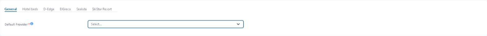

# System Setup – Hotel Providers

### Overview

Hotel Providers configures integrations to external hotel systems.

This includes bed banks and channel managers used to import availability, prices, and images.

Go to **Setup → System Setup → Hotel Providers**.


Provider credentials are sensitive.

Limit access and rotate credentials if you suspect exposure.


### Purpose

* Automate hotel data import from external providers.
* Ensure up-to-date availability, pricing, and images for bookings.
* Enable centralized management of hotel credentials for all agencies.

### Providers

The screen has one tab for each provider:

<figure><figcaption><p>The tabs of Hotel Providers.</p></figcaption></figure>

| Tab                | What you set up                                                                                                                      | More                                              |
| ------------------ | ------------------------------------------------------------------------------------------------------------------------------------ | ------------------------------------------------- |
| **General**        | **Default Provider**: the provider used for searching in live offer. The option for D-Edge is labeled **Availpro**.                  |                                                   |
| **Hotel beds**     | The Hotelbeds connection: endpoints, API key and secret, and the facilities template.                                                | [Hotelbeds integration](hotelbeds-integration.md) |
| **D-Edge**         | The D-Edge connection: login, push login, and endpoint.                                                                              | [D-Edge integration](d-edge-integration.md)       |
| **ElGreco**        | The ElGreco connection: URL, username, and password.                                                                                 |                                                   |
| **Seekda**         | The Seekda connection: credentials, requestor details, channel and PMS hotel IDs, and endpoint.                                      |                                                   |
| **SkiStar Resort** | The stay lengths SkiStar Sync fetches for each SkiStar resort. The SkiStar connection itself has no tab: Tourpaq Support sets it up. | [SkiStar integration](skistar-integration.md)     |

## Configuration

### Access

Navigate to:

```
Setup → System Setup → Hotel Providers
```

Only Administrator users can configure hotel provider integrations.

Each provider is set up on its own tab. The fields, the setup steps, and the troubleshooting of Hotelbeds and D-Edge are on their pages: [Hotelbeds integration](hotelbeds-integration.md) and [D-Edge integration](d-edge-integration.md).

### SkiStar Resort

#### Overview

The **SkiStar Resort** tab tells SkiStar Sync which stay lengths to fetch from SkiStar for each SkiStar resort. Each row is one resort and one stay length. See [SkiStar integration](skistar-integration.md).

For each row, the sync asks SkiStar about every Sunday arrival with that stay length, and updates allotment and cost on the room types coded for that stay, e.g. `-7D4` for 4 nights.

#### Page structure

<figure><figcaption><p>Resort 1 synced for 4-night and 7-night stays.</p></figcaption></figure>

| Column                  | Description                                                                                                                                            |
| ----------------------- | ------------------------------------------------------------------------------------------------------------------------------------------------------ |
| **Ski Resort ID**       | The resort's ID in SkiStar, e.g. `1` = Sälen, `4` = Hemsedal, `5` = Trysil. The same number as the **SkiStar Resort ID** on the hotels of that resort. |
| **Transport Length ID** | A stay length from [Transport Stay Days](../../setup/transport-stay-days.md), e.g. `4D`. Stay lengths longer than 7 days are not synced.               |

#### Add a stay length to a resort

1. Select **Create**. A new row appears at the bottom of the list.
2. In the new row, enter the **Ski Resort ID**.
3. In **Transport Length ID**, select the stay length.
4. Select the save icon at the start of the row. The **X** next to it discards the row.

Add one row per resort and stay length. To change a row, delete it and create a new one.

#### Remove a stay length from a resort

Select the trash icon on the row. From the next sync, SkiStar Sync no longer updates the rooms coded for that stay in that resort. Allotment and cost already in Tourpaq stay.

#### Example

| Ski Resort ID | Transport Length ID |
| ------------- | ------------------- |
| `1`           | `7D`                |
| `1`           | `5D`                |
| `4`           | `7D`                |
| `4`           | `5D`                |
| `4`           | `4D`                |

Hotels with SkiStar Resort ID `1` are synced for 7- and 5-night stays; hotels with `4` also for 4-night stays.

#### Why this matters

* Without a row for a resort, its hotels are not synced.
* Without a row for a stay length, the rooms coded for that stay get no allotment and no cost.
* Each stay length must also exist in Transport Stay Days, because SkiStar Sync stores the cost per transport length.

### Usage notes

* Only administrators can configure hotel provider integrations.
* Correct credentials are required to successfully fetch hotel availability, pricing, and images.
* Integration ensures bookings and pricing remain synchronized with external providers.

### Troubleshooting

* **No availability/prices imported:** Verify credentials first, then provider endpoints.
* **A SkiStar room gets no allotment or cost:** check that the hotel's SkiStar resort has a row for the room's stay length on the **SkiStar Resort** tab. See [SkiStar integration](skistar-integration.md#troubleshooting).
* **A provider worked yesterday but fails today:** Rotate credentials and check provider service status.
* **Provider-specific problems:** see [Hotelbeds integration](hotelbeds-integration.md#troubleshooting) and [D-Edge integration](d-edge-integration.md#troubleshooting).

## Administration

### Credential Management

Provider credentials are stored centrally in System Setup.

Benefits include:

* Single point of maintenance.
* Shared access across brands and agencies.
* Simplified integration management.

### Monitoring

Administrators should regularly verify:

* Connectivity status
* Import success
* Pricing synchronization
* Availability updates
* Contract validity

## Related pages

* [Hotel Providers](./)
* [Hotelbeds integration](hotelbeds-integration.md)
* [D-Edge integration](d-edge-integration.md)
* [SkiStar integration](skistar-integration.md)
