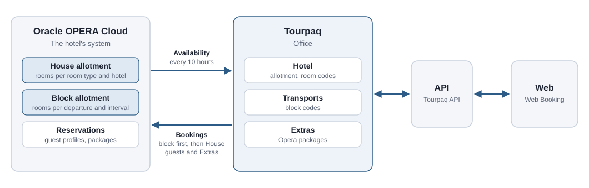
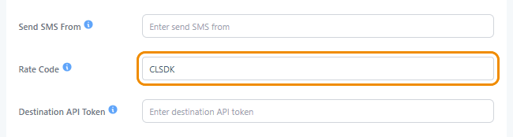
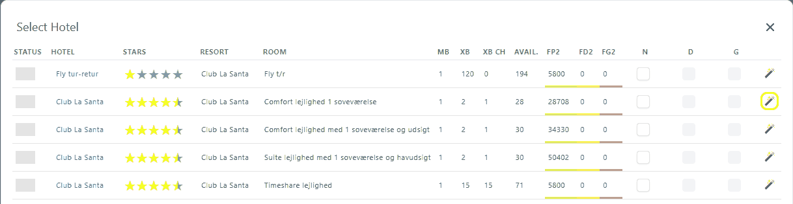
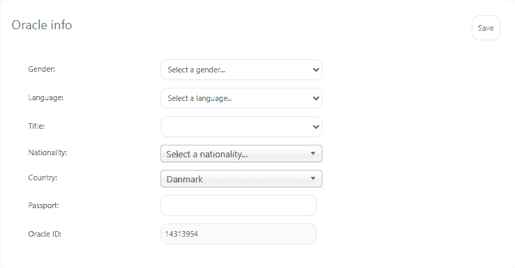
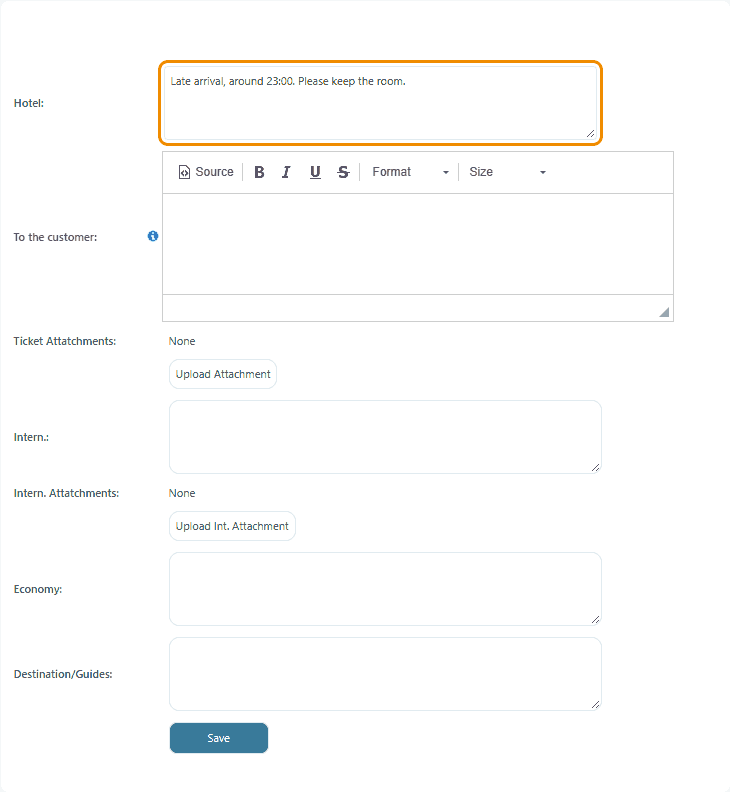
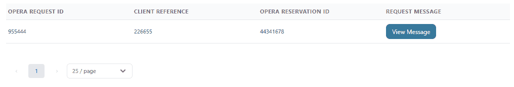
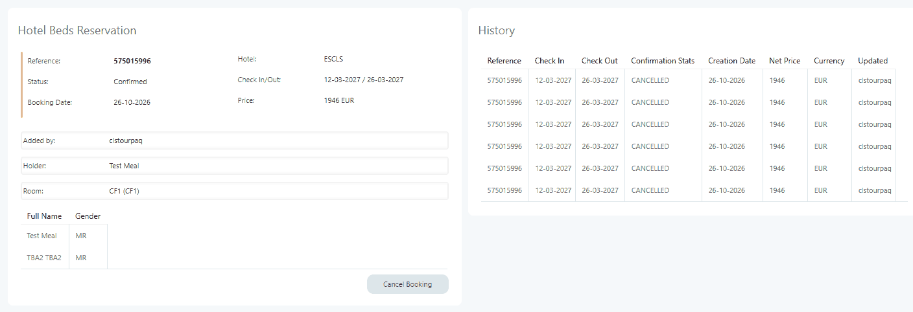

# Opera integration

Hotels on Oracle OPERA Cloud manage their rooms in Opera. The Opera integration lets Tourpaq sell those rooms and send every booking to the hotel as reservations in Opera.

## Overview

The integration connects Tourpaq with one Opera property per company. Opera holds the hotel's House allotment and its Block allotment. Tourpaq keeps its hotel allotment in line with Opera, and Tourpaq Office and Web Booking sell from it through the Tourpaq API.

<figure><figcaption>
The parts of the integration.
</figcaption></figure>

Data moves in both directions:

* **Opera → Tourpaq: availability.** Tourpaq reads the House general availability, the House room availability and the Block allotment from Opera into the hotel allotment every 10 hours. You can also update one price line at any time with **Reset Free Room Count**.
* **Tourpaq → Opera: reservations.** When you take allotment for a package trip, Tourpaq first searches the Block allotment of the booking's outbound transport. If the block does not have the room, Tourpaq uses the House allotment. It then creates one reservation per room. When you save passengers, Tourpaq updates the reservations with the guests, their Extras and their transport. When you cancel the booking, Tourpaq cancels the reservations.

The Opera confirmation number is shown on the booking's **Bed Bank** tab.

**What must match**

| Tourpaq                                                          | Opera          | Rule                                                               | Example (Club La Santa)                                                     |
| ---------------------------------------------------------------- | -------------- | ------------------------------------------------------------------ | --------------------------------------------------------------------------- |
| Hotel **Bed Bank ID**                                            | Property code  | Identical. Tourpaq sets it up.                                     | `ESCLS`                                                                     |
| **Room code** on the Room Types tab, and the base room type code | Room type code | Identical                                                          | `CF1` = `CF1`                                                               |
| Brand **Rate Code**                                              | Rate plan      | Identical                                                          | `CLSDK`                                                                     |
| Outbound transport: departure airport, date and interval         | Block code     | Built from the transport — see [Block codes](./#block-codes)       | BLL, 24 May 2027, interval 1 → `BLL2405271`                                 |
| Extra **Code**                                                   | Package code   | Identical, or the group format — see [Extra codes](./#extra-codes) | `BFADAG` → `BFADAG`; `HBADAG_BF5-DI12` → `BF5` and `DI12` in group `HBADAG` |


The data flows, the Opera API operations, the authentication and the field mapping are described in [Opera integration – technical reference](opera-integration-technical-reference.md).


## Before you start

* Tourpaq Support has set up the Opera connection for your company: the Opera endpoint, the credentials and the Opera property. Tourpaq Support also sets the hotel's **Bed Bank ID** to the property code. There is no screen for this.
* In Opera, the hotel has:
  * the room types you sell,
  * a rate plan for each brand that sells the hotel,
  * a travel agent profile for each brand, agreed with Tourpaq during setup,
  * definite (`DEF`) blocks for package trips, named by the [block-code rule](./#block-codes),
  * the packages that your Extras use.
* In Tourpaq, the hotel has a contract with the rates agreed with the hotel. Opera sends no cost to Tourpaq, so the hotel cost of a booking comes from this contract, as for any other hotel — see [Hotel Contracts](../../../hotel-contracts/hotel-contract-contract-name.md).

## Set up the integration

Do these tasks once per hotel, in this order.

### Mark the hotel as managed by Opera

1. Go to **Hotel → Hotels** and open the hotel.
2. On the **Basic setup** tab, open **Additional settings**.
3. In **Managed by**, select `OracleOpera`.
4. Click **Save**.

The hotel shows `OracleOpera` in the **BED BANK** column of the **Hotels** list. Select **Display only Bed Banks** to show only these hotels.

### Match the room codes

1. Open the hotel and go to the **Room Types** tab.
2. Compare each **ROOM CODE** with the room type code in Opera. In Opera, room type codes appear in the **Rooms Availability Summary** on the dashboard.
3. Correct any code that differs.
4. Go to **Base room types** and check that the base room type of each room has the same code.

Codes must match exactly, including upper and lower case.

### Set the brand Rate Code

1. Go to **System Setup → Brands** and select the brand.
2. On **General**, open **Other Settings**.
3. Under **Offers & API Integration**, enter the Opera rate plan in **Rate Code**, for example `CLSDK`.
4. Click **Save**.

Tourpaq uses this rate plan for the brand's reservations, block searches and availability checks.

<figure><figcaption>
The brand Rate Code, here Club La Santa's CLSDK.
</figcaption></figure>

### Set up the Extras

1. Go to **Extras Setup → Extras Category** and open the category.
2. Under **Settings**, set **Category Type** to `Opera Package` (packages, for example board) or `Opera Item Inventory` (inventory items).
3. Click **Save**.
4. Go to **Extras Setup → Extras** and open each Extra of the category.
5. Set **Code** as described in [Extra codes](./#extra-codes).
6. In Opera, open a reservation, click **Packages** and check that every package code exists in the list of available packages.

### Check the blocks in Opera

1. In Opera, go to **Bookings → Blocks → Manage Block**.
2. Search for the **Block Code** built from the transport — see [Block codes](./#block-codes).
3. Check that the block is a sub-block, not a master block, and that its **Block Status** is `DEF`.
4. Check that **Start Date** and **End Date** cover the stay, and that the block is under the brand's rate plan.
5. Check that the room types you want to sell have rooms on the block.

The block's rooms are added to the Tourpaq allotment at the next sync, or when you click **Reset Free Room Count** on the price line.

## Everyday tasks

### Update the allotment of a price line

Use this when Opera has changed and you don't want to wait for the next sync.

1. Open a booking. In the **Hotel** panel, click **Edit**. The **Select Hotel** window opens.
2. On the room's line, click **Reset Free Room Count** (the magic-stick icon at the end of the line).

Tourpaq reads Opera for the line's room type, from the departure date for the length of the trip, and shows `<n> allotments have been updated for room <code>!`. It then resets the free room count.

The icon is available to the roles SysAdmin, Administrator, BrandManager, Sales and Financial.

<figure><figcaption>
Reset Free Room Count at the end of each line in the Select Hotel window.
</figcaption></figure>

### Find the Opera reservation of a booking

1. Open the booking in Tourpaq Office and go to the **Bed Bank** tab.
2. Copy the **Reference**. This is the Opera confirmation number.
3. In Opera, go to **Bookings → Reservations → Manage Reservation**.
4. Enter the number in **Conf / Cxl / External** and click **Search**.

You can also search for the Tourpaq booking number in **Conf / Cxl / External**. Tourpaq sends it to Opera as the reservation's external reference.

Opera lists one line per room under the same confirmation number.

### Update a passenger's Opera profile

Use this to correct the guest data that Opera holds for a passenger, for example the nationality or the passport.

1. Open the booking and go to the **Passenger details** tab.
2. Click the passenger. The **Oracle info** panel shows the passenger's **Oracle ID**.
3. Edit **Gender**, **Language**, **Title**, **Nationality**, **Country** or **Passport**.
4. Click **Save** in the panel.

Tourpaq updates the passenger's Opera profile. The panel is shown for bookings with a hotel managed by Opera. Saving needs a passenger with an **Oracle ID**, which is filled in once the passengers have been saved and sent to Opera.

<figure><figcaption>
The Oracle info panel on the Passenger details tab.
</figcaption></figure>

### Send a comment to the hotel in Opera

Use this to give the hotel information about the booking, for example a late arrival or a special request.

1. Open the booking and go to the **Comments** tab.
2. Enter the text in **Hotel**.
3. Click **Save** at the bottom of the tab.

Tourpaq shows `Comments were saved!` and writes the text to every reservation of the booking in Opera, as an internal general comment (type `GEN`) titled `Tourpaq`.

* Each reservation has one `Tourpaq` comment. Every save replaces its text with the text in **Hotel**. Comments that the hotel adds in Opera are not changed.
* Only **Hotel** is sent. **To the customer**, **Intern.**, **Economy** and **Destination/Guides** stay in Tourpaq.
* The comment is sent when you click **Save** on the **Comments** tab, not when you save the booking or the passengers.
* The comment is sent only for a booking that has reservations in Opera, and not while **Disable Opera Connect** is selected. After you connect the booking again, click **Save** on the **Comments** tab to send the comment.

If Opera does not accept the comment, Tourpaq shows Opera's message instead of `Comments were saved!`. The comment is saved in Tourpaq.

<figure><figcaption>
The Hotel comment on the Comments tab is sent to Opera.
</figcaption></figure>

### Work on a booking without sending changes to Opera

Use this when you update Opera by hand.

**Before the booking exists:** select **Disable Opera Connect** before you click **Take Allotment**. Tourpaq does not check Opera and creates no reservation.

**For an existing booking:**

1. Open the booking.
2. In the booking summary panel on the right, select **Disable Opera Connect**.
3. Confirm the prompt. The setting is saved at once, and Tourpaq shows `Booking has been saved!`.
4. Make your changes and click **Save**.
5. In the confirmation dialog, click **Save**.

<figure><figcaption>
The Disable Opera Connect checkbox on the booking page.
</figcaption></figure>

While the checkbox is selected, nothing is sent to Opera: no booking or passenger changes, no comments and no **Oracle info** changes.

**To connect the booking again**, clear the checkbox and confirm the prompt. This needs the Administrator role or the user right **Allow User To Enable Opera Connection**. The next save sends the whole booking to Opera. A booking without reservations gets them at that save.

The checkbox is shown only for bookings with a hotel managed by Opera. The roles SysAdmin, Administrator, BrandManager, Sales and Financial can select it.


A booking or passenger cancelled while **Disable Opera Connect** is selected stays active in Opera. Cancel it in Opera yourself.


### Find Opera reservations without a Tourpaq booking

1. Go to **Notifications** and open the **Opera Mismatch** tab.
2. Check each line: **Client Reference** is the booking number the reservation was made for, **Opera Reservation ID** is the reservation in Opera. **View Message** shows the request Tourpaq sent.
3. Look up the reservation in Opera and cancel it there if the booking does not exist in Tourpaq.

The tab lists reservations that Tourpaq created in Opera for a booking number that does not exist in Tourpaq, for example when a booking failed after its first room was reserved. The tab is shown for companies with an Opera connection.

<figure><figcaption>
The Opera Mismatch tab.
</figcaption></figure>

## How it works

### When Tourpaq talks to Opera

| In Tourpaq                                                                    | In Opera                                                                                                                                                                                                            |
| ----------------------------------------------------------------------------- | ------------------------------------------------------------------------------------------------------------------------------------------------------------------------------------------------------------------- |
| **Take Allotment** on a booking that does not exist yet                       | Tourpaq checks that the block or House has the rooms. If so, it creates one reservation per room, with the booking customer as guest. The rooms share the first room's confirmation number and are linked in Opera. |
| **Take Allotment** on an existing booking (rooms, dates or transport changed) | Each room's reservation is updated. An added room gets a reservation, a removed room's reservation is cancelled.                                                                                                    |
| **Save** of the passengers (Office or Web Booking)                            | Each reservation is updated with its guests (matched to Opera profiles), their transport, and their Extras as packages or inventory items.                                                                          |
| **Save** on the **Comments** tab                                              | The **Hotel** comment is written to every reservation, titled `Tourpaq` — see [Send a comment to the hotel in Opera](./#send-a-comment-to-the-hotel-in-opera).                                                      |
| **Oracle info** saved on a passenger                                          | The passenger's Opera profile is updated.                                                                                                                                                                           |
| Booking cancelled                                                             | Every reservation is cancelled. If Opera refuses, Tourpaq shows Opera's message and the booking is not cancelled.                                                                                                   |
| Passenger cancelled                                                           | The reservation is updated at the next save of the booking.                                                                                                                                                         |

Every update sends the whole booking again, not only the changes. If the block code and room type are unchanged, the reservation stays where it is. If either changed, the reservation is moved: to the block if it has the rooms, otherwise to House.

### Block codes

A block holds rooms for one departure airport, one departure date and one interval. Tourpaq stores no link between a transport and a block. It builds the block code from the booking's outbound transport each time and looks it up in Opera.

| Part of the block code                            | Length | Example  |
| ------------------------------------------------- | ------ | -------- |
| Departure airport (IATA code)                     | 3      | `BLL`    |
| Departure date as DDMMYY                          | 6      | `240527` |
| Interval: the trip length in weeks (1, 2, 3 or 4) | 1      | `1`      |

Example: a trip from Billund on 24 May 2027 with interval 1 (one week) uses block `BLL2405271`. The same trip with interval 2 (two weeks) uses `BLL2405272`.

Tourpaq uses blocks for package trips with interval 1 to 4 that depart from **BLL** or **CPH**. Other bookings are made on House: departures from other airports and hotel-only bookings.

In Opera, Tourpaq uses the first block with the code that:

* has the status `DEF` (definite),
* is a sub-block, not a master block or master allocation,
* belongs to the brand's rate plan.


A block named outside this rule is not used by Tourpaq. Renaming a block code in Opera cuts the block off from Tourpaq bookings.


### Block or House

For every room, Tourpaq decides where the reservation goes:

1. If the booking has a block code and the block has the room on every night of the stay, the reservation is made in the block, at the block's rate.
2. Otherwise it is made on House, at the House rate, if Opera has the room type available for the stay under the brand's rate plan, for the number of adults and children.
3. If neither has the room, Tourpaq shows an error and creates no reservation — see [Messages](./#messages).

The reservation rates come from Opera. The Tourpaq price is not sent, and Opera sends no cost back: the hotel cost in Tourpaq comes from the hotel contract.

Rooms are reserved one at a time. When a booking needs more rooms than the block holds, the first rooms take the block and the rest go to House.

Hotel-only bookings are made on House and carry the internal note `OUTSIDE ALLOTMENT`.

One-way trips are transport only. They use the company's one-way hotel, which is not managed by Opera, so nothing is sent to Opera.

### Allotment from Opera

Tourpaq keeps the hotel allotment (**NO.** on the hotel's **Allotment** tab) in line with Opera. For every day it uses three Opera values:

| Value                          | Meaning                                                                         |
| ------------------------------ | ------------------------------------------------------------------------------- |
| **House general availability** | Rooms of the whole hotel that Opera has available, never below 0.               |
| **House room availability**    | Rooms of the room type that Opera has available on House, never below 0.        |
| **Block availability**         | Rooms left in each block with interval 1 or 2, for departures from BLL and CPH. |

**NO. = the smaller of House general availability and House room availability + rooms booked in Tourpaq + the rooms left in the blocks.**

Example: House room availability 5, House general availability 3, 2 rooms booked in Tourpaq, block `BLL2405271` has 4 rooms left and `CPH2405271` has 0. NO. = 3 + 2 + 4 + 0 = 9.

Price lines for hotel-only bookings get the smaller of House general availability and House room availability, plus the rooms booked on the price line, as their room limit.

**When the allotment is updated**

* **Every 10 hours**, for all price lines of the hotel. Contact Tourpaq Support to change how often.
* **When you click Reset Free Room Count** on a price line, for that price line — see [Update the allotment of a price line](./#update-the-allotment-of-a-price-line).

The update changes only these numbers, and only on days where they changed.

The allotment is read for a fixed list of room types set up by Tourpaq. Other room types of the hotel keep the allotment entered in Tourpaq.

Room types read from Opera

`CF1`, `CF2`, `CF22`, `CFV1`, `CFV2`, `CFV22`, `SP1`, `SP2`, `SP22`, `SP42`, `SU1SV`, `SU2`, `SU2SV`, `SU2H`, `SU3LUX`, `PH42`


For these room types, an allotment number entered by hand is overwritten at the next update from Opera.


### Extras sent to Opera

The Extra's category type decides what the Extra becomes in Opera:

| Category Type            | In Opera                                                      |
| ------------------------ | ------------------------------------------------------------- |
| **Opera Package**        | A package on the reservation, for example board.              |
| **Opera Item Inventory** | An inventory item on the reservation.                         |
| **Opera Baggage**        | Not supported. Extras in this category are not sent to Opera. |

Extras in other categories are not sent to Opera.

#### Extra codes

The Extra's **Code** is the link to Opera. Tourpaq has no mapping table, so the code must be the Opera code.

| Code in Tourpaq                           | Sent to Opera                                                                | Example                                                         |
| ----------------------------------------- | ---------------------------------------------------------------------------- | --------------------------------------------------------------- |
| `CODE`                                    | One package with that code.                                                  | `BFADAG` → package `BFADAG`                                     |
| `GROUP_CODE1-CODE2…`                      | One package per code after the underscore, all in the package group `GROUP`. | `HBADAG_BF5-DI12` → packages `BF5` and `DI12` in group `HBADAG` |
| Code of an **Opera Item Inventory** Extra | One inventory item with that code, as written.                               | —                                                               |

Rules for the group format:

* Use one underscore, between the group and the package codes.
* Separate the package codes with hyphens.
* The group and every package code must exist in Opera.

#### What is sent with an Extra

Extras are sent when the passengers are saved, and with every later update of the booking.

| Category Type            | Sent with the code                                                                                                                                                                                                                                                  | Not sent                        |
| ------------------------ | ------------------------------------------------------------------------------------------------------------------------------------------------------------------------------------------------------------------------------------------------------------------- | ------------------------------- |
| **Opera Package**        | Quantity: the passengers in the room with the Extra. Excluded quantity: the room's adults (or children) without it. Start: check-in. End: check-in plus the Extra's days, at the latest check-out; check-out when the Extra has no days. One schedule line per day. | Tourpaq price, Extra name       |
| **Opera Item Inventory** | Quantity, from check-in to check-out.                                                                                                                                                                                                                               | Tourpaq price, Extra name, days |

**Price.** The package price comes from Opera: the price already on the reservation for the same package and dates, otherwise the package rate in Opera.


Tourpaq manages the packages and inventory items on its reservations. Packages and items added in Opera are removed at the next update from Tourpaq. Add Extras in Tourpaq, not in Opera.


If Opera does not know a code, Opera rejects the update and Tourpaq shows `Unable to create booking reason: …` with Opera's reason. The passengers are saved in Tourpaq. Correct the Extra's code, or create the package in Opera, and save the passengers again.

### Data sent to Opera

| Data            | Sent                                                                                                                                                                                                                                                                     | When                                              |
| --------------- | ------------------------------------------------------------------------------------------------------------------------------------------------------------------------------------------------------------------------------------------------------------------------ | ------------------------------------------------- |
| **Reservation** | Booking number as reference, property, room type, rate plan, arrival and departure, adults and children (infants in a separate field), block or House and its rates, market and source, travel agent, guarantee and payment method, expected arrival and departure times | Take Allotment, and every update                  |
| **Guest**       | Before passengers exist: the booking customer (name, title, gender, language, nationality). Afterwards: every passenger of the room, the first as primary guest.                                                                                                         | Take Allotment, then every save of the passengers |
| **Transport**   | Per guest: arrival and departure station, date and time, carrier and transport number                                                                                                                                                                                    | Save of the passengers                            |
| **Extras**      | Packages and inventory items — see [Extras sent to Opera](./#extras-sent-to-opera)                                                                                                                                                                                       | Save of the passengers                            |
| **Comments**    | The **Hotel** comment from the booking's **Comments** tab, titled `Tourpaq`. `OUTSIDE ALLOTMENT` on hotel-only bookings.                                                                                                                                                 | **Save** on the **Comments** tab; Take Allotment  |

The source is `WEB` for Web Booking, `TSO` for timeshare owners and `AGE` for Office bookings. The market code follows the brand's country.

### Guest profiles

Every guest on a reservation is an Opera guest profile. Tourpaq reuses an existing profile when it finds one and creates a profile only when it does not.

**Take Allotment.** The booking customer is sent with the reservation. If the customer already has an Opera profile, that profile is used. Otherwise Opera creates one, and Tourpaq stores its ID on the customer.

**Save of the passengers.** For each passenger, the first match wins:

1. The Opera profile ID stored on the passenger, if the profile has the same full name.
2. A guest profile with exactly the same email address.
3. A guest profile with exactly the same phone number.
4. A guest profile with the same first and last name (not case-sensitive) and the same birthday, or no birthday in Opera.
5. No match: Tourpaq creates a guest profile.

One profile is used for one passenger per room.

**What Tourpaq writes to a matched profile:** first and last name, title, gender, language, nationality, birthday, phone, email, address and postcode, and the passenger type. Empty Tourpaq fields do not clear the Opera values.


A matched profile is overwritten with the Tourpaq values. Changes made to the profile in Opera are replaced at the next save of the passengers.


Enter the customer details before you click **Take Allotment**, to avoid duplicate profiles in Opera.

**Oracle info.** You can also edit a passenger's Opera profile from the booking — see [Update a passenger's Opera profile](./#update-a-passengers-opera-profile).

## Field reference

| Field                                     | Where                                                                                   | Description                                                                                                       |
| ----------------------------------------- | --------------------------------------------------------------------------------------- | ----------------------------------------------------------------------------------------------------------------- |
| **Managed by**                            | **Hotel → Hotels → hotel → Basic setup → Additional settings**                          | `OracleOpera` for hotels managed in Opera.                                                                        |
| **BED BANK**                              | Column in the **Hotels** list                                                           | Shows `OracleOpera`. Filter with **Display only Bed Banks**.                                                      |
| **Bed Bank ID**                           | Hotel, set up by Tourpaq                                                                | The Opera property code, for example `ESCLS`.                                                                     |
| **ROOM CODE**                             | Hotel **Room Types** tab                                                                | The Opera room type code, identical.                                                                              |
| Base room type code                       | **Base room types**                                                                     | The Opera room type code, identical.                                                                              |
| **NO.**                                   | Hotel **Allotment** tab                                                                 | Rooms available per day. Updated from Opera for the room types read from Opera.                                   |
| **Rate Code**                             | **System Setup → Brands → brand → General → Other Settings → Offers & API Integration** | The Opera rate plan for the brand, for example `CLSDK`.                                                           |
| **Category Type**                         | **Extras Setup → Extras Category → Settings**                                           | `Opera Package` or `Opera Item Inventory` sends the category's Extras to Opera. `Opera Baggage` is not supported. |
| **Code** (Extra)                          | **Extras Setup → Extras**                                                               | The Opera package or item code, or the group format.                                                              |
| **Reset Free Room Count**                 | **Select Hotel** window (booking → **Hotel** panel → **Edit**), at the end of a line    | Updates the line's allotment from Opera.                                                                          |
| **Disable Opera Connect**                 | Booking summary panel, between **Is Group Booking** and **Remember Extras**             | Stops changes to the booking from being sent to Opera.                                                            |
| **Allow User To Enable Opera Connection** | User rights                                                                             | Lets a user clear **Disable Opera Connect**. Shown for companies with an Opera connection.                        |
| **Oracle info**                           | Booking → **Passenger details** tab → click a passenger                                 | The passenger's Opera profile.                                                                                    |
| **Hotel** (comment)                       | Booking → **Comments** tab                                                              | Sent to every Opera reservation of the booking as the comment `Tourpaq`.                                          |
| **Opera Mismatch**                        | **Notifications**                                                                       | Opera reservations without a Tourpaq booking.                                                                     |

### Bed Bank tab

The **Bed Bank** tab of a booking shows the reservation held in Opera:

| Field            | Description                                                                                                                                   |
| ---------------- | --------------------------------------------------------------------------------------------------------------------------------------------- |
| **Reference**    | The Opera confirmation number.                                                                                                                |
| **Status**       | The status of the reservation, for example `Confirmed`. Earlier versions under **History** show `CANCELLED`.                                  |
| **Booking Date** | The date of the reservation.                                                                                                                  |
| **Hotel**        | The Opera property code.                                                                                                                      |
| **Check In/Out** | The arrival and departure dates.                                                                                                              |
| **Price**        | The price of the reservation.                                                                                                                 |
| **Added by**     | The user shown as having added the reservation.                                                                                               |
| **Holder**       | The name of the reservation holder.                                                                                                           |
| **Room**         | The room type, one block per room, and the passengers (Full Name, Gender) in each room.                                                       |
| **History**      | Earlier versions of the reservation, with Reference, Check In, Check Out, Confirmation Stats, Creation Date, Net Price, Currency and Updated. |


The panel title reads **Hotel Beds Reservation**, because the tab is shared by all bed banks.


<figure><figcaption>
The Bed Bank tab of a booking at a hotel managed by Opera.
</figcaption></figure>

### Example: booking in Tourpaq and reservation in Opera

|                        | Tourpaq                                      | Opera                                                                                                         |
| ---------------------- | -------------------------------------------- | ------------------------------------------------------------------------------------------------------------- |
| Hotel                  | **Bed Bank** tab → **Hotel** `ESCLS`         | **Property** `ESCLS`                                                                                          |
| Room type              | `CF1`                                        | **Room Type** `CF1`                                                                                           |
| Stay                   | 30-10-2026 to 06-11-2026                     | **Arrival** 30/10/2026, **Departure** 06/11/2026                                                              |
| Outbound transport     | `BLL-ACE`, `JTD531`, 30.10                   | **Transportation → Pick Up**: 30/10/2026, 11:25, Station `ACE`, Carrier `Jet Time`, Transport Number `JTD531` |
| Return transport       | `ACE-BLL`, `JTD532`, 06.11                   | **Transportation → Drop off**: 06/11/2026, Station `BLL`, Carrier `Jet Time`, Transport Number `JTD532`       |
| Block                  | None. The room comes from House.             | **Block Code** empty                                                                                          |
| Reservation identifier | **Bed Bank** tab → **Reference** `575010084` | **Confirmation Number** `575010084`                                                                           |
| Status                 | **Bed Bank** tab → **Status** `Confirmed`    | **Status** `Reserved`                                                                                         |

## Messages

**When you take allotment or save**

| Message                                  | Meaning                                                                      |
| ---------------------------------------- | ---------------------------------------------------------------------------- |
| `Room is not available on Opera!`        | A hotel-only booking: House does not have the room.                          |
| `Block Code Not Found '<code>'`          | The block can't be used and House has no availability for the room type.     |
| `Room not Available '<room code>'`       | The block can't be used and House has fewer rooms than requested.            |
| `Reservation not availabe on the house!` | No block can be used and House does not have the room.                       |
| `Unable to create booking reason: …`     | Opera rejected the reservation or the update. The text holds Opera's reason. |
| `<status> <text>`                        | A warning from Opera. The action is not completed.                           |

**When you click Reset Free Room Count**

| Message                                             | Meaning                                                       |
| --------------------------------------------------- | ------------------------------------------------------------- |
| `<n> allotments have been updated for room <code>!` | The allotment was updated on `<n>` days.                      |
| `Nothing to do!`                                    | The price line's room type is not read from Opera.            |
| `No Inventory found from the provider!`             | Opera returned no inventory for the room type and dates.      |
| `The hotel is not managed by Opera!`                | The hotel's **Managed by** is not `OracleOpera`.              |
| `Missing opera credentials!`                        | The company has no Opera connection. Contact Tourpaq Support. |
| `Price List not found!`                             | The price line no longer exists.                              |

**Disable Opera Connect**

| Situation                           | What Tourpaq shows                                                                                                                                                    |
| ----------------------------------- | --------------------------------------------------------------------------------------------------------------------------------------------------------------------- |
| You select or clear the checkbox    | A prompt to confirm, then `Booking has been saved!`.                                                                                                                  |
| You clear it without the right      | `You don't have Permissions to change this settings!` The checkbox is selected again.                                                                                 |
| The checkbox is selected            | The banner `Opera is disabled`, below the action bar.                                                                                                                 |
| You click **Save**                  | `Opera Connection is disabled. Are you sure you want to save without syncing to Opera?` **Save** saves without sending to Opera; **Cancel** keeps you on the booking. |
| You cancel a booking or a passenger | `Please remember to cancel the passenger/reservation in Opera as well.`                                                                                               |

<figure><figcaption>
The Opera is disabled banner.
</figcaption></figure>

<figure><figcaption>
The save confirmation dialog.
</figcaption></figure>

<figure><figcaption>
The cancellation reminder.
</figcaption></figure>

## Logging

* **Opera log.** Tourpaq logs every booking-related call to Opera: availability checks, block lookups, profiles, package rates and reservations, with the request, Opera's response and any error. Tourpaq Support can read the log — see [Opera integration – technical reference](opera-integration-technical-reference.md#log).
* **Bed Bank tab.** Shows the reservation and its earlier versions under **History**.
* **Opera Mismatch.** Lists Opera reservations without a Tourpaq booking — see [Find Opera reservations without a Tourpaq booking](./#find-opera-reservations-without-a-tourpaq-booking).


The Opera log holds guest data and Opera access headers. Access is limited to Tourpaq Support and developers.


## Related pages

* [Opera integration – technical reference](opera-integration-technical-reference.md)
* [PMS Integration](../)
* [Hotel creation](../../../hotel/hotel-creation/)
* [Room Types](../../../hotel/hotel-creation/room-types.md)
* [Base room types](../../../base-room-types.md)
* [Hotel allotments](../../../hotel/hotel-creation/hotel-allotments/)
* [Brands – General Settings](../../../brands/general-settings/)
* [Edit Extra Category](../../../extras-category/extra-category-overview/edit-extra-category.md)
* [New Booking](../../../booking/new-booking/new-booking/)

**Applies to:** Tourpaq Office, Web Booking · **Last reviewed:** 2026-10-30
