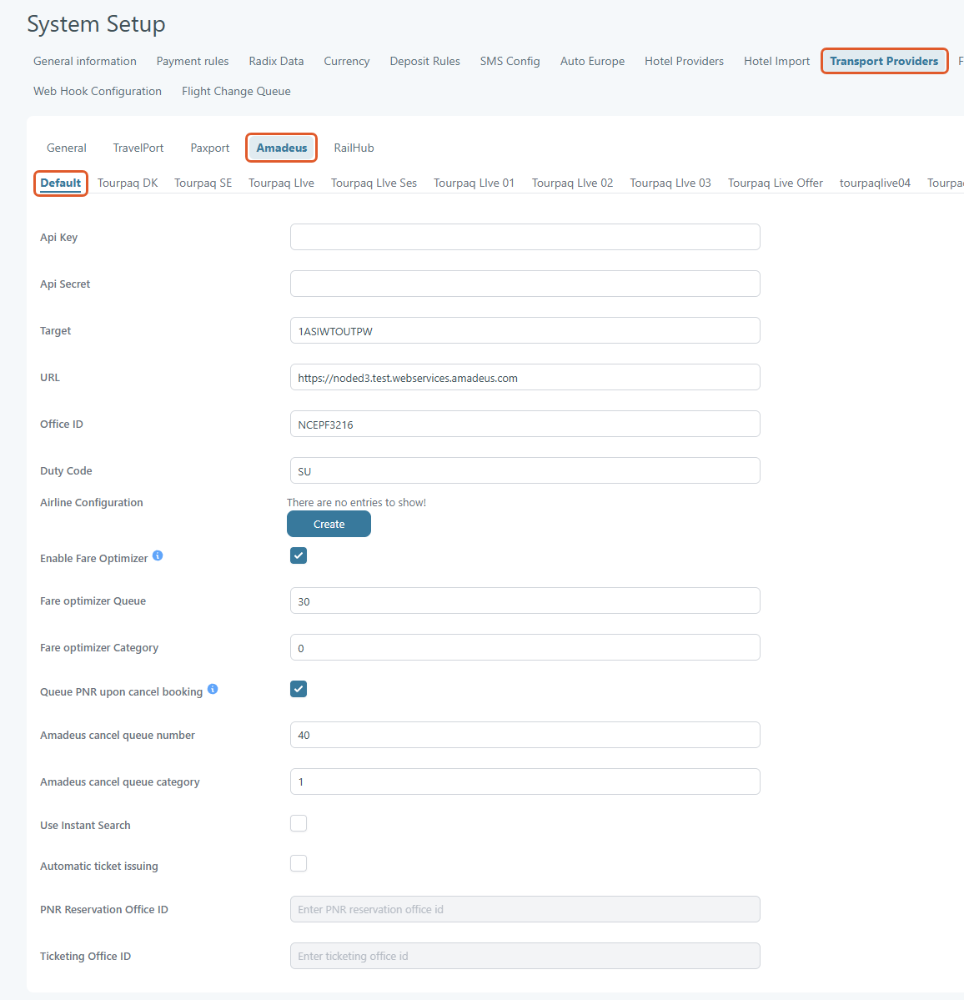
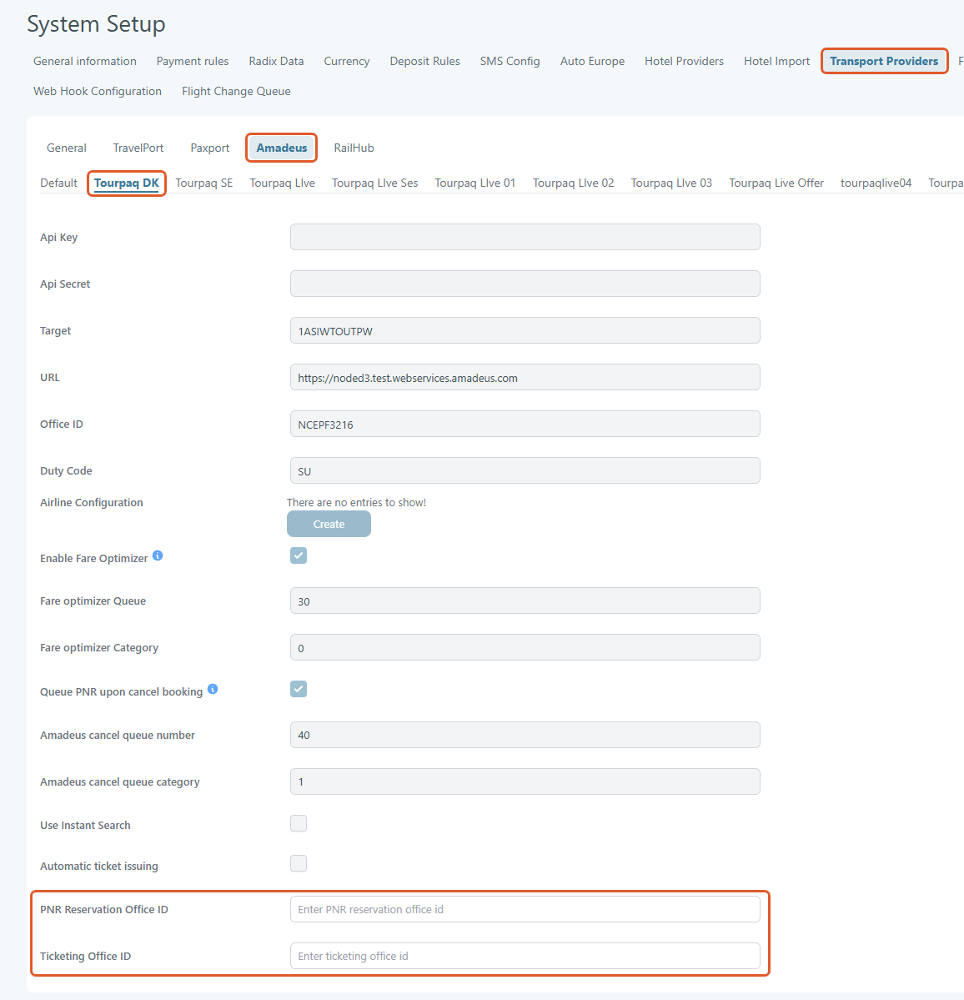
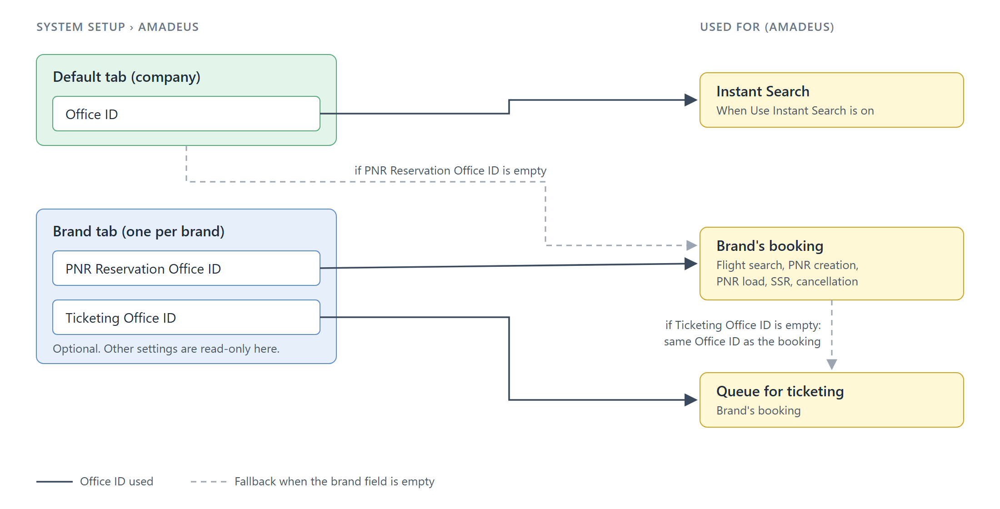

# Amadeus

## Overview

The **Amadeus Transport Provider Configuration** page is used to connect Tourpaq with the Amadeus reservation system.\
This integration enables the platform to:

* Search and book flights through Amadeus
* Issue tickets automatically
* Queue cancellations and booking updates
* Apply airline-specific configurations
* Support web booking and booking flow integrations
* Enable automated airline communication and reporting

This setup is located under:

`System Setup → Transport Providers → Amadeus`

## Purpose of the Feature

The purpose of the Amadeus configuration is to establish a secure communication channel between Tourpaq and the Amadeus GDS (Global Distribution System).

Once configured, the system can:

* Retrieve live flight availability
* Create and manage PNRs
* Issue airline tickets
* Send cancellation requests
* Manage queues
* Handle airline-specific OSI/SSR messaging
* Optimize fare processing

Without this configuration, flight booking functionality connected to Amadeus will not operate.

## Configuration Fields

### General Configuration

All fields below are set on the **Default** tab.

<figure><figcaption></figcaption></figure>

| Field                                                   | Description                                                                                                                                                                                                                                                                 |
| ------------------------------------------------------- | --------------------------------------------------------------------------------------------------------------------------------------------------------------------------------------------------------------------------------------------------------------------------- |
| **Api Key**                                             | Required. Authentication key provided by Amadeus Web Services. Used to identify the integration client.                                                                                                                                                                     |
| **Api Secret**                                          | Required. Secret token paired with the API key for secure authentication. Must remain confidential.                                                                                                                                                                         |
| **Target**                                              | Required. Identifier for the Amadeus environment (test or production). Determines which Amadeus system the platform communicates with.                                                                                                                                      |
| **URL**                                                 | Required. The endpoint address for the Amadeus API services (test or live environment).                                                                                                                                                                                     |
| **Office ID**                                           | Required. Amadeus office identifier (Pseudo City Code / PCC). Determines ownership of bookings and ticketing access. Brands can use their own Office IDs, see [Brand Office IDs](amadeus.md#brand-office-ids).                                                              |
| **Duty Code**                                           | Required. Code defining the agent’s permission level within Amadeus.                                                                                                                                                                                                        |
| **Airline Configuration**                               | Airline-specific methods to extend the ticket-issuing deadline. See [Airline Configuration Section](amadeus.md#airline-configuration-section).                                                                                                                              |
| **Enable Fare Optimizer**                               | If checked, the PNR is placed in a queue when the reservation is made, so the Amadeus Fare Optimizer can process it. Shows the two fields below.                                                                                                                            |
| **Fare optimizer Queue**                                | Amadeus queue number for fare optimization. Whole number, 0 or higher. Example: `30`.                                                                                                                                                                                       |
| **Fare optimizer Category**                             | Queue category used with the optimizer queue. Whole number, 0 or higher. Example: `0`.                                                                                                                                                                                      |
| **Queue PNR upon cancel booking**                       | If checked, the PNR is placed in a queue when the booking is cancelled, for manual processing in Amadeus. Shows the two fields below. See [Amadeus Cancellation Queue](amadeus.md#amadeus-cancellation-queue).                                                              |
| **Amadeus cancel queue number**                         | Queue that receives the cancelled PNRs. Whole number, 0 or higher. Example: `40`.                                                                                                                                                                                           |
| **Amadeus cancel queue category**                       | Queue category used for cancellations. Whole number, 0 or higher. Example: `1`.                                                                                                                                                                                             |
| **Use Instant Search**                                  | If checked, Tourpaq uses the Amadeus Instant Search service for flight searches. Otherwise, standard search is used.                                                                                                                                                        |
| **Automatic ticket issuing**                            | If checked, a background service issues the e-tickets for GDS bookings with status OK, when all flight segments are confirmed (HK) and the airline's last ticketing date is within the next 12 hours. If issuing fails, the warning **Unable to issue tickets!** is logged. |
| **PNR Reservation Office ID** / **Ticketing Office ID** | Read-only on the Default tab. Set them on a brand tab, see [Brand Office IDs](amadeus.md#brand-office-ids).                                                                                                                                                                 |

> 💡 **Note**\
> Queue numbers and categories are defined by Amadeus.

### Brand Office IDs

The Amadeus page has a **Default** tab and one tab for each brand. Use the brand tabs when a brand must work in Amadeus with its own Office ID.

* The **Default** tab holds all the settings described on this page. On the brand tabs these settings are shown but cannot be edited.
* Each brand tab has two optional fields:

<figure><figcaption></figcaption></figure>

| Field                         | Description                                                                                                                                                                            |
| ----------------------------- | -------------------------------------------------------------------------------------------------------------------------------------------------------------------------------------- |
| **PNR Reservation Office ID** | Office ID used for the brand's bookings in Amadeus: flight search from the booking, PNR creation, PNR load and cancellation. If empty, the **Office ID** from the Default tab is used. |
| **Ticketing Office ID**       | Office ID used when the brand's booking is queued for ticketing. If empty, the same Office ID as the booking is used.                                                                  |


**Use Instant Search** always uses the **Office ID** from the Default tab.


<figure><figcaption></figcaption></figure>

***

## Airline Configuration Section

The **Airline Configuration** table allows airline-specific behavior customization.

| Column        | Description                                                                                                     |
| ------------- | --------------------------------------------------------------------------------------------------------------- |
| **Airline**   | Airline code and airline name. Select the airline that has a dedicated ticket-issuing deadline extension method |
| **Method**    | Communication method used. Select the method used to extend the ticket-issuing deadline.                        |
| **Free Text** | Specify the free text associated with the method. The free text depends on the actual company agreement.        |

#### Available Actions

| Action            | Description                     |
| ----------------- | ------------------------------- |
| **Edit Icon**     | Modify existing airline setup   |
| **Create Button** | Add a new airline configuration |
| **Delete Icon**   | Remove configuration            |

***

### Airline Configuration Example

| Airline          | Method | Free Text     |
| ---------------- | ------ | ------------- |
| `D8 - Norwegian` | `OS`   | `NCAITFARES2` |

#### Example Usage

When the PNR is created in Amadeus for a booking with a Norwegian (D8) flight, the system adds the configured OS element with its free text to the PNR.

This ensures:

* Correct airline communication
* Special operational handling

***

## Typical Configuration Process

### Step-by-Step Setup

1. Open:\
   `System Setup → Transport Providers → Amadeus`
2. Enter:
   * API Key
   * API Secret
   * Target
   * URL
   * Office ID
   * Duty Code
3. Configure airline-specific rules
4. Enable required options:
   * Fare optimizer
   * Queue cancellations
   * Automatic ticket issuing
5. Optional: on a brand tab, enter the brand's Office IDs
6. Save configuration

### **Usage notes**

* All fields must be valid for the system to perform Amadeus flight searches or booking actions.
* Credentials differ between **test** and **production** environments. Verify values before switching.
* Changes take effect only after you click **Save**.

## Amadeus Cancellation Queue

### Overview

This feature controls how cancelled Amadeus PNRs are handled in the system. It introduces an optional step where cancelled reservations are routed to an Amadeus queue instead of being immediately cancelled in the GDS.


The **Amadeus cancel queue number** and **Amadeus cancel queue category** are not checked on save. If one is empty, cancelling the booking stops with the message **Missing Cancel Queue Number or Cancel Queue Category from Setting!** and the booking is not cancelled.


***

### System Behaviour

#### 1. Behavior (Enabled)

* **Booking Page Behavior**

If the option **“Queue PNR upon cancel booking”** is enabled, the cancellation flow from the booking page is changed for Amadeus GDS reservations.

When a user cancels a booking from the **front page of the booking**, the system automatically places the booking into the queue.

This means users do not need to access or use the GDS tab to complete the cancellation process.

* **GDS Tab Cancellation**

When the GDS Reservation is cancelled at the GDS tab, cancel the reservation directly at the transport provider

#### 2. Behavior (Disabled)

If the setting is not enabled:

* Cancellation from the booking page follows the standard flow
* The PNR is immediately cancelled in Amadeus
* No queue placement is performed
