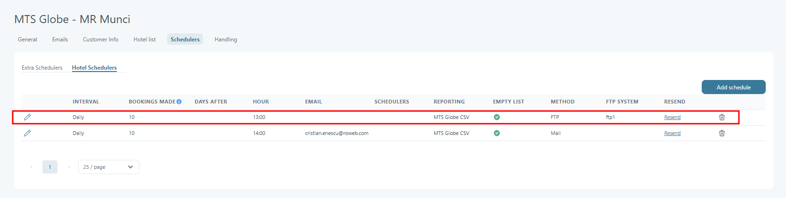
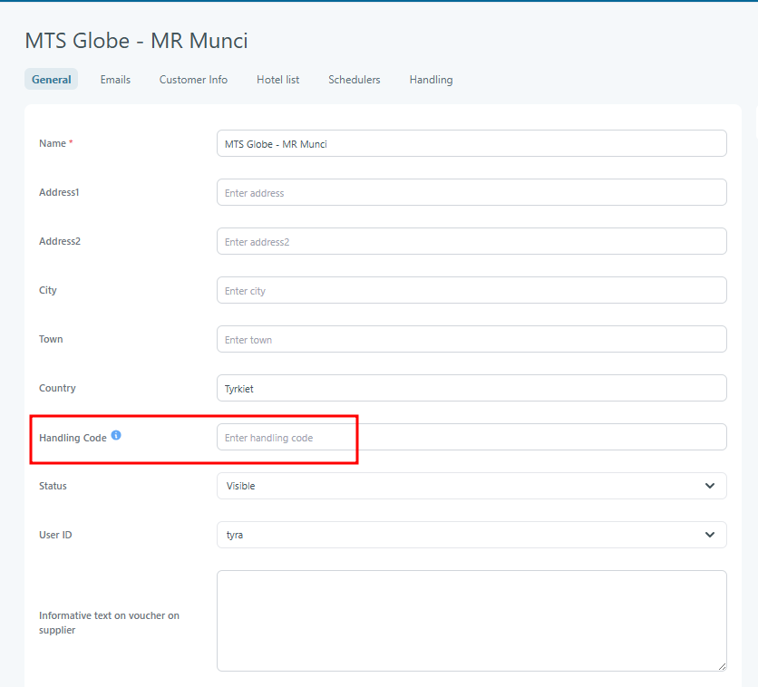
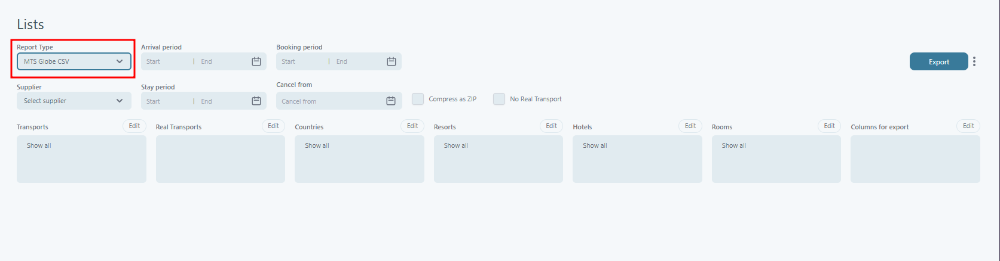

# Specification & Config

## Overview

The MTS Globe Hotel Reporting functionality enables Tourpaq to generate and deliver hotel booking reports to MTS Globe by FTP or email, in CSV format.

The integration supports automated reporting for:

* New bookings
* Cancelled bookings
* Amended (modified) bookings

The reporting mechanism is schedule-driven and tracks previously reported bookings to identify newly created, updated, or cancelled reservations.

This functionality is only available for companies where the **MTS Globe Reporting** feature is enabled by a Super Administrator.

***

## Purpose

The purpose of the MTS Globe Hotel Reporting functionality is to:

* Provide automated hotel booking communication with MTS Globe
* Deliver booking data in the required CSV structure
* Support FTP-based supplier communication
* Allow resending of previously generated schedules
* Maintain synchronization between Tourpaq and MTS Globe booking data
* Support tracking of new, amended, and cancelled bookings

***

## Main components

The implementation consists of the following areas:

1. Supplier Communication Configuration
2. Scheduler & Reporting Management
3. Company Feature Management
4. Supplier Handling Code
5. Export List Support
6. Reporting Logic & Booking Tracking

***

## 1. Supplier communication configuration

### Location

Users → Suppliers → Schedulers → Hotel Schedulers

### Purpose

Extend supplier communication to support FTP-based delivery for MTS Globe reporting.

***

### Supported method

* FTP
* Mail

<figure><figcaption></figcaption></figure>

When FTP is selected:

* The user can select one of the configured[ System FTP](../setup/system-setup-ftps.md) entries

***

### FTP Configuration

When using FTP communication:

* The scheduler sends CSV files directly to the configured FTP destination
* Multiple files may be generated and sent simultaneously
* Each generated file shall appear individually in the scheduler history list

***

## 2. Scheduler and reporting management

### Purpose

Allow users to:

* View all generated reporting files
* Resend reporting schedules
* Track sent booking reports

***

### Scheduler file visibility

All files sent through the scheduler shall be accessible under the:

* SCHEDULERS heading

For MTS Globe:

* Multiple files may be generated during one execution
* Each file must appear separately in the list

Examples:

* XXXX\_new\_date.csv
* XXXX\_canx\_date.csv
* XXXX\_amend\_date.csv

***

### RESEND functionality

Purpose - Allow users to resend previously generated schedules.

Tooltip text:

> Resend the list (including changes for report formats that support this)

Resend Button - it is available in the RESEND column.

#### Resend behavior

When clicking the Resend button:

* Active schedules will be resent
* For MTS Globe:
  * New bookings are resent
  * Cancelled bookings are resent
  * Amended bookings are resent
* The resent files contain the rooms reported on the last reporting day, with that day's date in the file name. Changes made since then are not included; they are sent with the next scheduled run.


For other reporting formats the current list shall be resent using existing behavior


***

## 3. Company feature management

* Control visibility of the MTS Globe functionality per company.Feature Group
* The feature shall be located under Apps and Integrations
* The feature can only be enabled by: Super Administrator

***

## 4. Supplier handling code

The MTS Globe reporting format requires a supplier handling code.This code is included in the generated reporting files.

***

### Supplier general changes

A new field is added to the Supplier General section.

<figure><figcaption></figcaption></figure>

Field Name - **Handling Code**

Validation - **Maximum length: 50 characters**

Info Tooltip - Tooltip text:

> The handling code is used in the reporting and is agreed on with the supplier. MTS Globe reporting needs this handling code.

***

## 5. Export list support

* Location: Exports → Lists
* Allow users to manually generate MTS Globe booking exports.
* New Report Type: MTS Globe CSV

<figure><figcaption></figcaption></figure>

***

### Export behavior

The export shall:

* Generate a CSV file
* Include current bookings matching the selected filters
* Follow the MTS Globe CSV specification for new bookings

***

## 6. Reporting specifications

### Purpose

Track previously reported bookings in order to determine:

* New bookings
* Modified bookings
* Cancelled bookings

***

### Reporting logic

The reporting system shall maintain a list of already reported bookings.

This list is used when the scheduler runs again.

Each room in a booking is tracked and reported separately, as one row in the file. A booking with more rooms can therefore have rooms in different files in the same run.

***

#### New bookings

Rooms shall be added to the NEW file when:

* The booking was created since the previous reporting
* The booking was not previously reported
* A room was added to a booking that was already reported
* The room type or the hotel was changed: the room with the new room type or at the new hotel is New

Output file example:

* XXXX\_new\_date.csv

***

#### Amended bookings

Rooms shall be added to the AMENDED file when the room was already reported and:

* Pax were added to or removed from the room, and the room still has pax
* Pax were moved between two rooms already in the booking: both rooms are Amended
* Any other data in the file changed, such as names, dates, board or note

Output file example:

* XXXX\_amend\_date.csv

***

#### Cancelled bookings

Rooms shall be added to the CANCELLED file when the room was already reported and:

* The booking was cancelled: all its rooms are Cancelled
* All pax were removed from the room, or the room was removed
* The room type was changed: the old room type is Cancelled
* The booking no longer belongs to the hotel: Cancelled at the old hotel, New at the new hotel

Output file example:

* XXXX\_canx\_date.csv

***

#### Important rules

**Rule 1**

Cancelled bookings that were never previously reported:

* Shall NOT be reported as new
* Shall NOT be reported as cancelled

***

**Rule 2**

After each successful reporting execution:

* The current booking list becomes the new reference list
* Future comparisons use this updated list

***

**Rule 3**

A room that is the same as when it was last reported is not reported again, even if it was changed in between.

Example: the room type is changed and changed back before the next run. Nothing is reported.

***

**Rule 4**

A room keeps the **Reference** it was first reported with:

* A one-room booking is reported with the booking number, for example `12345678`. In a booking with more rooms, each room is reported as booking number and room number, for example `12345678-2`.
* A second room is added to a one-room booking: only the new room is reported, as New with `12345678-2`. The first room stays `12345678` for the hotel.
* A room is removed from a booking with more rooms: only that room is reported, as Cancelled. The other rooms are reported only if they change.

***

## File naming convention

The following file naming structure shall be used:

| File Type          | Example               |
| ------------------ | --------------------- |
| New Bookings       | XXXX\_new\_date.csv   |
| Cancelled Bookings | XXXX\_canx\_date.csv  |
| Amended Bookings   | XXXX\_amend\_date.csv |

* `XXXX` = the first four letters of the supplier name, in capitals and without spaces.
* `date` = the reporting date, in the format `YYYYMMDD`.
* A file is generated only when it has rows.

***

## Examples: what is sent for each change

Each scheduled run compares every room with what the hotel received in the previous run. The tables below show, for each change made in the booking between two runs, which file the room is sent in.

In the examples, booking `1001` has one room with 2 adults, and booking `2001` has two rooms (`2001-1` and `2001-2`), each with 2 adults. All of them were already sent to the hotel, unless the row says otherwise.


**How to read the tables:** `new` = the room is in the NEW file, `amend` = in the AMENDED file, `canx` = in the CANCELLED file. **Nothing sent** means the room is in none of the files.


### New bookings and new rooms

| Change in the booking                            | Example                                     | What the hotel receives                                                     |
| ------------------------------------------------ | ------------------------------------------- | --------------------------------------------------------------------------- |
| A booking is created                             | New booking `1002`, one room                | `new`: room `1002`                                                          |
| A booking is created on the schedule's first run | All active bookings that match the schedule | `new`: all their rooms                                                      |
| A room is added to a booking already sent        | A second room added to `1001`               | `new`: room `1001-2` only. Room `1001` keeps its Reference and is not sent. |

### Pax changes

| Change in the booking                                 | Example                                           | What the hotel receives                           |
| ----------------------------------------------------- | ------------------------------------------------- | ------------------------------------------------- |
| Pax added to a room                                   | A child added to `1001`                           | `amend`: room `1001`                              |
| Some pax removed or cancelled; the room still has pax | One of the 2 adults in `1001` cancelled           | `amend`: room `1001`                              |
| All pax in a room removed or cancelled                | Both adults in `2001-2` cancelled                 | `canx`: room `2001-2`. Room `2001-1` is not sent. |
| Pax moved between two rooms already in the booking    | One adult moved from `2001-1` to `2001-2`         | `amend`: rooms `2001-1` and `2001-2`              |
| Some pax moved to a new room                          | One adult from `1001` moved to a new, second room | `amend`: room `1001`, and `new`: room `1001-2`    |
| All pax moved out of a room                           | Both adults in `2001-2` moved to `2001-1`         | `canx`: room `2001-2`, and `amend`: room `2001-1` |

### Changes to the booking details

| Change in the booking        | Example                                        | What the hotel receives                                                                   |
| ---------------------------- | ---------------------------------------------- | ----------------------------------------------------------------------------------------- |
| Pax name changed             | Lead passenger's last name corrected in `1001` | `amend`: room `1001`                                                                      |
| Dates changed                | Arrival in `1001` moved from 03-01 to 10-01    | `amend`: room `1001`                                                                      |
| Board changed                | `1001` changed from HB to AI                   | `amend`: room `1001`                                                                      |
| Hotel comment (Note) changed | A note added to `1001`                         | `amend`: room `1001`                                                                      |
| Room type changed            | `1001` changed from a double room to a suite   | `canx`: room `1001` with the old room type, and `new`: room `1001` with the new room type |
| Hotel changed                | `1001` moved to another hotel                  | `canx`: room `1001` at the old hotel, and `new`: room `1001` at the new hotel             |

### Cancellations

| Change in the booking              | Example               | What the hotel receives                           |
| ---------------------------------- | --------------------- | ------------------------------------------------- |
| The booking is cancelled           | `2001` cancelled      | `canx`: rooms `2001-1` and `2001-2`               |
| A room is removed from the booking | Room `2001-2` removed | `canx`: room `2001-2`. Room `2001-1` is not sent. |

### Changes that send nothing

| Change in the booking                                      | Example                                                     | What the hotel receives |
| ---------------------------------------------------------- | ----------------------------------------------------------- | ----------------------- |
| A change is made and undone before the next run            | Room type of `1001` changed, then changed back the same day | Nothing sent            |
| A booking is created and cancelled before it was ever sent | `1003` created and cancelled before the next run            | Nothing sent            |
| A change to data that is not in the file                   | A transfer or an extra added to `1001`                      | Nothing sent            |

### Several changes at once

When several changes are made before the next run, each room is reported once, based on how it looks at the time of the run.

| Change in the booking                                                  | What the hotel receives                                                                                                                                |
| ---------------------------------------------------------------------- | ------------------------------------------------------------------------------------------------------------------------------------------------------ |
| In `1001`: room type changed, a second room added and a transfer added | `canx`: room `1001` with the old room type. `new`: the room with the new room type, now sent as `1001-1`, and room `1001-2`. The transfer is not sent. |
