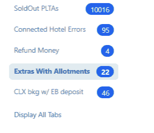

# Notifications

### Overview

The **Notifications** page is a centralised monitoring tool that collects and displays all system-generated alerts related to bookings, products, payments, and operational processes. Instead of discovering problems one booking at a time, agents and administrators can open this page and immediately see every issue that needs attention — organised by type and severity.

Notifications are generated automatically by the system based on background checks. They do not resolve themselves — each one must be investigated and fixed at the source before it disappears from the list.

<figure><figcaption>
Notifications overview – categories on the left, detailed list in the center.
</figcaption></figure>

### Purpose

The Notifications module exists to help teams:

* Spot and resolve **booking errors** before they affect customers or operations
* Track **unpaid bookings** and outstanding balances at a glance
* Identify and fix **overbooking situations** across hotels, rooms, and transports
* Stay on top of **Stop Sales violations**, queue errors, and upsell opportunities
* Maintain overall **data quality and reservation accuracy** across the platform

It is particularly valuable for operations managers and senior agents who need a daily system health check without opening individual bookings one by one.

***

### Requirements

Before using the Notifications page, ensure the following:

* You are logged in with a user role that has **access to booking administration and notifications**. If the Notifications page is not visible in your sidebar, contact your system administrator to review your permissions under [Users](https://manual.tourpaq.com/users/users).
* Background error-checking services are running correctly. If no notifications appear at all and you expect them, contact your administrator to verify that system checks are active.
* Allotment thresholds and Stop Sales rules must be correctly configured for overbooking and Stop Sales notifications to fire accurately. See [Stop Sales](https://manual.tourpaq.com/stop-sales) and [Hotel Contracts](https://manual.tourpaq.com/hotel-contracts).

***

### Use the Notifications page

#### Step 1 — Open Notifications

Click **Notifications** in the left sidebar. The page opens with the full list of active notifications across all categories.

***

#### Step 2 — Select a category

In the **left panel**, click the notification category you want to review. The central table immediately refreshes to show only notifications of that type. The number displayed next to each category name is the count of active, unresolved notifications in that category.


**Recommended daily priority order:**

* **Overbkg** — overbooking situations that may affect customers
* **Unpaid Bkg** — outstanding balances requiring follow-up
* **Warnings** — non-blocking issues that still need attention
* **Stop Sales / Queue Management** — operational and configuration issues


***

#### Step 3 — Review the notification list

In the central panel, scan the table for the most urgent items. Use column headers to sort the list — for example, sort by **Departure Date** to prioritise upcoming trips, or by **Balance** to focus on the largest outstanding payments first.

Use the **records-per-page selector** at the bottom to control how many rows are shown, and the **pagination controls** to navigate through the full list.

***

#### Step 4 — Open and resolve the booking

Use the **Booking No** in the notification row to locate the affected booking. Open it via [All Bookings](https://manual.tourpaq.com/booking/all-bookings) and correct the underlying issue — for example:

* Register a missing payment for an **Unpaid Bkg**
* Adjust allotment or move a passenger for an **Overbkg**
* Fix missing or invalid data for an **Error Bkg**
* Review and update product rules for **Warnings**

***

#### Step 5 — Verify the notification is cleared

After saving the fix, return to the Notifications page and refresh the list. If the underlying issue has been resolved, the notification will no longer appear. If it persists, the fix was incomplete — review the booking again.


Notifications are not automatically cleared when you save a reservation. The system checks for updates every 30 minutes.


***

### Field reference

#### Left Panel — Notification Categories

| Category                   | Description                                                                                                                                                                             |
| -------------------------- | --------------------------------------------------------------------------------------------------------------------------------------------------------------------------------------- |
| **Unpaid Bkg**             | Bookings with outstanding payments — the customer owes a balance that has not been registered                                                                                           |
| **Overbkg**                | Overbooking situations, broken down by type: Homebound transport, Hotels, Rooms, and Outbound transport                                                                                 |
| **Error Bkg**              | Bookings that encountered a system error during saving or processing and are in an incomplete or invalid state                                                                          |
| **Warnings**               | Bookings in a valid state but with a condition that requires attention — for example, travel insurance was not sent, or a special service request is missing                            |
| **Hotel Special Offer**    | Issues related to hotel special offers — for example, an offer that was applied incorrectly or is inconsistent with contract conditions                                                 |
| **Extra Special Offer**    | Issues with special offers on extras — similar to Hotel Special Offer but for extra products                                                                                            |
| **Upsale**                 | Alerts related to upsell opportunities or upsell products that have an issue requiring review                                                                                           |
| **Stop Sales**             | Bookings or products affected by an active Stop Sales rule                                                                                                                              |
| **Queue Management**       | Errors in background processing queues — for example, failed confirmation sends, communication jobs, or automated processing tasks                                                      |
| **Extras With Allotments** | A list of the Extras that have **Display allotment** ticked. It is a reference list, not a list of errors. See [Extras With Allotments tab](notification.md#extras-with-allotments-tab) |

***

#### Extras With Allotments tab

The **Extras With Allotments** tab lists every [Extra](../extras-setup/extras-general-page/extras.md) that has **Display allotment** ticked on its **Basic setup** tab. An Extra is listed because of that setting. It is not listed because of an error, and no allotment threshold is involved. An Extra that has allotments but does not have **Display allotment** ticked does not appear.

The number next to the tab is the number of Extras in the list, not a count of unresolved notifications.

<figure><figcaption>
The Extras With Allotments tab in the Notification left panel. The count is the number of Extras with Display allotment ticked.
</figcaption></figure>

The table has one row per Extra:

| Column           | Description                                                                                                                       |
| ---------------- | --------------------------------------------------------------------------------------------------------------------------------- |
| **ID**           | The ID of the Extra.                                                                                                              |
| **Code**         | The code of the Extra.                                                                                                            |
| **Name**         | The name of the Extra.                                                                                                            |
| **View details** | A link on each row. It opens a grid of the Extra's allotment per date. Use the **Back To Products** button to return to the list. |

To add an Extra to the tab, tick **Display allotment** on the Extra. To remove it, untick **Display allotment**. The same setting controls whether the Extra's available allotment is shown in the booking window. See [Extras](../extras-setup/extras-general-page/extras.md).


**TO VERIFY** — (1) Is the list limited to the brand selected in the top bar, or does it show Extras for all brands? It was only checked with **All brands** selected. (2) What do the abbreviated column headings in the **View details** grid mean (for example `AI1`–`AI4`, `BI1`–`BI4`, `FO1`–`FO4`, `URET`, `BOUT`, `BRET` and `TOTAL OUT`)? Both need confirming with the product team before this page is published to the manual.


***

#### Central Panel — Notification Table

The columns displayed depend on the selected category. The most commonly shown fields are:

| Column                | Description                                                                                                                                      |
| --------------------- | ------------------------------------------------------------------------------------------------------------------------------------------------ |
| **Booking No**        | The unique identifier of the affected booking. Use this to locate the booking in [All Bookings](https://manual.tourpaq.com/booking/all-bookings) |
| **Departure Date**    | The outbound travel date associated with the booking. Use this to prioritise time-sensitive cases                                                |
| **Customer**          | Full name of the lead passenger or primary customer on the booking                                                                               |
| **Booking Total**     | The total value of the reservation, including all travel components and extras                                                                   |
| **Paid Amount**       | The amount already registered as paid by the customer                                                                                            |
| **Balance**           | The remaining unpaid amount. A positive value means money is still owed                                                                          |
| **Error Description** | A plain-language description of the issue or error detected by the system                                                                        |

***

#### Navigation Controls

| Control              | Description                                                                                                               |
| -------------------- | ------------------------------------------------------------------------------------------------------------------------- |
| **Column headers**   | Click any column header to sort the list ascending or descending by that field                                            |
| **Records per page** | Selector at the bottom of the table — choose 10, 25, or 50 rows per page                                                  |
| **Pagination**       | Navigate between pages of results using the Previous / Next controls at the bottom                                        |
| **Filters**          | Where available, use filters at the top of the list to narrow results by departure period, destination, or other criteria |

***

### Working pattern by category

Use the category name to decide both **priority** and **owner**.

Some notifications can be resolved by an agent in the booking. Others point to a wider setup or system issue and should go to an administrator or product owner.

| Category             | Typical owner                    | Typical next action                                             | What usually clears it                                    |
| -------------------- | -------------------------------- | --------------------------------------------------------------- | --------------------------------------------------------- |
| **Unpaid Bkg**       | Sales or finance user            | Register payment, correct payment method, or verify balance     | The balance no longer matches the unpaid rule             |
| **Overbkg**          | Operations or product user       | Move passengers, adjust allotment, or review availability       | The booking no longer exceeds hotel or transport capacity |
| **Error Bkg**        | Senior agent or admin            | Open the booking, fix invalid data, then save again             | The booking passes validation and background checks       |
| **Warnings**         | Agent, operations user, or admin | Read the warning text and complete the missing follow-up        | The missing task or condition is no longer true           |
| **Stop Sales**       | Product or operations user       | Review the booking together with the Stop Sale rule             | The booking no longer conflicts with the active rule      |
| **Queue Management** | Admin or support user            | Check the failed background job, integration, or resend process | The queue job succeeds on the next run                    |


If a notification points to a setup issue, fixing one booking may not be enough. Check whether similar bookings could be affected by the same rule, contract, or integration problem.


### What to check before opening the booking

Use the notification row to decide your first check:

* Check **Departure Date** first for anything time-sensitive.
* Check **Balance** first for **Unpaid Bkg**.
* Check **Error Description** first for **Error Bkg**, **Warnings**, and **Queue Management**.
* Check whether the issue looks **booking-specific** or **system-wide** before you start editing data.

This saves time and reduces duplicate work between agents.

***

### Related pages

* [Warning Notification Rules](../warning-notification-rules.md) — configure which system warnings are generated and who receives them
* [Stop Sales](../stop-sales.md) — manage Stop Sales rules linked to Stop Sales notifications
* [All Bookings](../booking/all-bookings/) — find and open bookings referenced in notifications
* [Service Cases](../service-cases/) — manage customer service issues that may also generate notifications
* [Customer Information (Errata)](../customer-information-errata/) — notifications related to customer errata based on booking and stay periods
* [Email Templates](../email-templates.md) — manage automated email content triggered by booking events
* [Extras](../extras-setup/extras-general-page/extras.md) — the **Display allotment** setting that lists an Extra under Extras With Allotments
