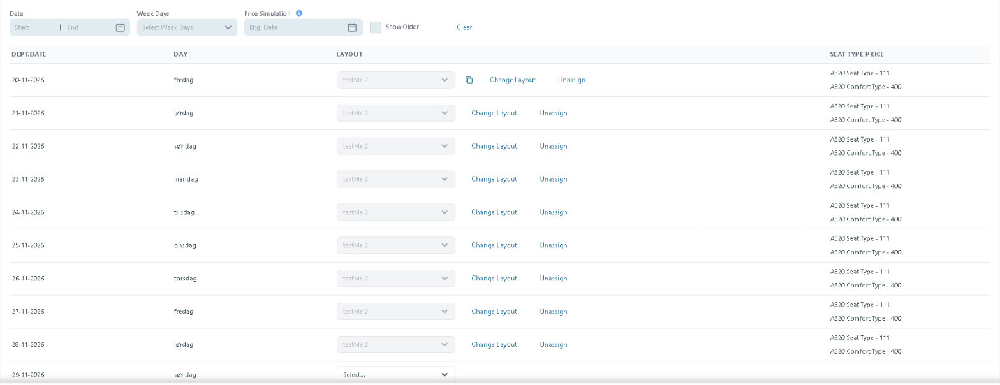
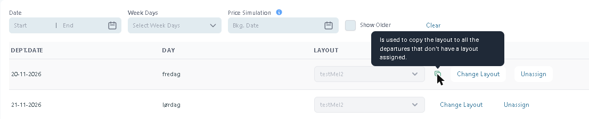

# Layout

## Overview

The **Layout** tab in a Real Transport configuration is used to assign and manage seating layouts for specific departure dates. It allows administrators to connect aircraft seat layouts to departures and see the seat prices that apply.

This functionality ensures that passengers can be assigned seats during the booking process and that seat availability is accurately managed across the system.

***

## Purpose

The Layout feature enables administrators to:

* Assign seat layouts to transport departures.
* Manage seating arrangements for specific travel dates.
* Provide seat selection functionality during booking.

***

## Navigation

Go to: **Transport → Real Transport → Open a Real Transport → Layout**

The Layout tab displays all layouts configured for the selected transport.

***

## Layout Screen

The screen consists of:

* Filters
* Departure layout list
* **Save** and **Cancel** buttons

<figure><figcaption>
The Layout tab
</figcaption></figure>

***

## Filters

Use the filters to show only the departures you need. The list refreshes when you change a filter.

* **Date** – Show departures between a start date and an end date.
* **Week Days** – Show departures on the selected days of the week. You can select more than one day.
* **Price Simulation** – Select a booking date to see the seat type prices that apply to a booking made on that date.
* **Show Older** – Include older departures. Without it, the list hides departures older than the number of days set in **Hide Filters** in [System Setup – General Information Settings](../setup/system-setup/system-setup-general-information-settings.md).
* **Clear** – Reset all filters. The number next to it shows how many filters are active.

***

## Departure Layout List

The table displays all configured layouts for the selected transport, sorted by departure date with the earliest first.

| Column              | Description                                                                              |
| ------------------- | ---------------------------------------------------------------------------------------- |
| **Dept. Date**      | The departure date associated with the layout.                                           |
| **Day**             | Day of the week for the departure.                                                       |
| **Layout**          | The assigned seating layout. For a departure without a layout, select one from the list. |
| **Seat Type Price** | Displays seat categories and their prices.                                               |

A departure that already has a layout shows it locked, with two actions:

* **Change Layout** – Opens a page where you choose a new layout for the departure.
* **Unassign** – Removes the layout from the departure. Tourpaq doesn't unassign a layout that is used for seats in a booking. Remove the seats from the booking first.

***

## How to Configure a Layout

1. Open the required Real Transport.
2. Navigate to the **Layout** tab.
3. Use the filters to show the departures you need.
4. In the **Layout** column, select a layout for each departure.
5. Click **Save**.

**Save** saves all your changes at once. It stays unavailable until you select a layout. **Cancel** discards the changes you haven't saved. If Tourpaq can't save some departures, it saves the others and lists the dates that failed.

***

### Copy a layout to other departures

When many departures use the same layout, select it once and copy it.

1. Make sure the first departure in the list has a layout.
2. Click the copy icon next to the layout.
3. Click **Save**.

<figure><figcaption>
The copy icon
</figcaption></figure>

* Tourpaq copies the layout to the departures on the current page that have no layout yet.
* Departures that already have a layout don't change.
* The copy is not saved until you click **Save**.

***

### Automatic Seating

When **Automatic Seating** is enabled on the Real Transport, and **Automatic Real Transport Seating** is enabled for your company (**Super Administration → Company → Features**):

* Passengers without assigned seats are automatically allocated to available seats.
* The configured layout determines which seats are available.
* Seat type restrictions and availability rules are respected.

***

## Example Configuration

| Setting            | Example Value    |
| ------------------ | ---------------- |
| Departure Date     | `26-06-2026`     |
| Layout             | `Ses Layout`     |
| Seat Type          | `A320 Seat Type` |
| Seat Price         | `0 EUR`          |
| Comfort Seat Price | `0 EUR`          |

#### Result

For the departure on **26-06-2026**:

* The **Ses Layout** seating plan is used.
* Passengers can select seats during booking.
* Seat availability is controlled by the layout.
* Passenger manifests include assigned seat numbers.
* Automatic seating can allocate remaining passengers to free seats.

#### Parent/child transports 

Parent/child transports let you **link one transport to another** so they can share operational setup. Configure the link on the **child transport** (via the **Parent** field in Real Transports). See [Create New Real Transport](https://manual.tourpaq.com/real-transports/create-new-real-transport) for the **Parent** field.

#### Shared seat layout 

If you use **parent-child transports**, you can **share the same seat layout**.


On the **child transport** you can select layout only for departures that are not attached to a parrent. If the departures are the same with the departures from the parent, the layout will not be available to be selected.


Result:

* Seats selected in a booking using the **child** transport show as occupied in bookings using the **parent** transport — and vice versa.
