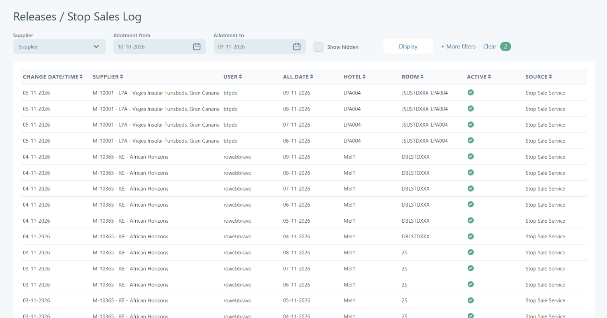

# Releases/Stop Sales Log

### Overview

The **Stop Sales Log** provides a complete audit trail of all changes made to allotments where availability has been reduced or stopped.

It tracks when and how room availability was modified, including manual actions and automated processes such as Stop Sale services.

This page is primarily used for troubleshooting, auditing, and operational monitoring.

### Purpose

* Track all stop sale and release actions
* Identify who made changes and when
* Verify system or supplier driven updates
* Support investigation of availability issues
* Ensure transparency in allotment management

### Navigation

Hotel → Releases / Stop Sales Log

You can also click **Log** on a line in **Hotel → Stop Sales**. The log opens filtered on that stop sale.

<figure><figcaption>
Releases / Stop Sales Log
</figcaption></figure>

***

### Filters and Search Options

The filter section allows narrowing down the log entries.

|                           |                                                                                                                                                                                           |
| ------------------------- | ----------------------------------------------------------------------------------------------------------------------------------------------------------------------------------------- |
| **Supplier**              | 
Dropdown used to filter log entries by <strong>supplier</strong>.

This corresponds to the supplier linked to the hotel contract.
                                             |
| **Allotment From / To**   | 
Defines the date range of the allotment being analyzed. Only changes affecting this period will be shown.
                                                                       |
| **Change Date From / To** | 
Filters based on when the change was made. Useful for tracking recent updates or historical actions.
                                                                            |
| **Hotels**                | 
Field used to select one or more <strong>hotels</strong>.
<ul><li>Clicking <strong>Edit</strong> opens a selection dialog</li><li>Filters log entries for specific hotels</li></ul> |
| **Room**                  | Filter by specific room type.                                                                                                                                                             |
| **Show Hidden**           | 
Checkbox that includes <strong>hidden or system-level entries</strong> in the results.

When enabled, additional technical records may be displayed.
                          |
| **Display**               | Button used to apply the selected filters and refresh the log results.                                                                                                                    |
| **More Filters**          | Expands the filter section to include additional criteria.                                                                                                                                |
| **Clear**                 | Resets all filters to default values.                                                                                                                                                     |
| **Display names**         | Checkbox that toggles between **codes and readable names** for hotels and rooms.                                                                                                          |

### Table Fields Explanation

Each row represents a **single allotment change event**.

**Change Date/Time -** Date when the modification was made. Represents when the stop sale or release action occurred.

**Supplier** - Supplier associated with the allotment.

**User** - Name of the user that performed the action.

**All Date** - The specific date of the allotment affected.

**Hotel** - Hotel where the change was applied.

**Room** - Room type affected by the change.

**Active** - Checked when the room was stopped for sale on that date. Unchecked when the room was opened again.

**Source** - Indicates how the change was triggered.

### Expected Behavior

* All stop sale and release actions are logged
* Creating, changing and deleting a stop sale is logged
* Data reflects both manual and automated updates
* Logs are immutable (read-only)
* Filters dynamically control visible data
* Pagination is applied for large datasets

***

## Behavior and Interpretation

### Stop Sale

A stop sale does not change the number of rooms. The room is only marked as stopped for sale:

* **Active** checked: the stop sale was applied to the date.
* **Active** unchecked: the date was opened again, for example because the stop sale was deleted, shortened, or the room was removed from it.

***

## Practical Use Cases

Investigating Overbooking - Check whether rooms were stopped after bookings were made.

Investigating Closed Availability - Identify when and why rooms became unavailable.

Supplier or System Issues - Determine whether changes came from:

* Internal users
* Automated services
* External integrations

***

## Key Notes

* The log is **read-only** and cannot be modified.
* It reflects **historical actions**, not current availability.
* Always correlate **ALL DATE** (stay date) with **CHANGE DATE/TIME** when analyzing issues.
* The **SOURCE** field is critical for debugging system behavior.
