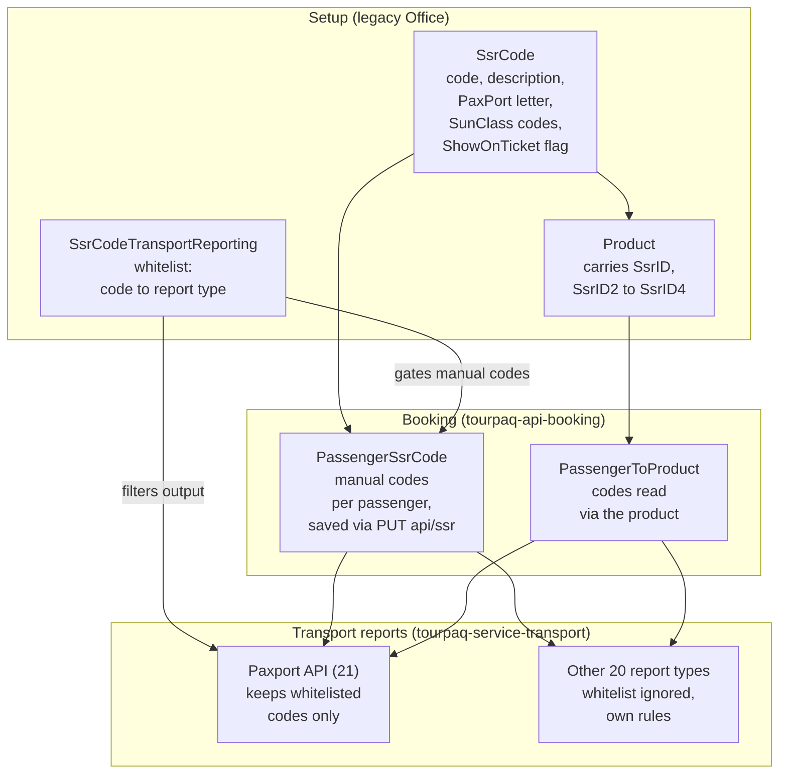

# SSR Codes whitelist and PNL reporting format

A passenger can have a valid SSR code on their booking and still not see it in the passenger name list (PNL) sent to the airline. Each transport report decides for itself which codes it writes. Some reports filter on a list of allowed codes, some use a fixed list built into Tourpaq, and some write no SSR codes at all. This page lists those rules per report.

### Overview

A **Special Service Request (SSR) code** is a code of up to four characters, such as `WCHR` (wheelchair) or `VGML` (vegetarian meal), that records a special service for a passenger. See [SSR Codes](/broken/pages/ec7cb76117bed77b1ab68f3c7944a6b494074eb8) for how codes are created.

Three things decide whether a code appears in a report. Keep them apart:

* **The stored code.** The code exists in the `SsrCode` table and is on the passenger, either set manually on the booking or carried by a product the passenger has.
* **The whitelist.** The `SsrCodeTransportReporting` table links each code to the report types it may be used with. It controls which codes a user can add manually to a booking. Among the report formats, only the **Paxport API** report also uses it to filter its output.
* **The generated report.** Each report format writes the code in its own shape, from the full four-letter code to a single PaxPort letter, or does not write SSR codes at all.

There are 21 report types plus 4 alternative formats. Only Norwegian, Air Seven (and Air Seven Full) and Bulgaria Air produce a real IATA PNL.

### Purpose

Use this page to:

* Check which SSR codes a given report writes, and in what format.
* Understand how a code reaches a passenger, manually or through a product, and when it is removed.
* Find out why an SSR code is missing from a PNL, using the `PRBD` case below as the worked example.
* See how and when each report is generated and delivered.

### Preconditions

* The SSR code exists in **SuperAdmin → SSR Codes** in the legacy Tourpaq Office. See [SSR Codes](/broken/pages/ec7cb76117bed77b1ab68f3c7944a6b494074eb8).
* The code is linked to the transport's report type, if you add it manually to a booking.
* You know which report type the transport uses. It is set on the transport (`Transport.Reporting`) or on the real transport (`RealTransport.Reporting`).


Several rules below are built into Tourpaq and cannot be changed in the Office. They are described at the technical level the source material supports. Where a rule is a setting you can change, the menu path is given.


### How-to

#### How the SSR data fits together

1. A user creates the code in **SuperAdmin → SSR Codes** and links it to report types. This creates the whitelist rows.
2. The code reaches a passenger in one of two ways: a user picks it in the booking SSR tab (manual, whitelist checked), or the passenger gets a product that carries it (no whitelist check).
3. For every passenger on a flight, the transport service reads both sources.
4. Each report then applies its own rules. Only the Paxport API report filters the codes again through the whitelist.

The diagram shows how an SSR code moves from setup, through the booking, to the transport reports.



#### Applying an SSR on a booking

A passenger gets SSR codes in one of two ways:

* **Manual:** a user picks codes in the booking's SSR tab. These are stored in `PassengerSsrCode`.
* **Product:** the passenger gets a product (meal, baggage, sports gear) that carries up to 4 codes in `Product.SsrID` to `SsrID4`.

Manual codes count for the passenger on both directions. Product codes follow the product, so a product sold for one direction is reported only on that leg. Every report receives both kinds.

#### Manual codes (booking SSR tab, tourpaq-api-booking)

1. The tab loads with `GET api/ssr/{bookingId}`. It returns the active passengers and their current codes (manual and product, flagged `fromProduct`). It also returns the dropdown list: codes linked to the booking transport's report type with `ShowOnTicket = 1`, plus any code already selected.
2. Saving sends `PUT api/ssr/{bookingId}` with the body `[{passengerid, selectedIDs: [ssrId, …]}]`.
   * Allowed roles: WebUser, SysAdmin, Administrator, BrandManager, Sales, Financial.
   * A locked booking returns the warning `BookingIsLocked`.
3. `SsrService.Update` compares the request with the stored codes:
   * eligible new codes are added
   * ineligible codes are skipped without an error
   * codes the passenger already gets from a product are skipped
   * stored codes missing from the request are deleted One PUT therefore replaces all the booking's manual codes.
4. It writes `PassengerSsrCode` rows (PassengerID, SsrID) and one booking-history line per change ("SSR added:" or "SSR removed:").
5. It sets `Booking.UpdateDate`. If the company has the `UsePaxportReportingAPI` feature, it also schedules a Paxport API report.

**Eligible** means the code is linked in the whitelist to the transport's report type:

* classic charter: `Transport.Reporting`
* real and dynamic transports: `RealTransport.Reporting` of each linked real transport allotment

Only the outbound `Booking.TransportAllotmentID` is checked. The return allotment never is.

#### Product codes

Codes can be set up on a product. They are reported for every passenger who has that product on the booking. Nobody adds them by hand, and the whitelist is never checked.

1. **Set up.** In Office, go to _Extras setup › Products › General_ and pick up to 4 SSR codes (`Product.SsrID`, `SsrID2`, `SsrID3`, `SsrID4`). Any code in `SsrCode` can be picked.
2. **Sold.** Adding the product to a passenger saves a `PassengerToProduct` row.
   * This happens in the booking engine, the Office passengers screen (`PUT api/bookings/{id}/passengers`) or on the web (`POST api/passenger/{bookingHash}`).
   * The row holds the passenger, the product and the direction (`OutHome`: 100 = out, 101 = home, empty = both).
   * It can also hold a transport price list (`PriceListTransportAllotmentID`).
3. **Reported.** The codes are never copied to `PassengerSsrCode`. Each report run joins `PassengerToProduct → Product → SsrCode` for the passengers on that flight, then merges the result with the manual codes.

| Report run                                  | Product rows included                                      |
| ------------------------------------------- | ---------------------------------------------------------- |
| Classic outbound                            | `OutHome` empty or 100                                     |
| Classic homebound, real-transport homebound | `OutHome` empty or 101                                     |
| Classic roundtrip                           | All directions                                             |
| Real-transport outbound                     | All directions (the `OutHome` filter is missing, see gaps) |

On every run, the row's `PriceListTransportAllotmentID` must be empty or match the passenger's own transport price list.

The product's category changes how the codes come out:

* **Catering, Catering + Baggage, Catering + Baggage + Transfer:** a code with no PaxPort letter is written as a blank meal letter in Paxport and DAT, so the passenger is not marked `Z` (no meal). STML on any product works the same way.
* **Baggage, Catering + Baggage, Catering + Baggage + Transfer:** Air Seven writes these codes as `.R/{code} HK1 CBAG`. The Paxport baggage letter `V` is switched off in code.
* **First code is FLYC:** on the classic path the passenger is moved to class C in Paxport, SunClass and Paxport API, and that product's PaxPort letters are not printed.

The booking SSR tab shows product codes as read-only (`fromProduct`).

#### Products with SSR codes today

The product export of 2026-10-13 lists 100 products with SSR codes. 99 of them use only slot 1, and 56 carry STML. The export has exactly 100 rows: if your SQL client caps results at 100, run it again without the limit.

| SSR code | Products | Example product codes                                         |
| -------- | -------- | ------------------------------------------------------------- |
| STML     | 56       | MFEX, STML AYT, AIR-STML, GZP-BAG+STML+TRF, FUE-XBAG+STML+BUS |
| VGML     | 8        | VGML, VGML JET, VGML SAS, AIR-VGML                            |
| GFML     | 7        | GFML-SHORT, GFML JET, AIR-GFML                                |
| MOML     | 5        | MOML JET, MOML SAS, AIR-MOML                                  |
| NLML     | 5        | NLML JET, NLML SAS, AIR-NLML                                  |
| DBML     | 4        | DBML JET, DBML SAS, AIR-DBML                                  |
| VLML     | 4        | VLML JET, VLML SAS, AIR-VLML                                  |
| XBAG     | 4        | BAG20, BAG-30, 10 kg, Golfbag PXO v7/14 (slot 2)              |
| VPHM     | 2        | MFL, VPHM                                                     |
| WCHR     | 2        | WCHR (products 1378 and 3077)                                 |
| VPML     | 1        | VPML                                                          |
| MLVP     | 1        | MLVP                                                          |
| SPEQ     | 1        | Golfbag PXO v7/14 (slot 1)                                    |
| RQST     | 1        | SEAT                                                          |

What this means for the reports:

* **Combined bag + meal products carry only STML.** Examples: `GZP-BAG+STML+TRF`, `FUE-XBAG+STML+BUS`, `SK-BAGP+STML`. The bag is never reported as XBAG. If their category type is Catering + Baggage or Catering + Baggage + Transfer, the Air Seven homebound PNL prints `.R/STML HK1 CBAG`. The outbound PNL strips meal codes from the baggage list.
* **STML has no SunClass meal code.** The SunClass file therefore prints the meal as `NM` and puts `STML` in an SSR slot, for every passenger with one of these 56 products.
* **Only `Golfbag PXO v7/14` uses slot 2** (SPEQ + XBAG). The booking SSR tab's duplicate guard and history look at slot 1 only.
* **No product carries FLYC**, so the product-driven class C rule is not used by this data.
* **`SEAT` carries RQST.** Air Seven does not print RQST; it prints the seat from seating data (`.R/SEAT HK1 12A`).
* **`WCHR` products** print WCHR in Air Seven and the wheelchair letter R in SunClass.

The `ProductCategory` value in the export is the category row ID, not its type. The category type (`pid`) is what drives the catering and baggage rules: 3 = Catering, 10 = Baggage, 11 = Catering + Baggage, 13 = Catering + Baggage + Transfer. To see the types:

```sql
select ProductCategoryID, ProductCategoryName, pid, CompanyID
from ProductCategory
where ProductCategoryID in (88, 92, 94, 104, 123, 142, 160, 168, 232, 274, 283, 297, 351, 499)
```

#### When codes are removed

* **Transport change:** every manual code on every active passenger is deleted, with no history line. The whitelist check in `DeleteSsrTransportChanged` is commented out.
* **Passenger cancelled or moved:** that passenger's manual codes are deleted.
* Product codes go away only when the product is removed.

#### Where codes show outside the transport reports

* **Ticket:** only when the agency has `ShowSSROnTicket`, and only codes with `ShowOnTicket = 1`.
* **Paxport Reporting API call from tourpaq-api-booking:** all codes are sent, ignoring both the whitelist and `ShowOnTicket`. Each code is repeated for every flight.
* **Travelport (GDS):** only the contact SSRs CTCM and CTCE. The `SsrCode` table is not used.

#### Generating a report

A report is generated in one of three ways:

* **Automatically**, by three Hangfire jobs in the transport service.
* **On demand**, through transport-service endpoints that download or resend a file.
* **From the booking**, when a booking change schedules a Paxport API report.

The classic path supports outbound, homebound, out-and-home and roundtrip. The real-transport path supports only outbound and homebound, and works out the direction from the leg.

#### Scheduled jobs

Each job's cron comes from `TourpaqServicesSchedule` per company: either `CronJob`, or `ExecutionHour` / `Interval` converted to a cron. Every run looks at a window of now ± 16 minutes.

| Job (service code)                             | Reads schedules from                                                                          | When it fires                                                                                                                                                                                                                                           |
| ---------------------------------------------- | --------------------------------------------------------------------------------------------- | ------------------------------------------------------------------------------------------------------------------------------------------------------------------------------------------------------------------------------------------------------- |
| TransportReportingServiceJob (TRS = 3)         | `TransportReportingSchedule` per transport, and `TransportSupplierCommunication` per supplier | At a set `Hour` N days before departure; every `MinutesInterval` within a day range; or `MinutesBeforeDeparture` against the timetable (supplier schedules only). Each schedule and allotment runs once, deduplicated through `TransportCommunication`. |
| TransportReportingFlightServiceJob (TRLF = 65) | `TransportReportingLegFlight` per flight number                                               | Every `MinuteInterval`, starting `DepartureBefore` days before departure. Uses `Transport.Reporting`; the direction comes from the timetable. Email or FTP only.                                                                                        |
| RealTransportReportingServiceJob (RTRS = 23)   | `TransportReportingSchedule.RealTransportID` and supplier communications on real transports   | Same hour and interval rules, without minutes-before-departure. First leg = outbound, other legs = homebound.                                                                                                                                           |

`TransportPnlWays` on a schedule sets the direction: 0 = roundtrip, 1 = out, 2 = home, 3 = out and home. When a run produces no file, it still logs a placeholder named `01empty_pnl.txt`.

#### Delivery

Each generator's `Send()` picks the channel in this order:

1. **FTP or SFTP:** when the supplier communication has `Method = 0` (FTP) and an `FtpType` pointing to a `SystemFTP` row. Some older types also fall back to `SystemFTP` by type name, or to the FTP columns in `SystemRegister`.
2. **Radixx (5):** HTTP POST to the Radixx endpoint, when the Radixx settings are valid.
3. **Paxport API (21):** REST with Basic auth (POST to create, PUT to update, DELETE to cancel), when `PaxportReportingEnabled` is set.
4. **Email** otherwise, using the agency's SMTP settings and the active email template of type 12. Air Seven puts the PNL in the email body instead of attaching it.

`IgnoreFtp` forces email. There is no SITA / teletype network sender.

#### Troubleshoot an SSR code that is missing from a PNL

**Worked example: `PRBD` missing from the PNL**&#x20;

1. **Observed behaviour.** The new SSR code `PRBD` (Priority boarding) was on the booking as an extra, but was not written in the PNL list. The passengers were `1NIELSEN/PREBENGULDMANNMR .C/AAR .L/208185` and `1NIELSEN/HANNEMS .C/AAR .L/208185`, in the transport communication for departure 22.08.2026, version 12, `AAR-PMIPART4`, OutHome.
2. **Expected behaviour.** `PRBD` is written on the passenger's PNL line, like the other disability and assistance codes.
3. **Root cause.** The new code `PRBD` was not in the hard-coded whitelist of SSR codes required for PNL transport reporting. The ticket classes this as system configuration. The booking, the extra and the code setup were correct, and the extra was set up the same way as `STML`, which did appear.
4. **Resolution.** `PRBD` was added to the hard-coded list. The list is now: `BLND`, `BLSC`, `DEAF`, `MEDA`, `WCHR`, `WCHS`, `WCHC`, `WCMP`, `WCBD`, `WCBW`, `SMED`, `DPNA`, `PRBD`. This matches the Air Seven list in the table "What each report writes" in Field Reference. The fix was released to Live as a hotfix.
5. **Verification.** The fix was tested on Staging, then released to Live. Support re-ran the same PNL on Live, and `PRBD` was in the output.


Linking a new code to a report type in **SuperAdmin → SSR Codes** does not add it to a hard-coded list. Support treats a request to add a further code to the Air Seven list as a support request, not a defect, because the behaviour is now documented here.


**Troubleshooting table**

| Symptom                                                                                          | Verified cause or check                                                                                                                               | Recommended action                                                                                 |
| ------------------------------------------------------------------------------------------------ | ----------------------------------------------------------------------------------------------------------------------------------------------------- | -------------------------------------------------------------------------------------------------- |
| A new SSR code is on the booking but not in an Air Seven PNL                                     | Air Seven writes `.R/` lines only for 13 hard-coded disability codes, plus baggage-product codes with `CBAG`. A code outside this list is not written | Check the code against the 13-code list. If it is missing, raise a support request to add it       |
| A code appears in the Transavia, Eurowings or Radixx file, or does not                           | These reports use hard-coded lists: Transavia (8 codes), Eurowings (96 codes), Radixx (meal codes only)                                               | Check the code against the report's list in the table "What each report writes" in Field Reference |
| A code is missing from the Paxport API message                                                   | The Paxport API report keeps only codes linked to report type 21 in the whitelist. Type 21 has no links today                                         | Raise it with Tourpaq support. See Known gaps                                                      |
| A code is missing from Norwegian, Bulgaria Air, Air Berlin, Inflight, Austrian or Bus Feed files | These formats write no SSR codes                                                                                                                      | No action. The format does not carry SSR codes                                                     |
| A manual code disappeared from a booking                                                         | Changing the booking's transport deletes every manual code on active passengers, with no history line                                                 | Re-add the codes in the booking SSR tab                                                            |
| A code cannot be selected in the booking SSR tab                                                 | The tab only offers codes linked to the transport's report type with `ShowOnTicket = 1`                                                               | Link the code to the report type in **SuperAdmin → SSR Codes** and tick **Show on ticket**         |
| A meal shows as `NM` in the SunClass file, with `STML` in an SSR slot                            | `STML` has no SunClass meal code                                                                                                                      | See Known gaps                                                                                     |

To collect evidence for support, note the booking number, the passenger, the transport and report type, the departure date, the code, and the generated file. You can download a file without sending it, using the on-demand endpoints in "Generating a report".

### Field Reference

#### SSR whitelist

The whitelist is the `SsrCodeTransportReporting` table. The database export of 2026-10-13 has 50 SSR codes and 227 links, covering report types 1–17. Report type 21 (Paxport API) has **no rows**, and it is the only report that filters its output on this table. Report types 18–20 have no rows either.

In practice the whitelist does two jobs:

* **Booking side (tourpaq-api-booking):** it decides which codes a user can add to a booking. The codes offered are the ones linked to the booking transport's report type. Codes that come from a product are not checked.
* **Report side (transport service):** only the Paxport API report (21) uses it as an output filter. Every other report ignores it and applies its own hard-coded rules (see Accepted format).

| ID | Report type (`ReportingType` enum) | Codes linked | Report filters its output on the whitelist |
| -- | ---------------------------------- | ------------ | ------------------------------------------ |
| 1  | Passenger Name List (Air)          | 2            | No: PDF, no SSRs printed                   |
| 2  | Pick up list (Bus)                 | 1            | No: PDF, no SSRs                           |
| 3  | Train                              | 1            | No: PDF, no SSRs                           |
| 4  | Paxport                            | 39           | No                                         |
| 5  | Radixx                             | 23           | No                                         |
| 6  | DAT                                | 30           | No                                         |
| 7  | Air Berlin                         | 5            | No: no SSRs written                        |
| 8  | Inflight Service                   | 2            | No: no SSRs written                        |
| 9  | World Ticket                       | 22           | No                                         |
| 10 | Norwegian Air Shuttle              | 5            | No: no SSRs written                        |
| 11 | Austrian Report                    | 5            | No: no SSRs written                        |
| 12 | Transavia Report                   | 8            | No: hard-coded list                        |
| 13 | Bus Feed                           | 1            | No: no SSRs written                        |
| 14 | Bulgaria Air                       | 1            | No: no SSRs written                        |
| 15 | Air Seven                          | 34           | No: hard-coded list of 13                  |
| 16 | Eurowings                          | 1            | No: hard-coded list of 96                  |
| 17 | SunClass                           | 47           | No                                         |
| 18 | AustrianReportV2025                | 0            | No: no SSRs written                        |
| 19 | Airline passenger tax list 2025    | 0            | No: PDF, no SSRs                           |
| 20 | Amadeus                            | 0            | No                                         |
| 21 | Paxport API                        | **0**        | **Yes**: codes with no link are dropped    |

The full list below comes from the DB export of 2026-10-13. The PaxPort letter is what the Paxport and DAT files print. The SunClass meal and wheelchair codes are what the SunClass file prints. `AvailableForRadix` is not read by any code in either repo.

| SsrID | Code | Description                              | PaxPort letter | SunClass meal / wheelchair | AvailableForRadix | ShowOnTicket | Linked report types (ID)     |
| ----- | ---- | ---------------------------------------- | -------------- | -------------------------- | ----------------- | ------------ | ---------------------------- |
| 1     | BLND | Blind Passenger                          | B              |                            | 1                 | 1            | 4, 5, 6, 9, 11, 12, 15, 17   |
| 2     | BLSC | Blind + sighted + no assistance          | S              |                            | 0                 | 1            | 4, 6, 11, 12, 15, 17         |
| 3     | DEAF | Deaf Passengers                          | F              |                            | 1                 | 1            | 4, 5, 6, 9, 11, 12, 15, 17   |
| 4     | MEDA | Medical Assistance (oxygen)              | M              |                            | 0                 | 1            | 4, 6, 15, 17                 |
| 5     | WCHR | Passenger steps + wheelchair             | C              | wheelchair R               | 1                 | 1            | 4, 5, 6, 9, 10, 12, 15, 17   |
| 6     | WCHS | Passenger walk + no stairs               | I              | wheelchair S               | 1                 | 1            | 4, 5, 6, 9, 10, 12, 15, 17   |
| 7     | WCHC | Passenger + wheelchair + carry           | J              | wheelchair C               | 1                 | 1            | 4, 5, 6, 9, 10, 12, 15, 17   |
| 8     | WCMP | Passenger + manual power wheelchair      | K              |                            | 1                 | 1            | 4, 5, 6, 9, 15, 17           |
| 9     | WCBD | Passenger + dry cell operated wheelchair | L              |                            | 1                 | 1            | 4, 5, 6, 9, 15, 17           |
| 10    | WCBW | Passenger + wet cell operated wheelchair | N              |                            | 1                 | 1            | 4, 5, 6, 9, 15, 17           |
| 11    | SMED | Passenger has medical condition          | O              |                            | 1                 | 1            | 4, 5, 6, 9, 15, 17           |
| 12    | AVML | Vegetarian Meal Requested                | A              |                            | 0                 | 1            | 4, 6, 15, 17                 |
| 13    | DBML | Diabetic Meal Requested                  | D              | meal D                     | 1                 | 1            | 4, 5, 6, 9, 15, 17           |
| 14    | GFML | Gluten Free Meal Requested               | G              | meal G                     | 1                 | 1            | 4, 5, 6, 9, 15, 17           |
| 15    | AVIH | Passenger with Pet in Luggage or Cargo   | H              |                            | 0                 | 1            | 4, 6, 15, 17                 |
| 16    | SPEQ | Passenger with Sports Equipment          | Q              |                            | 1                 | 1            | 4, 5, 6, 9, 15, 17           |
| 17    | STML | Standard meal on the flight              | (blank)        |                            | 1                 | 1            | 4, 5, 6, 9, 15, 17           |
| 18    | VLML | Ovo-Lacto Vegetarian Meal Requested      | P              | meal V                     | 1                 | 1            | 4, 5, 6, 9, 15, 17           |
| 19    | VGML | Vegetarian meal(vegan no animal product) | R              | meal W                     | 1                 | 1            | 4, 5, 6, 9, 15, 17           |
| 20    | MOML | Muslim Meal                              | T              |                            | 1                 | 1            | 4, 5, 6, 9, 15, 17           |
| 21    | NLML | No Lacto meal (no milk products)         | U              | meal N                     | 1                 | 1            | 4, 5, 6, 9, 15, 17           |
| 22    | VPHM | Comfort Meal                             | X              |                            | (null)            | 1            | 4, 6, 15, 17                 |
| 23    | VPML | VPML                                     | V              |                            | (null)            | 1            | 4, 6, 15, 17                 |
| 24    | MLVP | MLVP                                     | Y              |                            | (null)            | 1            | 4, 15, 17                    |
| 25    | DPNA | Disabled Pass (intellectual) Need Assist | E              |                            | (null)            | 1            | 4, 5, 6, 7, 8, 9, 10, 15, 17 |
| 26    | RQST | Specific seat request                    | 1              |                            | (null)            | 1            | 4, 5, 6, 7, 9, 15, 17        |
| 27    | XBAG | Bagage                                   | W              |                            | (null)            | 1            | 4, 5, 6, 7, 9, 15            |
| 28    | SVAN | Seing eye dog escorting BLND pax         | 2              |                            | (null)            | 1            | 4, 5, 6, 7, 9, 15, 17        |
| 29    | UMNR | Unaccompanied minor                      | 3              |                            | (null)            | 1            | 4, 15, 17                    |
| 30    | GFNL | Gluten Free Non Lactose                  | 4              |                            | (null)            | 1            | 4, 17                        |
| 31    | NOSF | No Seafood meal                          | 5              |                            | (null)            | 1            | 4, 6, 15, 17                 |
| 32    | SKIS | Ski Equipment                            | (blank)        |                            | (null)            | 1            | 1, 4, 5, 6, 11, 12, 15, 17   |
| 33    | CHML | Børne mad                                | (blank)        |                            | (null)            | 1            | 4, 17                        |
| 35    | PETC | Passenger is traveling with a pet in cab | 9              |                            | (null)            | 1            | 4, 17                        |
| 36    | PPGB | Pre Paid Golf Bag                        | 6              |                            | (null)            | 1            | 4                            |
| 37    | FLYC | Class C Flight                           | (blank)        |                            | (null)            | 1            | 4, 17                        |
| 38    | LGML | Combination of Non-gluten and Non-lactos | X              |                            | (null)            | 1            | 4, 17                        |
| 39    | GOLF | Golfbags                                 | (blank)        |                            | (null)            | 1            | all 17 (1–17)                |
| 50    | BIKE | Bicycle                                  | (blank)        |                            | (null)            | 1            | 15, 17                       |
| 51    | PRBD | Priority boarding                        | F              |                            | 1                 | 1            | 4, 15                        |
| 52    | HOML | Sunclass Menu                            | (blank)        |                            | (null)            | 0            | 17                           |
| 53    | MAAS | Meet and Assist                          | (blank)        |                            | (null)            | 1            | 17                           |
| 54    | MUTE | Mute Customer                            | (blank)        |                            | (null)            | 1            | 17                           |
| 55    | SMXB | 5KG EXCESS LUGGAGE                       | (blank)        |                            | (null)            | 1            | 17                           |
| 56    | MEXB | 10KG EXCESS LUGGAGE                      | (blank)        |                            | (null)            | 1            | 17                           |
| 57    | LGXB | 15KG EXCESS LUGGAGE                      | (blank)        |                            | (null)            | 1            | 17                           |
| 58    | XLXB | 20KG EXCESS LUGGAGE                      | (blank)        |                            | (null)            | 1            | 17                           |
| 59    | BODY | SURF-BODYBOARD, KITESURF MAX 30KG        | (blank)        |                            | (null)            | 1            | 17                           |
| 60    | DIVE | DIVING EQP MAX 30KG                      | (blank)        |                            | (null)            | 1            | 17                           |
| 61    | WIND | WINDSURFING EQP MAX 30KG                 | (blank)        |                            | (null)            | 1            | 17                           |

Source: `SsrCode` joined to `SsrCodeTransportReporting`. Codes that are linked to no report type do not show up in this export.

#### Accepted format

An SSR code is up to 4 characters and unique, ignoring case. Codes are created in only one place: the legacy Office page _SuperAdmin › SSR Codes_. Each report then writes the code in its own shape, anywhere from the full 4-letter code to a single PaxPort letter.

**Creating or editing a code** (tourpaq-team, `SuperAdmin/EditSSRCode.aspx`). Neither tourpaq-api-office nor tourpaq-api-booking can create or edit codes.

| Field                                     | Rule in the editor                                                                                                           |
| ----------------------------------------- | ---------------------------------------------------------------------------------------------------------------------------- |
| SsrCode                                   | Required, max 4 characters, trimmed, unique ignoring case                                                                    |
| Description                               | Max 40 characters                                                                                                            |
| PaxPort                                   | 1 character, required when Paxport (4) is ticked                                                                             |
| SunClassCode                              | 1 character, validated when SunClass (17) is ticked                                                                          |
| ShowOnTicket                              | Checkbox                                                                                                                     |
| Report types                              | List box filled from the `TransportReporting` table. Saving inserts or deletes the matching `SsrCodeTransportReporting` rows |
| AvailableForRadix, SunClassWheelchairCode | Not in the editor; set in the DB only                                                                                        |

**What each report writes.** "Both sources" means the codes set directly on the passenger plus the codes that come from the passenger's products. Every report reads both.

| Report (ID)                                                                                       | File format             | What is written                                                                                                                                                                                                      | Example                                                         |
| ------------------------------------------------------------------------------------------------- | ----------------------- | -------------------------------------------------------------------------------------------------------------------------------------------------------------------------------------------------------------------- | --------------------------------------------------------------- |
| Paxport (4)                                                                                       | Fixed-width text        | PaxPort letters, padded or cut to 7 characters. `Z` is added when the passenger has no meal letter                                                                                                                   | `Z` followed by spaces                                          |
| DAT (6)                                                                                           | Tab-separated .csv      | PaxPort letters in the "Meal code" column, not truncated                                                                                                                                                             | `… N ZW <remarks>`                                              |
| SunClass (17)                                                                                     | Fixed-width text        | SunClass meal code (2 characters, `NM` when none), then the wheelchair letter, then up to 3 remaining codes at 4 characters each                                                                                     | VGML + WCHR + SKIS gives meal `W`, wheelchair `R`, codes `SKIS` |
| Air Seven (15)                                                                                    | IATA PNL teletype       | `.R/` lines for 13 disability codes only (BLND BLSC DEAF MEDA WCHR WCHS WCHC WCMP WCBD WCBW SMED DPNA PRBD), plus baggage-product codes with `CBAG`. SEAT, CHLD and INFT lines come from booking data, not from SSRs | `.R/WCHR HK1`, `.R/XBAG HK1 CBAG`                               |
| Paxport API (21)                                                                                  | XML over HTTP           | Full code, only when it is linked to 21 in the whitelist. Repeated once per flight                                                                                                                                   | `<SsrCode>WCHR</SsrCode>`                                       |
| Transavia (12)                                                                                    | XML                     | Full codes from a hard-coded list, space-joined                                                                                                                                                                      | `<SSR><Code>CHML WCHR</Code></SSR>`                             |
| Radixx (5)                                                                                        | XML (Radixx API)        | Meal codes only. `NOML` is sent when the passenger has no meal                                                                                                                                                       | `<SSRCode>NOML</SSRCode>`                                       |
| World Ticket (9)                                                                                  | `;`-separated CSV       | One meal column, plus the other codes joined with a pipe (\|), for both outbound and homebound                                                                                                                       | `…;VGML;WCHR\|SKIS;…`                                           |
| Amadeus (20)                                                                                      | XLSX                    | All codes except STML, comma-joined, in the "SSR" column                                                                                                                                                             | `VGML, WCHR`                                                    |
| Eurowings (16)                                                                                    | XLSX                    | Full codes in columns Ssr1–Ssr5, from a hard-coded list of 96. Real-transport path only                                                                                                                              | `WCHR`                                                          |
| PNL address list (alternative format)                                                             | Tab-separated .txt      | One code in "Meal Codes". Classic path only                                                                                                                                                                          | `"VGML"`                                                        |
| Gate Gourmet (alternative format)                                                                 | Fixed-width meal report | First meal code, else `Normal` (STML), else `NOML`                                                                                                                                                                   | `VGML`                                                          |
| Air Berlin (7), Inflight (8), Norwegian (10), Austrian (11, 18), Bus Feed (13), Bulgaria Air (14) | Text, CSV or XML        | No SSRs written. Inflight has a "Meal Code" header with an empty column                                                                                                                                              | –                                                               |
| Passenger list (1), Bus (2), Train (3), Airline tax (19)                                          | PDF                     | No SSRs                                                                                                                                                                                                              | –                                                               |

One rule is shared by Transavia, PNL address and World Ticket: STML becomes CHML for a child under 12 and BBML for an infant. STML is dropped when the passenger also has a special meal.

#### PNL and transport reporting formats

The transport service has 21 report types, plus 4 alternative formats that are picked through `AlternativeReportingType`. Only four of them produce a real IATA-style PNL:

* Norwegian (10)
* Air Seven (15)
* Air Seven Full (alternative 7)
* Bulgaria Air (14), with the PNL lines wrapped inside XML

The others are fixed-width, CSV, XML, XLSX, PDF or API messages, even where the file name says "PNL".

The report type comes from `Transport.Reporting` (classic) or `RealTransport.Reporting` (real transports). Direction defaults: RT = roundtrip, one combined record. OH = out and home as separate blocks. A schedule can override the default.

| ID    | Report                          | Format                                               | File name                                                | Default direction | Full or delta                                   |
| ----- | ------------------------------- | ---------------------------------------------------- | -------------------------------------------------------- | ----------------- | ----------------------------------------------- |
| 1     | Passenger Name List (Air)       | PDF, from the external PdfGenerator                  | `{yyyyMMdd}{DEP}{DEST}.pdf`                              | RT                | Full                                            |
| 2     | Pick up list (Bus)              | PDF                                                  | `{yyyyMMdd}Bus.pdf`                                      | RT                | Full                                            |
| 3     | Train                           | PDF                                                  | `{yyyyMMdd}Train.pdf`                                    | RT                | Full                                            |
| 4     | Paxport                         | Fixed-width text (999 header + passenger lines)      | `{yyyyMMdd}.{TourOp}`                                    | RT                | Full                                            |
| 5     | Radixx                          | XML posted to the Radixx API                         | `{yyyy-MM-dd}.xml`                                       | OH                | Full                                            |
| 6     | DAT                             | Tab-separated text                                   | `{yyMMdd}.csv`                                           | RT                | Full                                            |
| 7     | Air Berlin                      | `;` CSV                                              | `PNL_{TourOp}.txt`                                       | OH                | Full                                            |
| 8     | Inflight Service                | `;` CSV                                              | `{yyyyMMdd}.csv`                                         | RT                | Full                                            |
| 9     | World Ticket                    | `;` CSV                                              | `{yyyyMMdd}.csv`                                         | OH                | Full                                            |
| 10    | Norwegian Air Shuttle           | **IATA PNL text**                                    | `{yyyyMMdd}.txt`                                         | OH                | Full                                            |
| 11    | Austrian Report                 | `;` records of type 0 / 21 / 32                      | `{yyyyMMdd}AustrianPassenger.txt`                        | OH                | Full                                            |
| 12    | Transavia Report                | XML                                                  | `{yyyyMMddHHmm}_{num}_{letters}__{dd-MM-yyyy}.xml`       | OH                | Full                                            |
| 13    | Bus Feed                        | `;` quoted CSV, Danish headers                       | `{yyyyMMdd}BusFeed.csv`                                  | RT                | Full                                            |
| 14    | Bulgaria Air                    | XML SpreadsheetML holding **IATA PNL lines**         | `{yyyyMMdd}BulgariaAir.xml`                              | RT                | Full                                            |
| 15    | Air Seven                       | **IATA PNL text**, split into parts of 40 passengers | `{yyyyMMdd}AirSeven{route}{PARTn}.txt`                   | OH                | Full                                            |
| 16    | Eurowings                       | XLSX, from the external ExcelGenerator               | `Eurowings PNL SKN {ddMMMyy} {flight}.xlsx`              | OH                | Full                                            |
| 17    | SunClass                        | Fixed-width (999 header, 998 footer)                 | `{yyMMddHHmm}.{TourOp}`                                  | RT                | **Delta**: N = new or changed, C = cancelled    |
| 18    | AustrianReportV2025             | Same layout as 11                                    | `{yyyyMMdd}AustrianPassenger.txt`                        | OH                | Full                                            |
| 19    | Airline passenger tax list 2025 | PDF                                                  | `{yyyyMMdd}{DEP}{DEST}.pdf`                              | Out               | Full                                            |
| 20    | Amadeus                         | XLSX (ClosedXML)                                     | `Amadeus_PNL_{Mode}_{ddMMMyy}.xlsx`                      | RT                | Full                                            |
| 21    | Paxport API                     | One XML message per booking, sent over REST          | `PaxportApi_{Mode}_{BookingNo}_{Carrier}_{yyyyMMdd}.xml` | RT                | **Delta**: create, update or cancel per booking |
| alt 1 | Passenger list with addresses   | Tab-separated quoted text                            | `{yyyyMMdd}.txt`                                         | RT                | Full                                            |
| alt 5 | Gate Gourmet                    | Text catering list with meal counts                  | `{flight}-{MM-dd}.txt`                                   | OH                | Full                                            |
| alt 6 | Infection detection             | PDF                                                  | `Infection{dir}{flight}{yy-MM-dd}.pdf`                   | OH                | Full                                            |
| alt 7 | Air Seven Full                  | **IATA PNL**, no part splitting                      | `{yyyyMMdd}AirSevenFull.txt`                             | OH                | Full                                            |

Alternatives 2, 3, 4, 8 and 9 share their names with main types (Airline, Inflight, Bus Feed, SunClass, Airline tax), so they run the main generator. Every file is also stored with a version prefix (`01…`, `02…`) before it is sent.

#### IATA PNL layout (Air Seven example)

```
PNL
DY1234/15JUN CPH PART1
-AYT3Y
1HANSEN/JENSMR .C/SPIES .L/123456 .R/SEAT HK1 12A .R/WCHR HK1
1HANSEN/MARIEMS .C/SPIES .L/123456 .R/SEAT HK1 12B
.R/XBAG HK1 CBAG .R/INFT HK1 HANSEN/BABY 01JAN25
1HANSEN/OLECHD .C/SPIES .L/123456 .R/CHLD HK1 -1HANSEN/OLECHD
ENDPNL
```

* **Header:** carrier + flight number padded to 4 digits, departure date (`ddMMM`), departure airport and part number. Next comes `-{DEST}{passengers excluding infants}Y`. The class is always Y.
* **Name line:** `1{LAST}/{FIRST}{MR|MS|CHD}`, then `.C/` tour operator, `.L/` booking number, `.R/` remarks. Lines wrap at 64 characters.
* **Infants:** they have no name line of their own. They ride on the first adult of their booking as `.R/INFT HK1 {LAST}/{FIRST} {DOB}`.
* **Parts:** a part that reaches 40 passengers ends with `ENDPART{n}` and a new `PNL` part starts. The file ends with `ENDPNL`. Air Seven Full does not split into parts.
* **Norwegian:** writes `.C/{BookingNo}` and adds infants as `.C/1INF {DOB} {LAST}/{FIRST}`. **Bulgaria:** writes `.L/{BookingNo}`. Neither writes SSR remarks.
* **Not implemented:** ADL change messages, CFG / RBD lines and `.RN/` continuation lines.

#### Known gaps and open questions

The biggest gap: the Paxport API report sends no SSRs at all, because report type 21 has no whitelist rows. The rest are listed below roughly by impact. All of them were checked in the code on the branches current on 2026-10-13.

The biggest gap: the Paxport API report sends no SSRs at all, because report type 21 has no whitelist rows. The rest are listed below roughly by impact. All of them were checked in the code on the branches current on 2026-10-13.

| Area           | Finding                                                                                                                               | Effect                                                                                                        |
| -------------- | ------------------------------------------------------------------------------------------------------------------------------------- | ------------------------------------------------------------------------------------------------------------- |
| Whitelist data | Report types 18–21 have no `SsrCodeTransportReporting` rows                                                                           | Paxport API (21) drops every code. A booking on a transport with report type 18–21 cannot get any manual SSR  |
| Whitelist data | The Office list box is filled from the `TransportReporting` table                                                                     | Open question: does that table have rows 18–21? If it doesn't, those types cannot be linked from the UI       |
| Booking        | A transport change deletes every manual SSR on the booking. The whitelist check in `DeleteSsrTransportChanged` is commented out       | Codes disappear even when the new transport accepts them, and no history line is written                      |
| Booking        | Old Knockout SSR tab (`bEngine.ssr.js`) sends `[{passengerID, ssrid}]`, but the API expects `[{passengerid, selectedIDs}]`            | Open question: which UI calls `api/ssr` today? If it's the old tab, each save wipes all manual codes          |
| Booking        | Saving on the charter path ignores `ShowOnTicket`. The real-transport path and the dropdown both require it                           | The rules differ by transport type                                                                            |
| Booking        | Ineligible codes are skipped with no error. The passenger ID is not checked against the booking, and duplicate IDs are inserted twice | Silent data issues                                                                                            |
| Booking        | Manual SSRs are stored per passenger, not per leg                                                                                     | The same manual codes go to outbound and homebound reports. Product codes follow the product's direction      |
| Products       | Real-transport outbound reads product codes without the OutHome filter                                                                | A product sold for the home leg only also shows its codes in the outbound report                              |
| Products       | Product SSRs skip the whitelist, both at setup and at sale                                                                            | A product can put a code in the reports that the booking SSR tab would not allow. Only Paxport API filters it |
| Product data   | Combined bag + meal products (BAG+STML+TRF, XBAG+STML+BUS, SK-BAGP+STML) carry only STML                                              | The bag is never reported as XBAG. Air Seven homebound may print .R/STML HK1 CBAG                             |
| Product data   | STML (on 56 products) has no SunClass meal code                                                                                       | SunClass prints meal NM plus a raw STML code. Open question: should STML map to a SunClass meal code?         |
| Booking        | Only product slot 1 (`Product.SsrID`) is used for history and for the duplicate guard. Slots 2–4 are not                              | A slot 2–4 code can also be saved as a manual code                                                            |
| Reports        | Only Paxport API uses the whitelist. Air Seven (13 codes), Transavia, Eurowings (96 codes) and Radixx (meals) use hard-coded lists    | Linking a code in Office does not make it appear in those files                                               |
| Reports        | 14 generators, including DAT, SunClass and Air Seven, choose FTP or SFTP but pass no FTP settings to the sender                       | FTP delivery fails for them, with no error message                                                            |
| Reports        | Radixx's meal list lacks AVML and NLML                                                                                                | A passenger with only AVML is sent `NOML` and `AVML`                                                          |
| Reports        | FLYC (class C) is read only from product slot 1. A FLYC set directly on the passenger is ignored                                      | The passenger is not moved to the C cabin                                                                     |
| Reports        | The real-transport homebound path skips the passenger-level SunClass meal code                                                        | The SunClass file shows `NM` and puts the raw code in the SSR slots                                           |
| Reports        | Eurowings on the classic path, and Inflight's "Meal Code" column, write no SSRs                                                       | Those files carry no SSRs                                                                                     |
| Reports        | Resend-all validation is inverted (`IsValid` true means error)                                                                        | Missing allotment IDs or email are not rejected                                                               |
| Code table     | PaxPort letters collide: F = DEAF and PRBD; X = VPHM and LGML                                                                         | The Paxport and DAT files cannot tell these apart                                                             |
| Code table     | `AvailableForRadix` is not read anywhere. `SunClassWheelchairCode` and `AvailableForRadix` cannot be edited in the UI                 | Decide whether to drop these columns or wire them up                                                          |
| Code table     | Typos in descriptions: "Seing", "Bagage", "Non-lactos" (cut at 40 characters)                                                         | Cosmetic, but they show on tickets                                                                            |
| Code table     | The export only lists codes that are linked to at least one report type (SsrIDs 34 and 40–49 are missing)                             | Open question: a full `SsrCode` dump is needed to list unlinked codes                                         |

### Related pages

* [SSR Codes](/broken/pages/ec7cb76117bed77b1ab68f3c7944a6b494074eb8)
* [Glossary](/broken/pages/0abd8a16650ca66076dc54811470a769ac827495)
