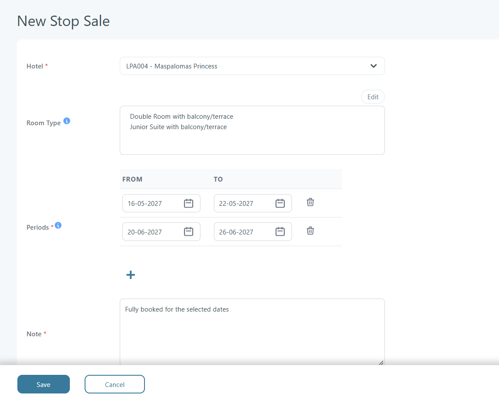
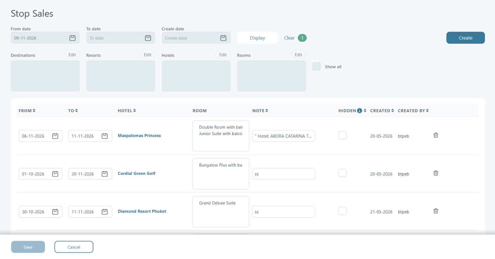
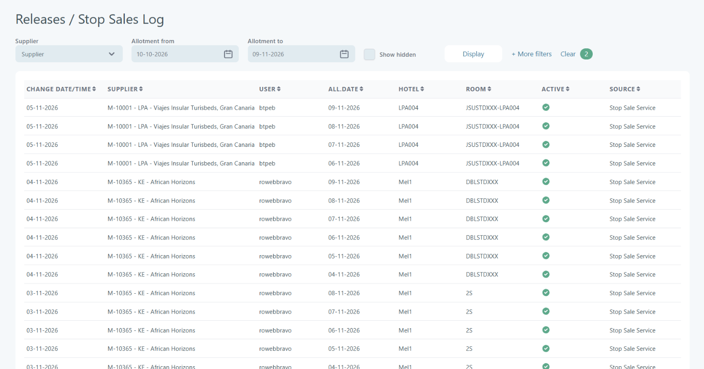

# Stop Sales

### Overview

The **Stop Sale** page allows users to create a stop sale for specific hotels and room types within one or more date periods. A _stop sale_ prevents new bookings for the specified period — it is typically used when a hotel reaches full occupancy or temporarily stops accepting reservations.

A supplier can remove a hotel room from selling by creating a stop sale for that room. He can do that by going to the Stop Sale page and filling in the hotel, the room and the periods. The allotment of the room is kept as it is; for each date in the period the room is marked as **stopped for sale**.

**Important:** A stop sale blocks **allotment rooms** only. Secured and guaranteed rooms can still be sold — see [Availability calculation](stop-sales.md#availability-calculation-guaranteed-vs-secured-vs-booked).

### Key rules

* Stop sales apply per day in the selected date periods.
* Stop sales are applied by the Stop Sale service in the background after saving.
* The allotment in **Allotment per Day** is not changed by a stop sale.
* **Note** can be mandatory, based on your System Setup settings. Maximum 500 characters.
* Fields marked with a red asterisk (\*) are mandatory.

### Create a stop sale

Navigate to **Hotel → Stop Sales** and click **Create**.

1. Select the **Hotel**. The cursor is already in this field.
2. Select **Room Type** (optional).
3. Under **Periods**, select **From** and **To**. Click **+** to add another period. Click the bin icon to remove a period.
4. Add a **Note** (optional unless required).
5. Click **Save**.

<figure><figcaption>
New Stop Sale with two periods
</figcaption></figure>


One stop sale is created for each period, with all the selected room types. Periods must not overlap, and at least one period is required.


### Fields

| Field         | What it controls                                                                                                    |
| ------------- | ------------------------------------------------------------------------------------------------------------------- |
| **Hotel**     | The hotel that will be blocked for sale.                                                                            |
| **Room Type** | One or more room types. If empty, the stop sale applies to all room types of the hotel.                             |
| **Periods**   | One or more **From** / **To** date periods (both days included). **To** must be the same as or later than **From**. |
| **Note**      | Reason for the stop sale (for internal reference and reporting). Can be mandatory via System Setup.                 |

### Example

To stop sales for **Maspalomas Princess** for two room types in two weeks:

* **Hotel:** LPA004 – Maspalomas Princess
* **Room Type:** Double Room with balcony/terrace, Junior Suite with balcony/terrace
* **Periods:** 16-05-2027 to 22-05-2027, and 20-06-2027 to 26-06-2027
* **Note:** Fully booked for the selected dates

Click **Save**. Two stop sales are created, one for each period.

### Availability calculation (guaranteed vs secured vs booked)

While a stop sale is active, the allotment rooms cannot be sold. Only guaranteed or secured rooms can still be sold:

`Rooms for sale = Guaranteed (or Secured) − Booked` (never below 0).


A room type has either guaranteed or secured rooms on a date, never both. Tourpaq does not save an allotment with both values and shows: _There can not be both guaranteed rooms and secured rooms on the same allotment!_


#### Scenarios

| Allotment | Secured | Guaranteed | Booked | Rooms for sale |
| --------- | ------- | ---------- | ------ | -------------- |
| 10        | –       | 5          | 4      | 1              |
| 10        | –       | 5          | 6      | 0              |
| 10        | 3       | –          | 1      | 2              |
| 10        | –       | –          | 6      | 0              |


**Cancelled rooms stay stopped.** If a booking is cancelled while the stop sale is active, the room does not go back on sale.


### What happens after saving

After you create a stop sale, you return to the **Stop Sales** list.

The room types are marked as stopped for sale for each date of the periods. In **Allotment per Day**, a yellow warning icon is shown next to the **Allotment** value.

Room types added to the hotel later are not included automatically. To block them, add them to the existing stop sale — see [Edit Stop Sale](stop-sales/edit-stop-sale.md).

### Manage stop sales (admin view)

On **Hotel → Stop Sales**, you can see all stop sales.

All lines are open for editing. Change **From**, **To**, **Room**, **Note** or **Hidden** in the list and click **Save** at the bottom of the page — see [Edit Stop Sale](stop-sales/edit-stop-sale.md).

To remove a stop sale, click the bin icon on its line — see [Delete Stop Sale](stop-sales/remove-undo-stop-sale.md).

<figure><figcaption>
Stop Sales list
</figcaption></figure>

#### Filters & search

* **From date / To date**: Date range for stop sales. **From date** is today by default.
* **Create Date**: Date the stop sale was created.
* **Destinations**: Select one or more destinations.
* **Resorts**: Select one or more resorts.
* **Hotels**: Select one or more hotels.
* **Rooms**: Filter by room types.
* **Show All**: Also show stop sales for hidden rooms.
* **Display**: Apply current filters.
* **Clear**: Reset filters.

#### Data table columns

| Column         | Meaning                                                                        |
| -------------- | ------------------------------------------------------------------------------ |
| **From / To**  | Date range for the stop sale. Editable.                                        |
| **Hotel**      | Hotel name. Click it to open **Allotment per Day** for the hotel in a new tab. |
| **Room**       | Room types in the stop sale. Editable.                                         |
| **Note**       | Reason for the stop sale. Click it to edit the note in a popup.                |
| **Log**        | Opens the **Releases / Stop Sales Log** filtered on this stop sale.            |
| **Hidden**     | Whether the stop sale is hidden on dashboard. Editable.                        |
| **Created**    | Creation date.                                                                 |
| **Created By** | User who created the stop sale.                                                |
| Bin icon       | Deletes the stop sale.                                                         |

### Stop Sale service

The Stop Sale service applies the stop sales to the hotel allotment days.

When a stop sale is changed or deleted, the service opens again the dates and room types that are no longer covered by an active stop sale.

Every change is written to the **Releases / Stop Sales Log**.

### Stop sale logs

Admins can review changes in the **Release/Stop Sale logs** from the Hotel area.

The **Active** column shows whether the room was stopped for sale on that date. The last column shows whether the log entry was created by:

* a release
* a stop sale
* the Stop Sale service

<figure><figcaption>
Releases / Stop Sales Log
</figcaption></figure>

### Stop sales in Notifications

Notifications include a tab listing new stop sales.

<figure><figcaption></figcaption></figure>

Select **View Details** to open the log view with filters prefilled from the stop sale.

<figure><figcaption></figcaption></figure>

### Stop sales in Supplier

<figure><figcaption></figcaption></figure>

If a supplier has the **Allow to make stop sale** right, they can view stop sales in **Agent → Stop sales list**.

Suppliers can create, edit and delete stop sales in the same way. The **Log** link is not shown for suppliers.

### Stop sale email

After a new stop sale is created, an email can be sent to the company with the stop sale filters. One email is sent for each period.

Prerequisites:

1.  In **System Setup**, each company must set an **email address for stop sale**.

    <figure><figcaption></figcaption></figure>
2.  Each agency must create an **email template** in the Email Center.

    <figure><figcaption></figcaption></figure>

### **Stop Sale Room Reservation**

Some hotels can enable a setting that locks room selection during stop sale hours:

* Web Booking and Office users cannot select a room during the stop sale window if nothing is selected yet.
* Web Booking and Office users cannot change an existing room selection during the stop sale window.

<figure><figcaption></figcaption></figure>

### Related tasks

* [Edit Stop Sale](stop-sales/edit-stop-sale.md)
* [Delete Stop Sale](stop-sales/remove-undo-stop-sale.md)
* [Notification on Dashboard Stop Sale](stop-sales/notification-on-dashboard-stop-sale.md)
* [Allotments per day](hotel/hotel-creation/allotments-per-day/)
* [Releases/Stop Sales Log](releases-stop-sales-log.md)
