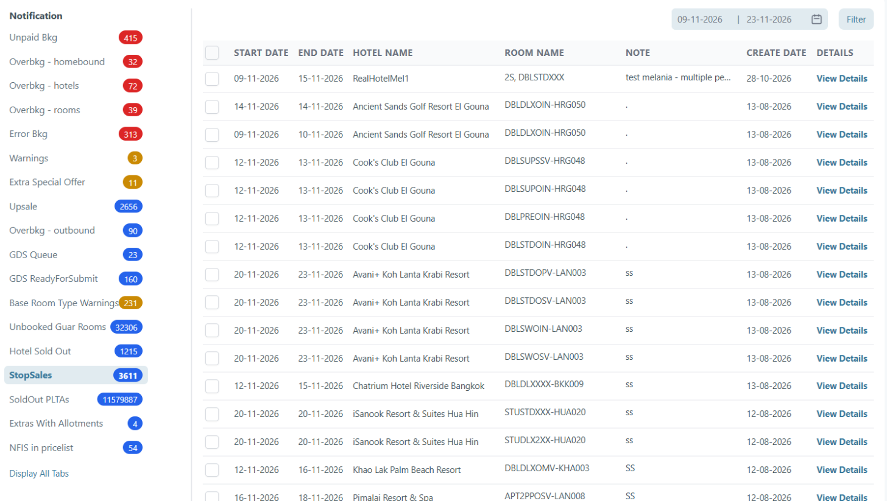

# Notification on Dashboard Stop Sale

### Overview

The **Stop Sale Notifications** section in the Dashboard allows users to view and manage all system notifications related to Stop Sales. This ensures that upcoming or active Stop Sale rules are easily monitored.

### When to use it

* You want to see which Stop Sales will apply soon.
* You want to review Stop Sales without opening each rule.

### View Stop Sale notifications



**Open Stop Sale notifications**

1. Go to **Notifications → Stop Sales**.
2. The **Notifications** page opens with the Stop Sales list.

<figure><figcaption>
Stop Sales notifications
</figcaption></figure>



**Understand the default list and columns**

* The default date filter shows Stop Sales for the next **2 weeks** (from today).
* **Room Name** lists all room types in the stop sale.
* **View Details** opens the **Releases / Stop Sales Log** filtered on the stop sale.


If you need older or future periods, expand the date range in the filters.




### Related Stop Sale tasks

* [Stop Sales](../stop-sales.md)
* [Edit Stop Sale](edit-stop-sale.md)
* [Delete Stop Sale](remove-undo-stop-sale.md)
