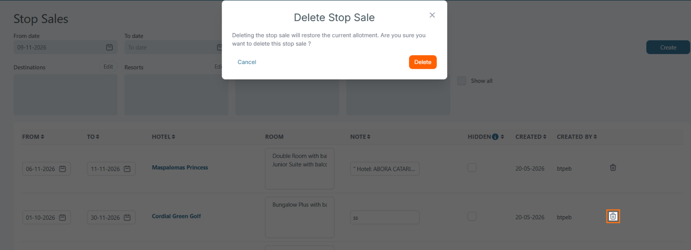

# Delete Stop Sale

### Overview

Use the bin icon to delete a Stop Sale rule and make the rooms available for sale again.

### Purpose

Delete a Stop Sale when the restriction is no longer needed. The allotment in **Allotment per Day** is not changed: the rooms are for sale again with the current allotment for the same dates.

### When to use it

* The hotel/room should be sellable again.
* The supplier lifted a restriction.
* A Stop Sale was created by mistake.


Only want to reopen part of the dates or some room types? Change the stop sale instead — see [Edit Stop Sale](edit-stop-sale.md).


### Delete a Stop Sale



**Find the rule**

1. Go to **Hotel → Stop Sales**.
2. Find the rule you want to delete.



**Click the bin icon**

Click the bin icon at the end of the line. The **Delete Stop Sale** message opens: _Deleting the stop sale will restore the current allotment._



**Confirm or cancel**

Click **Delete** to delete the stop sale. Click **Cancel** to keep it.



<figure><figcaption>
Delete Stop Sale confirmation
</figcaption></figure>

### Verify availability was restored

After you delete, check these spots:

* **Releases / Stop Sales Log** (same hotel, room and dates)
  * The new entries show **Active** unchecked for the dates that were opened again.
* **Hotel → Allotment per Day** (same room and dates)
  * The yellow warning icon next to **Allotment** is gone, unless another active stop sale covers the date.
* **Pricelist** (same hotel, room type, and dates)
  * `FHA` (free-hotel-allotment) should show the restored availability.
