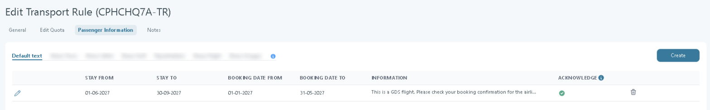
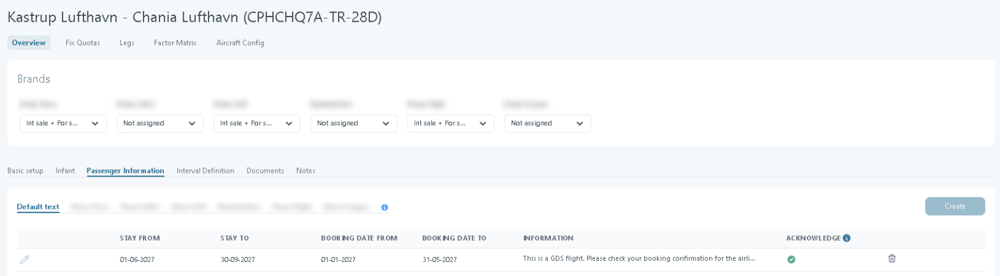

# Passenger Information

**Transport › Transport Rules › Passenger Information tab**

## Purpose

Use the **Passenger Information** tab to enter a notice once on a transport rule, instead of on every transport the rule generates. A rule often generates many transports, one for each stay length. Typical notices are that a flight is a GDS flight the guest must acknowledge, or information that applies to a whole charter route.

Tourpaq copies the entry to the transports the rule has generated, and keeps the copies in step when you edit or delete the entry. These are System transports and Sys-real transports. On those transports the information is read-only.

## How to use

Check [Before you start](passenger-information.md#before-you-start) first.

### Add passenger information

1. Click **Transport**, and then click **Transport Rules**.
2. Open the rule.
3. Click the **Passenger Information** tab. It is between **Edit Quota** and **Notes**. A rule that has no **Edit Quota** tab shows it after **General**.
4. Click **Create**.
5. Enter **Stay From** and **Stay To**.
6. Optional: enter **Booking Date From** and **Booking Date To**. Enter both dates or neither.
7. Click the **Information** field, enter the text, and click **Save**.
8. To make the guest confirm the text, select **Acknowledge**.
9. Click the save icon at the start of the row.

<figure><figcaption>
The <strong>Passenger Information</strong> tab of a transport rule.
</figcaption></figure>

### Add text for a brand

1. On the **Passenger Information** tab, click the brand tab.
2. Click the pencil icon at the start of the row.
3. Enter the brand text in **Information**.
4. Click the save icon.

On a brand tab you change only the text. The dates and **Acknowledge** come from the **Default text** tab.

### Edit or delete passenger information

* To edit an entry, click the pencil icon, change the row, and click the save icon.
* To delete an entry, click the trash icon, and then click **Delete**.

Tourpaq applies the change to the copies on the generated transports.

### How Tourpaq copies the information to the transports

When you save, edit, or delete an entry on the rule, Tourpaq changes the transports the rule has generated:

* **New entry:** Tourpaq adds a copy to each generated transport. The copy has the same dates, text, **Acknowledge** setting, and brand texts. A transport that already has an identical entry doesn't get a second copy.
* **Edited entry:** Tourpaq updates the copies that still match the entry as it was before the edit.
* **Deleted entry:** Tourpaq deletes the copies that still match the entry.

On a transport generated by the rule, you can't create or edit passenger information. **Create** and the edit icon are disabled, so you maintain the information on the rule. The trash icon on the transport deletes only that copy. The entry on the rule stays.

<figure><figcaption>
The copy on a generated transport. <strong>Create</strong> and the edit icon are disabled.
</figcaption></figure>


Tourpaq copies the entry to the transports that exist when you save it. A transport the rule generates later doesn't get the entry automatically. To copy it, click the pencil icon on the entry on the rule, and then click the save icon.


The copies work like passenger information entered on a transport. See [Passenger information](../transport/transport/passengers-informations.md).

## Example

The transport rule `CPHCHQ7A-TR` has generated five transports, one for each stay length. You add this entry on the **Default text** tab:

| Field             | Value                                                                                 |
| ----------------- | ------------------------------------------------------------------------------------- |
| Stay From         | 01-06-2027                                                                            |
| Stay To           | 30-09-2027                                                                            |
| Booking Date From | 01-01-2027                                                                            |
| Booking Date To   | 31-05-2027                                                                            |
| Information       | This is a GDS flight. Please check your booking confirmation for the airline details. |
| Acknowledge       | Selected                                                                              |

After you save, each of the five transports shows the same entry on its **Passenger Information** tab. To change the text later, edit it once on the rule.

## Reference

### Before you start

* **Role:** you need the Administrator, BrandManager, or Support role to open **Transport Rules**.
* **Company feature:** the company feature UseTransportRule must be on. Without it, the **Transport Rules** menu item isn't shown.
* **Transport rule:** the rule must exist and have generated transports for the entry to be copied. See [Create Transport Rule](create-transport-rule.md) and [Edit Transport Rule](edit-transport-rule.md).

### Configuration

| Field                                       | Description                                                                                             |
| ------------------------------------------- | ------------------------------------------------------------------------------------------------------- |
| **Stay From** / **Stay To**                 | The stay period the information applies to. Both are required.                                          |
| **Booking Date From** / **Booking Date To** | The booking creation period the information applies to. Optional: enter both dates or neither.          |
| **Information**                             | The text the guest sees. Required on the **Default text** tab. Click the field to open the text dialog. |
| **Acknowledge**                             | If selected, the guest must acknowledge the information during checkout and in the booking flow.        |
| Brand tabs                                  | Each brand can have its own text. Only the text is editable on a brand tab.                             |

## Related pages

* [Create Transport Rule](create-transport-rule.md)
* [Edit Transport Rule](edit-transport-rule.md)
* [Passenger information](../transport/transport/passengers-informations.md) (on a transport)
