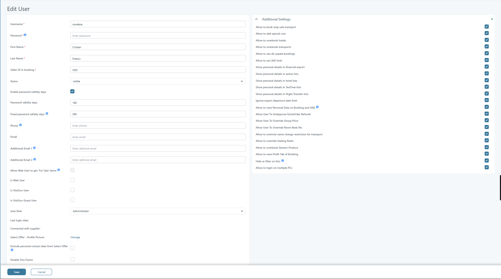
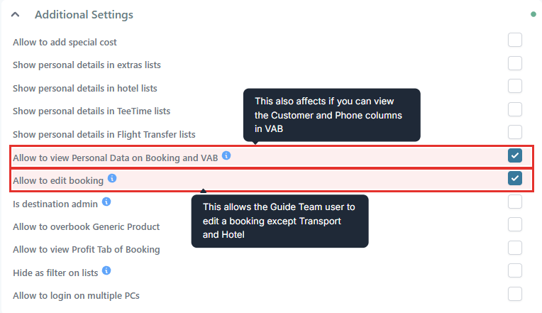
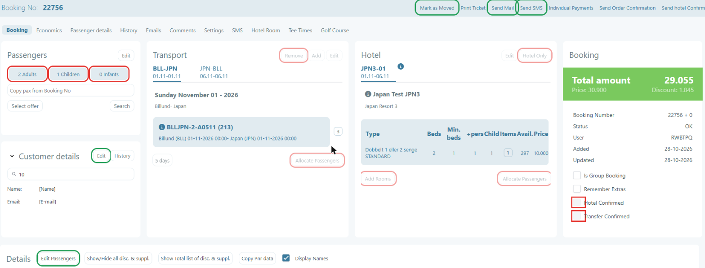
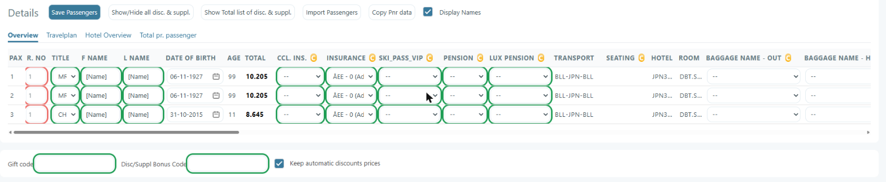
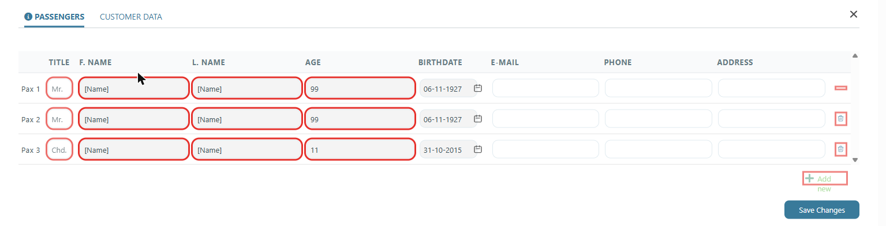

# Edit User

### Introduction

The **Edit User** page is used to manage user accounts in Tourpaq Office. It controls user identity, access rights, permissions, and system behavior. This page is central to user administration and directly impacts access to modules such as bookings, financial data, exports, and system configuration.

***

### Overview

This page allows updating:

* User login credentials
* Personal information
* Role and permissions
* Access to sensitive data
* Operational capabilities across the system

***

### 📸 Screenshot – Full Page Overview

<figure><figcaption>
The Edit User page.
</figcaption></figure>

***

### Purpose

* Maintain user accounts
* Control access to system features
* Configure permissions for operations and data visibility
* Ensure GDPR compliance through access restrictions

***

### Requirements

* Access to **Users → Users**. The menu is shown to:
  * Super Administrator and System Administrator users
  * Administrator and Brand Manager users who have the **Users** permission, when user editing is enabled for the company

***

### Navigation

Users → Users → click the **Username** of the user

***

### Interface Overview

The page is divided into two main sections:

1. **User Information (left side)**
2. **Additional Settings (right side)**

***

### 📸 User Information Section

<figure><figcaption>
The User Information section.
</figcaption></figure>

***

### Field Description – User Information

<table><thead><tr><th width="197.75">Field Name</th><th>Description</th><th width="117">Mandatory</th><th>Notes / System Impact</th></tr></thead><tbody><tr><td>Username</td><td>The name the user logs in with.</td><td>Yes</td><td>Must be unique across Tourpaq. The check ignores upper and lower case, so "Anna" and "anna" count as the same username.</td></tr><tr><td>Password</td><td>The user's password. A strength indicator under the field shows Too short, Weak, Good or Strong.</td><td>Yes, when creating the user</td><td>
On create, a Weak password cannot be saved. On edit, leave the field empty to keep the current password.

Tooltip: "For a stronger password please use both lower and uppercase characters, numbers and special chars (!,%,&#x26;,@,#,$,^,*,?...)"
</td></tr><tr><td>First Name</td><td>The user's first name.</td><td>Yes</td><td>First and last name are shown as the sender name on offer e-mails and as the sales person's name in the offer text.</td></tr><tr><td>Last Name</td><td>The user's last name.</td><td>Yes</td><td>See First Name.</td></tr><tr><td>Seller ID in booking</td><td>The user's signature.</td><td>Yes</td><td>Saved on every booking the user creates and shown on the booking, for example in Economics and History. The Users list can be filtered by it. It does not have to be unique.</td></tr><tr><td>Status</td><td><strong>visible</strong> or <strong>hidden</strong>.</td><td>No</td><td>
A hidden user does not appear in the Users list or in the Guide Names lists. Status does not affect login.

<strong>To see hidden users in the Users list, select "Show hidden".</strong>
</td></tr><tr><td>Enable password validity days</td><td>Turns on password expiry for this user.</td><td>No</td><td>At login, the user sees a warning when the password expires in 10 days or less, and is asked to change it in the last 3 days. After the validity days have passed, login fails with "The password has expired!". Saving the user with this option selected restarts the count from the day of saving.</td></tr><tr><td>Password validity days</td><td>Number of days a password is valid.</td><td>When password validity is enabled</td><td>Numbers only. Used for the expiry checks at login.</td></tr><tr><td>Fixed password validity days</td><td>Number of days a password is valid after the user changes it.</td><td>When password validity is enabled</td><td>
When the user changes their own password, this value replaces Password validity days.

Tooltip: "This is going to override the Password validity days (if it is enabled) after the user changes the password"
</td></tr><tr><td>Phone</td><td>The user's phone number.</td><td>No</td><td>Digits only, no spaces, dots or "+". Used for two-factor login by SMS. Shown as the sales phone on offers, unless Exclude personal contact data from Select Offer is selected.</td></tr><tr><td>Email</td><td>The user's main e-mail address.</td><td>No</td><td>
Must be a valid e-mail address. Used for two-factor login by e-mail.

Offers are sent from the e-mail of the user who sends them. If the user has no e-mail, offers are sent from the brand e-mail (User > Brand).
</td></tr><tr><td>Additional Email 1</td><td>A second e-mail address for two-factor login.</td><td>No</td><td>Receives a copy of the two-factor login code. Not used for anything else.</td></tr><tr><td>Additional Email 2</td><td>A third e-mail address for two-factor login.</td><td>No</td><td>
Same as Additional Email 1.

Tooltip: "Only used for 2 factor authentication! You must have the first address set!"
</td></tr><tr><td>Allow Web User to get "For Sale" items</td><td>Gives a web user the products marked "For Sale" instead of "Internet sale".</td><td>No</td><td>Can be selected only when Is Web User is selected. Applies to extras, insurance and pickup points.</td></tr><tr><td>Is Web User</td><td>Makes the user a web booking user for the API.</td><td>No</td><td>A web user cannot log in to Tourpaq Office. Through the API, the user books with web prices and products.</td></tr><tr><td>Is VisitSun User</td><td>Gives the user API access with the VisitSun user role.</td><td>No</td><td>Has no effect when Is Web User is selected.</td></tr><tr><td>Is VisitSun Guest User</td><td>Gives the user API access with the VisitSun guest role.</td><td>No</td><td>Has no effect when Is Web User or Is VisitSun User is selected.</td></tr><tr><td>User Role</td><td>The user's role.</td><td>Yes</td><td><ul><li>One role per user.</li><li>Changing the role reloads the rights in Additional Settings.</li><li>Only System Administrators and Super Administrators can give the Support, System Administrator or Super Administrator role.</li></ul></td></tr><tr><td>User Brands</td><td>The brands the user works with.</td><td>No</td><td>Not shown for Super Administrator, Administrator, Questionnaire, System Administrator and Support. Administrator, System Administrator and Support get all brands of the company automatically.</td></tr><tr><td>Last login date</td><td>Date of the user's last login.</td><td>—</td><td>Read-only.</td></tr><tr><td>Connected with supplier</td><td>The suppliers this user is linked to.</td><td>—</td><td>Read-only. Shown for Supplier users. For Hotel Manager users the label is "Connected with hotel manager".</td></tr><tr><td>Select Offer - Profile Picture</td><td>The picture shown on Select Offer e-mails.</td><td>No</td><td>Can be set per brand. Offers use the picture of the offer's brand. Not shown when creating a user, or for Guide Team and Guide Master.</td></tr><tr><td>Exclude personal contact data from Select Offer</td><td>Shows the brand phone number on offers instead of the user's.</td><td>No</td><td>
Only the phone number changes. The user's name and e-mail stay on the offer.

Tooltip: "Brand contact data will be used instead!"
</td></tr><tr><td>Disable Two Factor</td><td>Turns off two-factor login for this user.</td><td>No</td><td>Shown only to Administrators, System Administrators and Super Administrators. Two-factor login applies only when it is enabled for the company.</td></tr></tbody></table>

***

### Additional Settings

Additional Settings represent the permissions granted to a user depending on the selected user role. A user can have only one role in the system. A user's role can be:

* administrator
* sales
* brand manager
* extras supplier
* financial
* guide team
* guide master
* hotel manager
* agency orders user
* questionnaire
* supplier
* transport user
* support
* system administrator

<figure><figcaption>
Additional Settings with all rights selected. The rights shown depend on the user role.
</figcaption></figure>

***

### Field Description – Additional Settings

These settings define **fine-grained permissions** across Tourpaq. Each role shows only some of them.

| Field Name                                              | Description                                                                                                                                                                                                                                                                                                                        |
| ------------------------------------------------------- | ---------------------------------------------------------------------------------------------------------------------------------------------------------------------------------------------------------------------------------------------------------------------------------------------------------------------------------- |
| Allow to book stop sale transport                       | Lets the user book a transport that is on stop sale, outbound or homebound. Without it, the booking is refused with "Reservation could not be booked because a stop sale is in place for outbound/homebound transport."                                                                                                            |
| Allow to add special cost                               | Lets the user set a special cost price per passenger on the booking's **Profit** tab (Save For All, Save Individual, History). Without it, the user sees "You have no rights to change cost price!"                                                                                                                                |
| Allow to overbook hotels                                | Lets the user book a room when no rooms are free for the room type, and book a room that has no price. Without it, the booking is refused, for example with "There are no available rooms for room type \[…]!"                                                                                                                     |
| Allow to overbook transports                            | Lets the user book when there are not enough free seats on the outbound or homebound transport. Without it, the booking is refused with "There are no available seats for outbound!" or "… for homebound!"                                                                                                                         |
| Allow to see all unpaid bookings                        | In **Notifications → Unpaid booking**, with "See everyone's unpaid bookings" selected, the user sees the overdue bookings of all sellers. Without it, a Sales user sees only their own. Administrator, Brand Manager and Support always see all                                                                                    |
| Allow to set LMS limit                                  | Shows the **Special Access Payment Settings** section on **Brand → Payment settings**, where the user sets the **Web Payment LMS day limit** (Last Minute Sales, 0–99 days)                                                                                                                                                        |
| Show personal details in financial export               | Includes customer and passenger personal data in the Financial Export (names, e-mail, phone, address, age, date of birth). Without it, these fields are left empty, also in scheduled financial exports                                                                                                                            |
| Show personal details in extras lists                   | Includes customer and passenger names, e-mail, phone, gender and age in the Extras List export. Without it, these fields are left empty                                                                                                                                                                                            |
| Show personal details in hotel lists                    | Includes customer and passenger personal data in the lists on the hotel list export page, for example Hotel, Rooming, Passengers, Guide, Transfer and Fast Check-in lists. Without it, these fields are left empty                                                                                                                 |
| Show personal details in TeeTime lists                  | Includes customer and passenger names, e-mail, phone, gender and age in the TeeTime List. Without it, these fields are left empty                                                                                                                                                                                                  |
| Show personal details in Flight Transfer lists          | Includes the customer's first and last name in the Flight Transfer lists. Without it, the names are left empty                                                                                                                                                                                                                     |
| Ignore export departure date limit                      | Lets the user export lists for any date. Without it, when the company has a day limit for suppliers, the lists start no earlier than that number of days before today. Applies to hotel lists, Extras and TeeTime lists, the Changes list, SMS lists and ticket lists                                                              |
| Allow to view Personal Data on Booking and VAB          | Shows the **Customer** and **Phone** columns in **All Bookings** and shows personal data on bookings. Without it, names, e-mail addresses, phone numbers, addresses and dates of birth on bookings are anonymised, and bookings open read-only. Tooltip: "This also affects if you can view the Customer and Phone columns in VAB" |
| Allow to edit booking                                   | Guide Team role only. Allows the user to edit a booking, except transport, hotel, the number of passengers and cancellation. Can be selected only when Allow to view Personal Data on Booking and VAB is selected. See Example 2 – Guide Team user who can edit bookings, under Examples.                                          |
| Allow User To UnApprove ExtraOrder Refunds              | Lets the user cancel an approved extra order refund from the booking's **Extra Orders** tab (View Refunds → "Click to cancel Refund"). Without it, the user sees "You have no right to unapprove Extra Order Refunds"                                                                                                              |
| Allow User To Override Group Price                      | Lets the user edit the group room price on a booking. The entered price replaces the price list price. Without it, the field is disabled                                                                                                                                                                                           |
| Allow User To Override Room Beds No.                    | Lets the user change the number of beds on a Base Room Type that already has price lists. Without it, the change is refused with "There is pricelist defined on this room, changing configuration is not allowed!"                                                                                                                 |
| Allow to overrule name change restriction for transport | Lets the user change passenger names when the transport does not allow name changes. Without it, the change is refused with "This transport has restriction for name change"                                                                                                                                                       |
| Allow to override Seating Rules                         | When a seat does not meet the age or infant rules, the user can accept the warning ("Override rule? accept") and take the seat. Without it, the warning blocks the seat                                                                                                                                                            |
| Allow to overbook Generic Product                       | When a tee time or generic product reaches its limit per day, before a time or per passenger, the user can accept the warning ("Override rule? accept") and book it anyway                                                                                                                                                         |
| Allow to view Profit Tab of Booking                     | Shows the booking's **Profit** tab to Sales users. Administrator, Brand Manager, Financial, Support and System Administrator always see it                                                                                                                                                                                         |
| Hide as filter on lists                                 | Hides the user from the user and seller filter lists, for example the user list on the Guide page. The user still appears in the Users list. Tooltip: "Hide this user in the lists throughout the system"                                                                                                                          |
| Allow to login on multiple PCs                          | Lets the user be logged in on more than one PC or browser at the same time. Without it, the login is refused with "You are logged in on another PC/Browser, please log out there!"                                                                                                                                                 |

***

### Configuration Steps

1. Navigate to Users → Users
2. Click the **Username** of the user
3. Update required fields:
   * Identity (name, email)
   * Role
   * Permissions
4. Configure Additional Settings based on access needs
5. Click **Save**

***

### System Behavior

* The User Role decides which rights and settings are shown in Additional Settings
* A user right only applies when it is selected for the user in Additional Settings
* On bookings, names, e-mail addresses, phone numbers, addresses and dates of birth are anonymised for users without Allow to view Personal Data on Booking and VAB, and always for the Support role
* Most changes in Additional Settings apply without a new login. A page that is already open shows the change after it is reloaded
* A change of User Role or of Allow to view Personal Data on Booking and VAB applies within 20 minutes, when the user's login session is renewed, or at the next login

***

### Examples

#### Example 1 – Support User (GDPR restricted)

* User Role: Support

**Result:**\
The user sees bookings read-only. Names, e-mail addresses, phone numbers, addresses and dates of birth on bookings are anonymised. The Support role has no "Show personal details" rights and no Allow to view Personal Data on Booking and VAB, so this cannot be changed in Additional Settings.

***

#### Example 2 – Guide Team user who can edit bookings

* User Role: Guide Team
* Select **Allow to view Personal Data on Booking and VAB**
* Select **Allow to edit booking**

**Result:**\
On bookings that are not locked, the guide can change customer details, passenger details and extras, for example to sell an extra to a guest at the destination. Transport, hotel, the number of passengers and cancellation stay locked. The guide does not need to log in again. A booking that is already open shows the change after it is reloaded.

<figure><figcaption>
The tooltips of Allow to view Personal Data on Booking and VAB and Allow to edit booking.
</figcaption></figure>


**Allow to edit booking** is greyed out until **Allow to view Personal Data on Booking and VAB** is selected. Clearing **Allow to view Personal Data on Booking and VAB** also clears **Allow to edit booking**.


**What the guide can change on a booking:**

<figure><figcaption>
Booking page for a Guide Team user with Allow to edit booking. Green: available. Red: locked.
</figcaption></figure>

| Area on the booking                                                                 | With Allow to edit booking                                                      | Without it                                                         |
| ----------------------------------------------------------------------------------- | ------------------------------------------------------------------------------- | ------------------------------------------------------------------ |
| Customer details (**Edit** on the customer card)                                    | Can change the details of the booking's own customer.                           | **Edit** is disabled.                                              |
| Choose another customer, or create a new one (**Choose**, **New**)                  | Locked.                                                                         | Locked.                                                            |
| **Edit Passengers** on the pax grid: name, title, date of birth, age                | Allowed, as long as the passenger stays the same type (adult, child or infant). | **Edit Passengers** is disabled.                                   |
| **Edit Passengers** on the pax grid: extras                                         | Can add new extras and change or remove any extra already on the booking.       | **Edit Passengers** is disabled.                                   |
| **Edit Passengers** on the pax grid: gift card code and coded discount (bonus code) | Allowed.                                                                        | **Edit Passengers** is disabled.                                   |
| Passenger type: adult, child or infant                                              | Locked.                                                                         | Locked.                                                            |
| **Passengers → Edit**                                                               | Locked: name, title, age, date of birth, **Add new** and delete.                | Locked.                                                            |
| Passenger details, including emergency contacts                                     | Allowed.                                                                        | **Save** is refused with "You have no right to edit this booking". |
| Settings (SSR)                                                                      | Allowed.                                                                        | Read-only.                                                         |
| Golf Courses                                                                        | Allowed.                                                                        | Read-only.                                                         |
| Tee Times                                                                           | Allowed.                                                                        | Allowed. The right does not change tee times.                      |
| Hotel Room: pick the room number                                                    | Allowed.                                                                        | The room cannot be changed.                                        |
| Transport Seating: pick the seat                                                    | Allowed.                                                                        | The **Save** buttons are hidden.                                   |
| Comments and attachments                                                            | Can add, edit and delete.                                                       | Saving is refused with "You have no right to edit this booking".   |
| Send e-mails, SMS, the confirmation and vouchers                                    | Allowed.                                                                        | Refused with "You have no right to edit this booking".             |
| Special discount                                                                    | Allowed.                                                                        | Not shown.                                                         |
| Group booking settings                                                              | Allowed.                                                                        | Not shown.                                                         |
| Economics: change the payment dates (**Save**)                                      | Allowed.                                                                        | **Save** is refused with "You have no right to edit this booking". |
| Mark the booking as moved, when the button is shown                                 | Allowed.                                                                        | Refused with "You have no right to edit this booking".             |
| Hotel and transfer confirmation checkboxes                                          | Locked.                                                                         | Locked.                                                            |
| Transport: **SELECT ALTERNATIVE**, transfer, pickup point                           | Locked.                                                                         | Locked.                                                            |
| Hotel: **Add Rooms**, hotel-only and one-way hotel, the **Room** a passenger is in  | Locked.                                                                         | Locked.                                                            |
| **Allocate Passengers**                                                             | Locked.                                                                         | Locked.                                                            |
| Number of passengers: **Add new**, delete a passenger, the pax count fields         | Locked.                                                                         | Locked.                                                            |
| **Cancel passenger or booking**                                                     | Locked.                                                                         | Locked.                                                            |
| No-show checkbox                                                                    | Locked.                                                                         | Locked.                                                            |
| Wish list rooms and seats                                                           | Locked.                                                                         | Locked.                                                            |

<figure><figcaption>
Edit Passengers for a Guide Team user: names and extras can be changed, the room (R. NO) cannot.
</figcaption></figure>

<figure><figcaption>
Passengers → Edit for a Guide Team user: names, age, Add new and delete are locked.
</figcaption></figure>

**Rules:**

* **Allow to edit booking** is shown only for the **Guide Team** role. It is not shown for **Guide Master**.
* A locked booking stays read-only.
* Name change rules for transport still apply.
* The right has no effect on users with any other role.

***

#### Example 3 – Administrator

* User Role: Administrator
* Select all rights in Additional Settings

**Result:**\
The user has every right available to the Administrator role and gets all brands of the company automatically. An Administrator cannot give the Support, System Administrator or Super Administrator role to other users.

***

### Related Pages

* [Users Management](users-management.md)
* [Password expiration](password-expiration.md)
* [Support User Role (GDPR Compliance)](support-user-role-gdpr-compliance.md)
* [Edit Passenger](../../booking/new-booking/new-booking/edit-passenger/)
