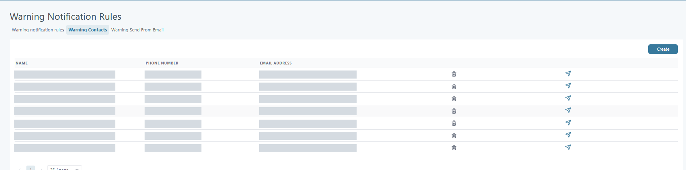
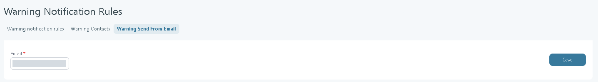
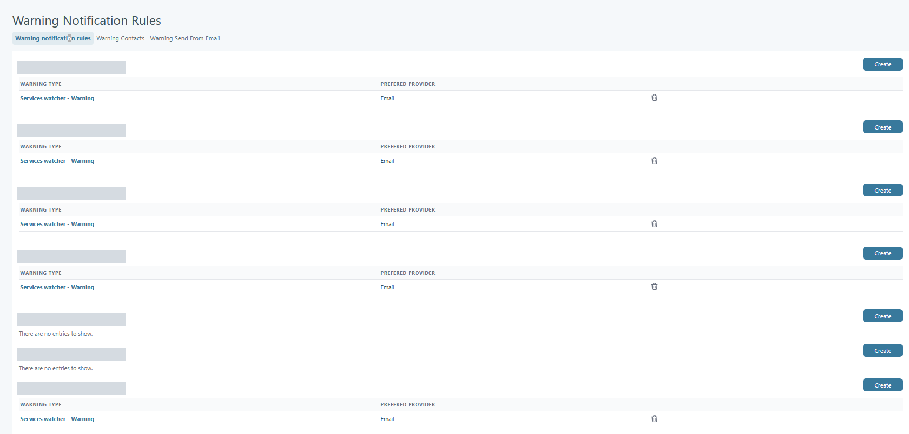

# Warning notification rules

### Overview

Use **Warning Notification Rules** to send automatic warning messages to your team.

Warnings can be sent by **email** or **SMS**.

They help you react faster when something important goes wrong. For example, when an email fails to send or a booking task fails.

### Access

Open **Email Setup → Warning Notification Rules**.

### Purpose

Use this feature to:

* Notify users about problems and important changes automatically.
* Reduce response time by alerting the right people when Tourpaq detects a problem.
* Avoid missed issues by using clear rules for who gets what.

### Tabs overview

You will see three tabs:

1. **Warning notification rules**: choose which warnings each contact receives, and how (email or SMS).
2. **Warning Contacts**: choose who receives warnings.
3. **Warning Send From Email**: choose the sender address for service warning emails.

#### Warning Contacts

Create contacts that can receive warning emails or SMS messages.

In the list, click the **Test notification** icon next to a contact to send a test email to the contact's email address. The test doesn't send an SMS.

<figure><figcaption>
Warning contacts list.
</figcaption></figure>

<figure><figcaption>
Add or edit a warning contact.
</figcaption></figure>

#### Warning Send From Email

Set which sender email address is shown on warning emails.

Tourpaq uses this address for the **Services watcher - Warning** and **No Running Gds Flights Service** warnings. Other warning emails show the brand's contact email as the sender.

<figure><figcaption>
Set the sender email address.
</figcaption></figure>

#### Warning notification rules

Set rules for which warning types each contact should receive.

For each rule, choose the **Warning Type** and the **Preferred Provider**: **Email** or **SMS**.

Tourpaq sends an identical warning (same type and text) at most once a day.

<figure><figcaption>
Rules list.
</figcaption></figure>

<figure><figcaption>
Edit a rule.
</figcaption></figure>

### Types of warnings

The groups below describe the warnings. In the **Warning Type** list, the names can be more technical.

Some warnings include terms like **SMTP**, **FTP**, or **GDS**.

These are technical names used by the system. You can still use them safely as labels.

Common terms used in warning names

* **SMTP**: email sending.
* **FTP**: file transfer between systems.
* **GDS**: flight booking connection (for example Travelport).
* **PNR**: a booking reference used for flight reservations.

#### Common warning groups

These are common examples:

* **Informational**
  * General information alerts.
* **Email sending problems**
  * Hotel reporting email failed to send (SMTP error).
* **Reporting problems**
  * Hotel reporting errors (other errors).
  * Transport reporting errors (FTP, SMTP, or other errors).
* **GDS and flight-related warnings**
  * GDS status changed (for example TKQ → TKOK).
  * Unable to check PNR or apply time changes.
  * Unable to submit reservation To Provider.
  * Noticeably fewer GDS flights than in the previous check (dynamic transports).
  * Flight time changes found in the GDS queue.
  * Success messages for time changes or submissions (used as confirmations).
* **Other system warnings**
  * Mail helper errors.
  * Service watcher warnings.
  * Unable to generate a price list per day.
  * Bookings in error status.
  * Connected hotel errors (errors reported by a hotel connection, for example a room code that isn't found).


If you are unsure which warning to enable, start with email failures and booking errors.


### Instructions for use



#### Choose who should receive warnings

Open **Warning Contacts**. Add one or more recipients.



#### Set the sender email address

Open **Warning Send From Email**. Set the sender address for service warning emails.



#### Turn on the warnings you need

Open **Warning notification rules**.

Pick the warning types you want. For each one, choose **Email** or **SMS** as the **Preferred Provider**.



#### Review and adjust

If people get too many messages, reduce the warning list.


