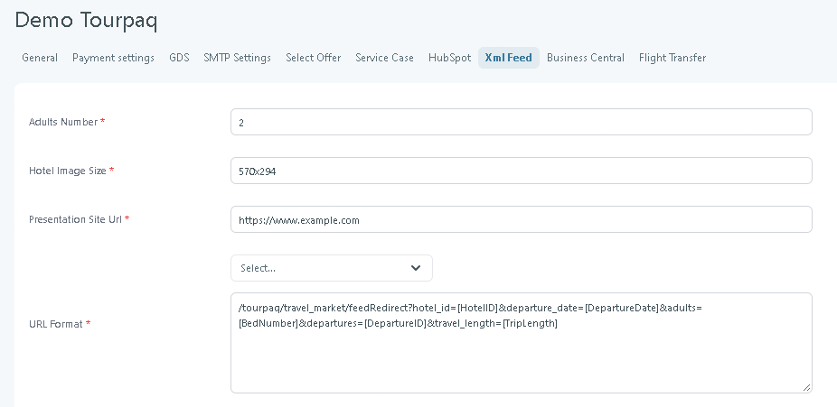
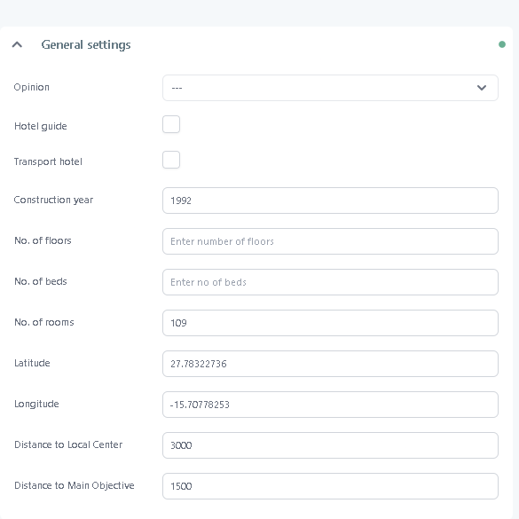
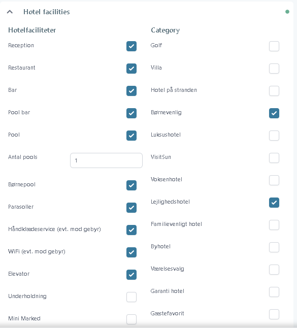
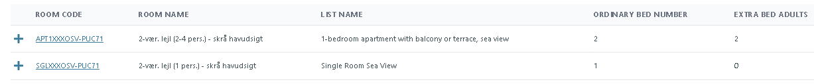

# XML feed

**Users › Brands › Xml Feed**

## Purpose

The XML feed is a file with the offers of a brand. Tourpaq builds it for an external partner, such as Travelmarket. Each offer has a booking link to your website.

Each offer is one hotel stay on one departure date. It has:

* The hotel, with its description, photos, and facilities.
* The departure and the destination.
* The outbound flight and the homebound flight.
* The board and the extras, such as a visa.
* The price for each number of travelers.
* The link to your website.

Tourpaq builds the feed in two formats: one for Travelmarket and one for Skisport. This page describes the Travelmarket format.

## How to use

### Set up the feed of a brand

If the brand has no feed yet, contact Tourpaq support first. See [Before you start](xml-feed.md#before-you-start).

1. Open the brand, and then click the **Xml Feed** tab.
2. In **Adults Number**, enter the number of adults.
3. In **Hotel Image Size**, enter the size of the hotel images in the format width x height, such as `570x294`.
4. In **Presentation Site Url**, enter the address of your website.
5. In **URL Format**, build the booking link: select a placeholder in the list to add it to the text, and complete the rest of the address by typing.
6. Click **Save**.

<figure><figcaption><p>The <strong>Xml Feed</strong> tab of a brand.</p></figcaption></figure>


The booking link of each offer is the **Presentation Site Url** followed by the **URL Format**. Tourpaq replaces each placeholder, such as `[HotelID]` and `[DepartureDate]`, with the value of the offer.


### Keep the offers in the feed correct

Most of what the file shows comes from the hotel. Change it on the hotel in Tourpaq Office. The feed shows the change after the next update. See [Where the file is published and how often it is updated](xml-feed.md#where-the-file-is-published-and-how-often-it-is-updated) and [Where each value comes from](xml-feed.md#where-each-value-comes-from).

### If a value in the file is wrong

* **A facility shows No in `Amenities`, but the hotel has it.** The feed doesn't read the name of the facility. Open the facility in **Hotel › Facilities**, and mark it **Swimming pool**, **Child pool**, or **All inclusive**.
* **A change isn't in the file yet.** The feed shows the change after the data is synced and the next update finishes. Ask Tourpaq support for the update schedule of your brand.
* **The booking link opens the wrong page.** Check the **Presentation Site Url** and the **URL Format** of the brand.
* **Tourpaq Office asks you to contact support when you save.** The brand has no feed record. Ask Tourpaq support to set up the feed.

## Reference

### Before you start

* Roles: Administrator, BrandManager, Support, and SuperAdministrator can open and change the **Xml Feed** tab. All except SuperAdministrator can open only the brands of their own company.
* The brand needs a feed record. Tourpaq support creates it.

### Configuration

| Field                     | Description                                                                                                               | Values                                               | Required |
| ------------------------- | ------------------------------------------------------------------------------------------------------------------------- | ---------------------------------------------------- | -------- |
| **Adults Number**         | Number of adults.                                                                                                         | Whole number                                         | Yes      |
| **Hotel Image Size**      | Size of the hotel images. Each image link in the file has this size.                                                      | Width and height separated by `x`, such as `570x294` | Yes      |
| **Presentation Site Url** | The address of your website. It is the start of every booking link.                                                       | Text                                                 | Yes      |
| **URL Format**            | The rest of the booking link. Add placeholders from the list, such as `[HotelID]`, `[DepartureDate]`, and `[TripLength]`. | Text and placeholders                                | Yes      |

### Limits of the feed

* Prices are for a number of travelers. The file has no child prices, ages, or infants.
* The stays in the file are 7 days and 14 days.
* Transport is by plane, with one outbound flight and one homebound flight for each offer. The file has no connections and no other kinds of transport.
* Only offers with transports of type 1, 2, and 4 are in the file. Offers with dynamic packaging transports (type 3) are left out.
* Each offer has one departure and one destination.

### Where the file is published and how often it is updated

* The file is a zip file named `offer.xml.zip`. It is on the web booking site of the brand, such as `https://<your web booking site>/xmlfeed/offer.xml.zip`.
* Tourpaq sets the update schedule of each feed. You can't change it in Tourpaq Office. Ask Tourpaq support for the schedule of your brand.
* At each run, Tourpaq updates the file with the changes since the last run. When the last full rebuild is older than the interval Tourpaq set for the feed, Tourpaq rebuilds the whole file instead.
* A change you make in Tourpaq Office, such as a facility mark or a price, shows in the file after the data is synced and the next run finishes.

### Where each value comes from

The hotel information in the file comes from the hotel in Tourpaq Office. Change it there.

| In the file                             | Where you maintain it                                                                                                                                                                                                                                                                                                       |
| --------------------------------------- | --------------------------------------------------------------------------------------------------------------------------------------------------------------------------------------------------------------------------------------------------------------------------------------------------------------------------- |
| Hotel (`Accommodation id`)              | The ID of the hotel. It is also the `[HotelID]` placeholder.                                                                                                                                                                                                                                                                |
| `Name`                                  | **Hotel Name** on the **Overview** tab of the hotel.                                                                                                                                                                                                                                                                        |
| `Rating`                                | **Stars** on the **Overview** tab.                                                                                                                                                                                                                                                                                          |
| `Address` and `URL`                     | **Address** and **Url** on the **Overview** tab.                                                                                                                                                                                                                                                                            |
| `Description`                           | **Short Description** on the **Web** tab.                                                                                                                                                                                                                                                                                   |
| `HtmlDescription`                       | **HTML Description** on the **Web** tab.                                                                                                                                                                                                                                                                                    |
| `Latitude` and `Longitude`              | **Latitude** and **Longitude** in the **General settings** section of the **Web** tab.                                                                                                                                                                                                                                      |
| `Room`                                  | **Room Name** of the room type on the **Room Types** tab.                                                                                                                                                                                                                                                                   |
| `persons_per_room`                      | **Ordinary Bed Number** of that room type.                                                                                                                                                                                                                                                                                  |
| `Resort` and `ResortCode`               | **Resort** on the **Overview** tab.                                                                                                                                                                                                                                                                                         |
| `Images`                                | The photos on the **Photos** tab. The size is the **Hotel Image Size** of the brand.                                                                                                                                                                                                                                        |
| `Pool`, `ChildPool`, and `AllInclusive` | The facilities of the hotel in the **Hotel facilities** section of the **Web** tab. Yes when the hotel has at least one facility marked **Swimming pool**, **Child pool**, or **All inclusive**, No when it has none. You set the marks on the facility in **Hotel › Facilities**. The name of the facility doesn't matter. |
| `DistanceBeach` and `DistanceCenter`    | **Afstand til strand** and **Afstand til centrum** in the **Afstande** group of the hotel facilities, in meters.                                                                                                                                                                                                            |
| `BookingURL`                            | **Presentation Site Url** and **URL Format** of the brand.                                                                                                                                                                                                                                                                  |

<figure><figcaption><p>The <strong>General settings</strong> section on the <strong>Web</strong> tab of a hotel.</p></figcaption></figure>

<figure><figcaption><p>The <strong>Hotel facilities</strong> section on the <strong>Web</strong> tab of a hotel.</p></figcaption></figure>

<figure><figcaption><p>The <strong>Room Types</strong> tab of a hotel.</p></figcaption></figure>

### What the file contains

The file starts with an `Offers` node. It has a date and time in the attributes `DateTime` and `LastChangesUpdate`. Each `Offer` node inside has the nodes below.

**Offer**

| Node                                   | What it shows                                                                                              |
| -------------------------------------- | ---------------------------------------------------------------------------------------------------------- |
| `Offer` (attribute `id`)               | One offer. The `id` is the ID of the price list line (**PLTA ID**).                                        |
| `Duration`                             | The length of the stay in days.                                                                            |
| `Interval`                             | The stay as an interval: 1 for 7 days, 2 for 14 days.                                                      |
| `OfferType`                            | The value is 1.                                                                                            |
| `Currency`                             | The currency of the prices, such as `DKK`.                                                                 |
| `BookingURL`                           | The link to your website. See [Configuration](xml-feed.md#configuration).                                  |
| `IsLastMinute`                         | 1 when the price list line is marked as a **Hot Deal** (the **HD** column of the price list), otherwise 0. |
| `Note`, `Discounts`, and `Supplements` | Not used. The nodes are empty.                                                                             |

**Prices**

`Prices` has one `Price` for each number of travelers. The smallest number is the **Ordinary Bed Number** of the room type, and each next price is for one more traveler.

| Node or attribute                  | What it shows                                                                       |
| ---------------------------------- | ----------------------------------------------------------------------------------- |
| `Price` (the value)                | The sales price for the whole party.                                                |
| `required_pax` and `price_for_pax` | The number of travelers the price is for. Both have the same value.                 |
| `normal_price`                     | The price before the discount for the same party. It is never lower than the price. |

**Departures and destinations**

Each offer has one `Departure` and one `Destination`.

| Node                                                   | What it shows                                                                         |
| ------------------------------------------------------ | ------------------------------------------------------------------------------------- |
| `Departure` › `Name`, `IATA`, `Country`, `CountryCode` | The departure airport.                                                                |
| `Departure` › `Date` and `Time`                        | The date and time of the outbound flight.                                             |
| `Destination` › `Name` and `Code`                      | The destination of the hotel, with its code.                                          |
| `Destination` › `Resort` and `ResortCode`              | The resort of the hotel, with its code.                                               |
| `Destination` › `IATA`, `Country`, and `CountryCode`   | The airport where the outbound flight lands.                                          |
| `Destination` › `Arrivalgateway`                       | The arrival gateway of the offer, when it has one. The node is empty for most offers. |
| `Departure` › `Note` and `Destination` › `Note`        | Not used. The nodes are empty.                                                        |

**Hotel**

`Accommodation` (attribute `id`) has the hotel and the room type of the offer. See [Where each value comes from](xml-feed.md#where-each-value-comes-from).

| Node                                                        | What it shows                                                                 |
| ----------------------------------------------------------- | ----------------------------------------------------------------------------- |
| `Name`, `Rating`, `Address`, `URL`, `Latitude`, `Longitude` | The hotel.                                                                    |
| `Description` and `HtmlDescription`                         | The text of the hotel, plain and with HTML.                                   |
| `Room` and `persons_per_room`                               | The room type and its ordinary beds.                                          |
| `Images` › `Image`                                          | A link to each photo of the hotel, with the size of the **Hotel Image Size**. |
| `Amenities` › `AllInclusive`, `Pool`, `ChildPool`           | Yes or No.                                                                    |
| `Amenities` › `DistanceBeach` and `DistanceCenter`          | The distances, in meters.                                                     |
| `Amenities` › `Breakfast`, `HalfPension`, `FullPension`     | Not used. The value is always `false`. The board is in `Products`.            |
| `Type`                                                      | The value is `Hotel`.                                                         |
| `GuaranteeHotel` and `GuaranteeTransport`                   | Not used. The value is always `false`.                                        |
| `Note`                                                      | Not used. The node is empty.                                                  |

**Products**

An offer has no product or one product: the board of the offer, or an extra such as a visa.

| Attribute of `Product` | What it shows                                                                                                                                       |
| ---------------------- | --------------------------------------------------------------------------------------------------------------------------------------------------- |
| `ProductID`            | The ID of the product.                                                                                                                              |
| `Code`                 | The code of the product. For a board, it starts with the code of the hotel.                                                                         |
| `Name`                 | The name of the product, such as the board extra of the hotel.                                                                                      |
| `CategoryType`         | 2 for a board, and 5 for another extra, such as a visa.                                                                                             |
| `BoardTypeCode`        | The code of the board type in **Board Types**, such as `AI` for All Inclusive and `HB` for Half Board. It is empty for an extra that isn't a board. |
| `Days`                 | The value is 0 or 7.                                                                                                                                |

**Transport**

Each offer has one outbound and one homebound `Transport`. Each has one `Segment`, a single flight.

| Node or attribute               | What it shows                                                                                                                        |
| ------------------------------- | ------------------------------------------------------------------------------------------------------------------------------------ |
| `Transport` › `Direction`       | `Outbound` or `Homebound`. The homebound flight returns to the departure airport, and its date is the outbound date plus `Duration`. |
| `Transport` › `Mode` and `Type` | The kind of transport, such as `plane`, and the transport type.                                                                      |
| `Segment` › `No`                | The number of the flight. It is always 1.                                                                                            |
| `Departure` and `Arrival`       | The airport (`Name`, `IATA`, `CountryCode`), the `FlightNo`, and the `Date` and `Time`.                                              |

## Example: follow one offer

This offer is from a real feed. To follow it, open hotel 11383 in Tourpaq Office, and compare each value.

```xml
<Offer id="14303813">
  <Duration>7</Duration>
  <Currency>DKK</Currency>
  <Prices>
    <Price required_pax="2" price_for_pax="2" normal_price="10398">7398</Price>
    <Price required_pax="3" price_for_pax="3" normal_price="15597">8597</Price>
    <Price required_pax="4" price_for_pax="4" normal_price="20796">9796</Price>
  </Prices>
  <BookingURL><![CDATA[https://www.example.com/tourpaq/travel_market/feedRedirect?hotel_id=11383&departure_date=21-11-2026&adults=2&departures=44&travel_length=7]]></BookingURL>
  <Departures>
    <Departure>
      <Name>Billund</Name>
      <IATA>BLL</IATA>
      <Country>Danmark</Country>
      <CountryCode>DK</CountryCode>
      <Time>06:50</Time>
      <Date>2026-11-21</Date>
    </Departure>
  </Departures>
  <Destinations>
    <Destination>
      <Name>Gran Canaria</Name>
      <IATA>LPA</IATA>
      <Country>Spanien</Country>
      <CountryCode>ES</CountryCode>
      <Resort>Puerto Rico</Resort>
      <ResortCode>LPA-PURI</ResortCode>
    </Destination>
  </Destinations>
  <Accommodation id="11383">
    <Description><![CDATA[Holiday Club Puerto Calma ligger i det populære ferieområde Puerto Rico ...]]></Description>
    <HtmlDescription><![CDATA[<h2>Dejligt lejlighedshotel i solrige Puerto Rico</h2><div>...]]></HtmlDescription>
    <Room>2-vær. lejl (2-4 pers.) - skrå havudsigt</Room>
    <Name>Holiday Club Puerto Calma</Name>
    <Rating>3+</Rating>
    <persons_per_room>2</persons_per_room>
    <URL><![CDATA[www.holidayclubcanarias.com/da/club-puerto-calma/]]></URL>
    <Address><![CDATA[C) Joaquín Blanco Torrent 2, 351 30 Puerto Rico]]></Address>
    <Latitude>27.78322736</Latitude>
    <Longitude>-15.70778253</Longitude>
    <Amenities>
      <AllInclusive>No</AllInclusive>
      <Pool>Yes</Pool>
      <ChildPool>Yes</ChildPool>
      <DistanceBeach>1500 meters</DistanceBeach>
      <DistanceCenter>3000 meters</DistanceCenter>
    </Amenities>
    <Images>
      <Image><![CDATA[https://photos.example.com/GetPhoto.ashx?type=Hotel&photosize=570x294&photoid=138326]]></Image>
      ...
    </Images>
  </Accommodation>
  <Transports>
    <Transport Direction="Outbound" Mode="plane">
      <Segments>
        <Segment No="1">
          <Departure Name="Billund" IATA="BLL" FlightNo="CAT711" Date="2026-11-21" Time="06:50" CountryCode="DK" />
          <Arrival Name="Las Palmas" IATA="LPA" FlightNo="CAT711" Date="2026-11-21" Time="11:15" CountryCode="ES" />
        </Segment>
      </Segments>
    </Transport>
    <Transport Direction="Homebound" Mode="plane">
      <Segments>
        <Segment No="1">
          <Departure Name="Las Palmas" IATA="LPA" FlightNo="CAT712" Date="2026-11-28" Time="12:20" CountryCode="ES" />
          <Arrival Name="Billund" IATA="BLL" FlightNo="CAT712" Date="2026-11-28" Time="18:30" CountryCode="DK" />
        </Segment>
      </Segments>
    </Transport>
  </Transports>
</Offer>
```

The example is shortened: empty nodes and most of the images and text are left out. The hotel part of the offer comes from this place:

| In the offer                         | Value                                                                                                                                        | Where it comes from                                                                                                                                                                                                                                          |
| ------------------------------------ | -------------------------------------------------------------------------------------------------------------------------------------------- | ------------------------------------------------------------------------------------------------------------------------------------------------------------------------------------------------------------------------------------------------------------ |
| `Name`                               | Holiday Club Puerto Calma                                                                                                                    | **Hotel Name** of hotel 11383.                                                                                                                                                                                                                               |
| `Rating`                             | 3+                                                                                                                                           | **Stars** of the hotel.                                                                                                                                                                                                                                      |
| `Address` and `URL`                  | The street address and the hotel website                                                                                                     | **Address** and **Url** of the hotel.                                                                                                                                                                                                                        |
| `Description` and `HtmlDescription`  | The text that starts with "Holiday Club Puerto Calma ligger"                                                                                 | **Short Description** and **HTML Description** on the **Web** tab.                                                                                                                                                                                           |
| `Latitude` and `Longitude`           | 27.78322736 and -15.70778253                                                                                                                 | The same fields on the **Web** tab.                                                                                                                                                                                                                          |
| `Room` and `persons_per_room`        | The room name, and 2                                                                                                                         | **Room Name** and **Ordinary Bed Number** of the room type on the **Room Types** tab.                                                                                                                                                                        |
| `Resort` and `ResortCode`            | Puerto Rico and LPA-PURI                                                                                                                     | **Resort** on the **Overview** tab.                                                                                                                                                                                                                          |
| `Pool` and `ChildPool`               | Yes and Yes                                                                                                                                  | The hotel has the facilities **Pool** and **Børnepool** selected, and they are marked **Swimming pool** and **Child pool**.                                                                                                                                  |
| `AllInclusive`                       | No                                                                                                                                           | The hotel has no facility marked **All inclusive**.                                                                                                                                                                                                          |
| `DistanceBeach` and `DistanceCenter` | 1500 meters and 3000 meters                                                                                                                  | **Afstand til strand** and **Afstand til centrum**.                                                                                                                                                                                                          |
| `Images`                             | 18 images, each with `photosize=570x294`                                                                                                     | The 18 photos on the **Photos** tab, and the **Hotel Image Size** `570x294` of the brand.                                                                                                                                                                    |
| `BookingURL`                         | `https://www.example.com/tourpaq/travel_market/feedRedirect?hotel_id=11383&departure_date=21-11-2026&adults=2&departures=44&travel_length=7` | The **Presentation Site Url**, followed by the **URL Format** `/tourpaq/travel_market/feedRedirect?hotel_id=[HotelID]&departure_date=[DepartureDate]&adults=[BedNumber]&departures=[DepartureID]&travel_length=[TripLength]` with the placeholders replaced. |

## Related pages

* [Brands](brands/)
* [Facilities](facilities.md)
* [Integration overview](integration/overview.md)
